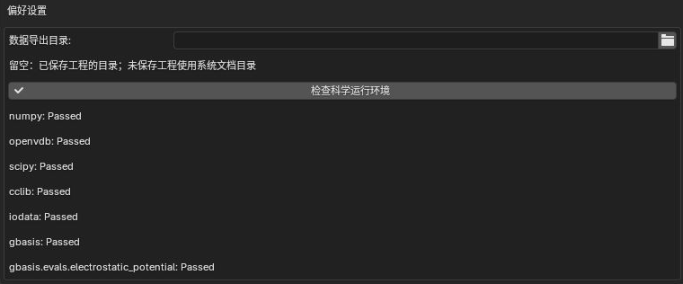
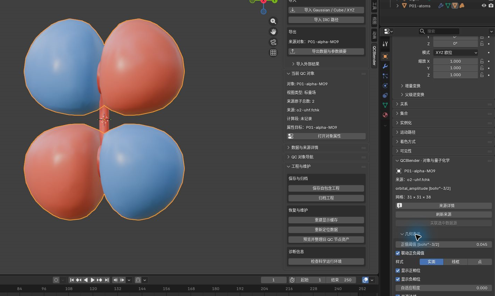
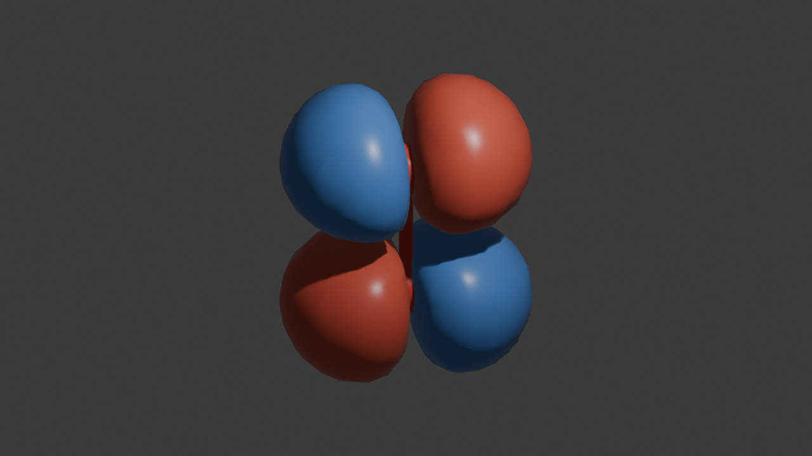
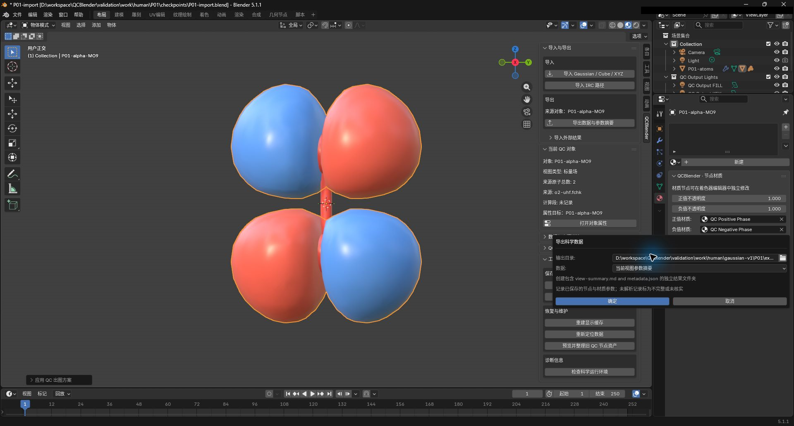

# QCBlender 安装与操作教程

## 目录

- [安装并找到插件](#install)
- [生成第一张轨道图](#orbital)
- [渲染图片](#render)
- [导出当前参数](#export)
- [保存、重新打开和归档工程](#save)
- [按需选择功能专题](#topics)

适用 Windows x64、Blender 5.1.1、QCBlender 0.1.0。本文共 15 步；完成后可继续选择专题。

本文的文件路径均相对**材料根目录**，即解压后同时含有 `human/` 和 `shared/` 的文件夹。保留这两个目录的相对位置；无需安装 Gaussian、Multiwfn 或 PySCF。

教程截图保存在 `human/screenshots/`，以案例编号和内容命名，如 `P01-orbital.png`；本页使用 P01 前缀。渲染图保存在 `human/renders/`，工程和导出文件保存在 `work/human/`。按步骤保存图片后，下方引用便会显示对应图片。

## 安装并找到插件

1. 打开 Blender，选择 **Edit → Preferences → Get Extensions → 右上角菜单 → Install from Disk**，选择 [shared/install/qcblender-0.1.0.zip](../shared/install/qcblender-0.1.0.zip)，完成安装。在 **Add-ons** 中搜索 **QCBlender**，确认已经启用。

> Preferences 是偏好设置窗口；Get Extensions 用于管理扩展，Install from Disk 从本地 ZIP 安装，Add-ons 用于启用或停用插件。

> Check Scientific Runtime 检查插件执行量子化学数值计算所需的运行环境是否可用。

2. 展开 QCBlender，点击 **Check Scientific Runtime**。等待检查完成，应显示科学运行环境可用。截图保存为 `human/screenshots/P01-install.png`。

3. 关闭偏好设置，选择 **File → New → General**。在右上角 **Outliner** 选中默认 **Cube** 并删除，保留 Camera 和 Light。鼠标移入 **3D Viewport**，切到 **Object Mode**，按 `N`，打开 **QCBlender** 页；点击视口右上角的 **Material Preview**。之后文中的“N 侧栏”均指这里。

> Outliner 是场景对象列表；3D Viewport 是观察和选择三维对象的视口，Object Mode 用于操作整个对象。Material Preview 是材质预览，可直接看到分子和表面的颜色。

> Cube 是默认立方体，Camera 是决定出图取景的相机，Light 是灯光；本教程导入的原子和场表面也都是场景对象。

> Properties 是属性编辑区，用于查看和修改所选对象及场景的设置。“对象属性”指右侧 **Properties → Object → QCBlender · 对象与量子化学**。也可选中对象后点击 **N 侧栏 → 工作流 → 对象属性与显示参数**；该入口会固定当前对象，换对象后再次点击即可。

## 生成第一张轨道图

4. 点击 **N 侧栏 → 工作流 → 导入 Gaussian / Cube / XYZ**，选择 [shared/data/public/P01/o2-uhf.fchk](../shared/data/public/P01/o2-uhf.fchk)。应出现两个氧原子。选中这个原子对象，按 `F2` 命名为 **P01-atoms**；点击 **数据集与数值摘要 → 查看完整来源**，应看到 **filename: o2-uhf.fchk**、**coordinate_unit: angstrom**。关闭来源窗口。

> FCHK 是格式化的量子化学计算结果文件，提供分子构型和波函数。构型是原子的空间位置；波函数提供计算轨道等物理量所需的信息。本例的计算条件见[样本说明](../shared/data/public/NOTICE.md)。

> 数据集是导入的科学数据及其来源记录；`filename` 是源文件名，`coordinate_unit` 是坐标单位。`angstrom` 即 Å（埃），1 Å = 0.1 nm。

> 活动对象是本次操作针对的对象；只选一个对象时就是它，多选时通常为最后选中的对象。生成量子化学场会在空间网格上计算所选物理量，网格是规则排列的采样点。

5. 保持 **P01-atoms** 活动，点击 **工作流 → 生成量子化学场**。首次使用时先等待自动检查，再在 **Generate Quantum Field** 对话框中设置下表，点击 **OK**。

| 控件 | 输入值 | 用途 |
| --- | --- | --- |
| Quantity | Molecular orbital | 选择计算的物理量；本例为分子轨道振幅 |
| Spin | Alpha | 选择 Alpha 自旋通道 |
| Orbital | Source number | 按源文件编号选择轨道 |
| Orbital number (1-based) | 9 | 指定轨道编号；1-based 表示从 1 开始编号 |
| Grid spacing (angstrom) | 0.2 | 相邻采样点的间距；越小采样越密，计算量也越大 |
| Grid margin (angstrom) | 3 | 在分子外围扩展计算区域的距离 |
| Memory budget (MiB) | 512 | 供计算程序估算内存需求并安排分批计算的预算 |

> MO 是分子轨道；Alpha 和 Beta 是两种自旋的标记。这里选择源文件中的 Alpha 第 9 个轨道，两种表面颜色表示波函数的正负相位。

> MiB 是内存容量单位，1 MiB = 1024² 字节；这里的预算用于本次数值计算，不是 Blender 总内存的硬限制。本文参数用于学习显示操作。

> 等值面连接场值达到某个阈值的位置；正值阈值设置正相位表面的取值。Link Thresholds 让正负相位使用相同的阈值幅度，两个“显示相位”开关分别控制可见性。

> `orbital_amplitude` 表示轨道振幅；bohr 是原子尺度的长度单位，约等于 0.529 Å，轨道振幅的单位 `bohr^-3/2` 表示 bohr 的 −3/2 次方。

6. 完成后选中 **QC orbital_amplitude**。在 **对象属性 → 几何表示** 将 **正值阈值** 设为 **0.045**，保持 **Link Thresholds**、**显示正相位**、**显示负相位** 开启。应看到两种颜色的轨道表面；在 **科学记录与振动模式** 中应看到 `spin: alpha`、`source_number: 9`，单位为 `bohr^-3/2`。截图保存为 `human/screenshots/P01-orbital.png`。

> `spin` 记录自旋通道，`source_number` 记录源轨道编号。科学记录用于核对当前表面对应哪份计算数据。

> Material 是材质设置区，节点材质通过相连的计算单元控制颜色和透明度。Positive Opacity 调整正相位表面的不透明度；0 为全透明，1 为不透明。

7. 关闭再开启 **显示负相位**，应只有一种相位的表面消失后恢复。打开 **Properties → Material → QCBlender · 节点材质**，将 **Positive Opacity** 设为 **0.4**，正相位应变透明；最后恢复 **1**，保留两种相位。

## 渲染图片

8. 在文件管理器中，在材料根目录创建 `work/human/P01/` 和 `work/human/exports/`。回到 Blender，选中 **QC orbital_amplitude**，转到能看清两种相位的角度，点击 **N 侧栏 → 创建视图与检查工具 → 创建取景相机**。按小键盘 `0` 查看相机范围，整个轨道应在画面内。

> 渲染是按相机、灯光和材质生成图片；创建取景相机用于把当前观察对象纳入出图范围。Render Properties 是渲染设置区，EEVEE 是本例使用的渲染引擎；Output Properties 控制输出尺寸，1280 × 720 是图片的宽、高像素数，100% 表示按此尺寸输出。

9. 在 **Render Properties** 选择 **EEVEE**，在 **Output Properties** 设分辨率 **1280 × 720、100%**。按 `F12` 渲染，在结果窗口选择 **Image → Save As**，保存到 `human/renders/P01-mo.png`。应看到完整的两种相位表面，构图与相机视图一致。

这张 PNG 是可直接用于教程、报告或演示的静态图片。需要调整视角、表面或材质时，使用后面保存的工程继续编辑，再重新渲染。

## 导出当前参数

> Data 选择要导出的内容类型；Output directory 指定保存目录。绝对路径从盘符开始定位文件夹，可由文件浏览器自动填入。

10. 回到主窗口，选中 **QC orbital_amplitude**，点击 **N 侧栏 → 工程与诊断 → 导出数据与参数摘要**。将 **Data** 设为 **当前视图参数摘要**；在 **Output directory** 选择材料根目录下的 `work/human/exports/`，让文件浏览器填入它的实际绝对路径。截图保存为 `human/screenshots/P01-summary.png`，然后确认导出。

11. 按 **Data exported:** 提示中的完整路径打开新生成的子目录。应有 **view-summary.md** 和 **metadata.json**；打开前者，检查其中有 **Alpha、源轨道 9、0.2 Å 网格、0.045 阈值**。插件每次自动创建一个不同名称的子目录。

这两个文件记录图中数据的来源和导出时读取的参数，方便以后核对与追溯，例如确认这张图使用 Alpha 源轨道 9，以及当时的网格和阈值。

> 计算方法规定采用的量子化学近似，基组是表达轨道的一组基础函数；它们帮助区分计算条件。色带把数值映射为颜色。

> `.md` 是 Markdown 文本，可用文本编辑器阅读；JSON 是便于程序读取的结构化文本。

| 文件 | 用途与内容 |
| --- | --- |
| `view-summary.md` | 供人阅读的参数说明：来源、已记录的计算方法与基组、轨道与自旋、网格、表面阈值、材质和色带，以及未记录或未验证的项目。 |
| `metadata.json` | 供程序读取的结构化记录：数据来源、科学参数、导出类型、数据身份和文件校验信息；本次参数摘要导出还包含当前视图参数，便于自动检查和比较。 |

日常主要查看 `view-summary.md`，将 `metadata.json` 一起保留即可，通常不需要手动编辑。这是导出时的快照；修改参数后需要重新导出，并将需要留存的图片和对应摘要一起保存。摘要中的未记录或未验证项说明本次记录的边界，它不保证完整记录节点内部效果或渲染结果。继续编辑工程仍需保留后面介绍的 `.blend` 与配套 `.qcdata/`。

> CSV 是以逗号分隔各列的数值表格，可用表格或绘图软件打开。[剖面专题](topics/04-spatial-tools.md#profile)会练习一次科学数据 CSV 导出。

专题中导出 CSV 时，同目录的 `metadata.json` 用于说明数据来源、列名、单位和适用的筛选条件。需要分析或分享数据时，将 CSV 和该文件一起保留。

## 保存、重新打开和归档工程

> 自包含工程把场景及它引用的科学数据保存到配套位置，便于重新打开和移动。

12. 点击 **N 侧栏 → 工程与诊断 → 保存自包含工程**，保存为 `work/human/P01/P01.blend`。在文件管理器中应同时看到 `work/human/P01/P01.qcdata/`。

> `.blend` 是 Blender 工程，保存场景对象、显示设置、材质、节点和相机等内容；同名 `.qcdata/` 保存工程需要的科学数据和场缓存。继续编辑或重新出图需要保留两者；移动时保持它们同处一个目录，不单独改名或手动修改配套数据。

13. 选择 **File → Quit** 正常关闭 Blender，再启动 Blender，用 **File → Open** 打开 `work/human/P01/P01.blend`。

14. 选中 **QC orbital_amplitude**，切到 **Material Preview**。两种相位仍应完整显示，阈值仍为 **0.045**；按小键盘 `0` 应能恢复刚才的取景。

> 归档把已保存的工程及配套数据打包成一个 ZIP 压缩文件，便于备份或传递。

15. 点击 **工程与诊断 → 归档工程**，保存为 `work/human/P01/P01-project.zip`。在文件管理器中打开 ZIP，应能找到 `.blend` 与配套科学数据目录。该 ZIP 用于备份或分享已保存的工程；接收者解压后保持目录结构，再打开其中的 `.blend`。

归档使用磁盘上已保存的工程。若归档前又修改了场景，先再次执行 **保存自包含工程**。独立导出的 PNG、CSV 和参数摘要仍在各自保存目录，需要一起分享时另行附上。

## 按需选择功能专题

后续专题可按需要选择。标明“接续”的专题使用前页生成的对象，其余从新工程开始；新建前先保存你想保留的工程。出图和保存使用上面的共同方法，无需每例重复渲染、导出或重新启动 Blender。

| 想学习的功能 | 专题 |
| --- | --- |
| 球棍、氢显隐、局部选择、测量标注、显示层、XYZ 帧 | [分子显示与 XYZ](topics/01-molecule-xyz.md) |
| 导入 Cube，声明量与单位，调整两符号表面，多场叠加与跨场着色 | [Cube 场](topics/02-cube.md) |
| 密度表面按 ESP 着色、图例、色带预设、原子电荷、偶极和自旋密度 | [密度与 ESP](topics/03-density-esp.md) |
| 切片、等值线、探针、剖面 CSV、裁剪和体积雾 | [空间观察与数据导出](topics/04-spatial-tools.md) |
| IGMH、IRI 表面与成对场筛选 | [IGMH 与 IRI](topics/05-igmh-iri.md) |
| ESP 极值和面积、AIM 临界点与路径 | [外部 ESP 与 AIM 分析](topics/06-esp-aim.md) |
| IRC 路径、随步标注和 Mayer 键级 | [IRC 与 Mayer](topics/07-irc-mayer.md) |
| ETS-NOCV 表和正负变形密度 | [ETS-NOCV](topics/08-ets-nocv.md) |
| 用公共节点组合自己的显示流程 | [几何节点](topics/09-nodes.md) |

公开样本的计算条件和许可见 [shared/data/public/NOTICE.md](../shared/data/public/NOTICE.md) 与 [LICENSE](../shared/data/public/LICENSE)。
