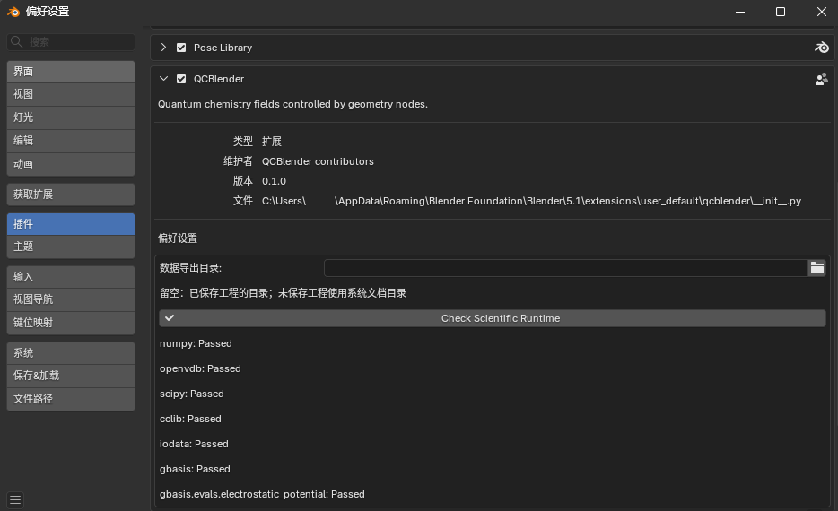
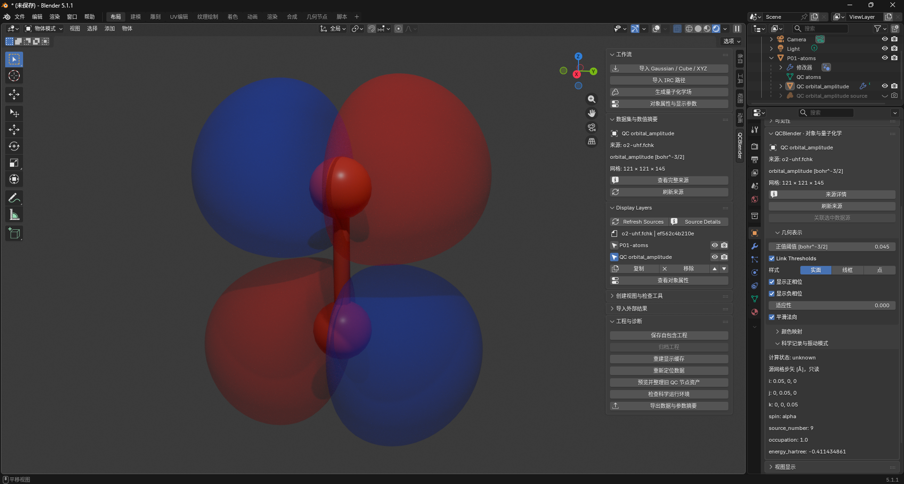

# QCBlender 安装与操作教程

## 目录

- [安装并找到插件](#install)
- [生成第一张轨道图](#orbital)
- [渲染图片](#render)
- [导出当前参数](#export)
- [保存、重新打开和归档工程](#save)
- [按需选择功能专题](#topics)

适用 Windows x64、Blender 5.1.1、QCBlender 0.1.0。本文共 15 步；完成后可继续选择专题。

本文的文件路径均相对**材料根目录**，即解压后同时含有 `human/` 和 `shared/` 的文件夹。保留这两个目录的相对位置；无需安装 Gaussian、Multiwfn 或 PySCF。

图片位置留给实际操作时的截图。看到“截图保存为”时，将截图放到指定目录并使用指定文件名，下面的图片引用便会显示它。

## 安装并找到插件

1. 打开 Blender，选择 **Edit → Preferences → Get Extensions → 右上角菜单 → Install from Disk**，选择 [shared/install/qcblender-0.1.0.zip](../shared/install/qcblender-0.1.0.zip)，完成安装。在 **Add-ons** 中搜索 **QCBlender**，确认已经启用。

2. 展开 QCBlender，点击 **Check Scientific Runtime**。等待检查完成，应显示科学运行环境可用。截图保存为 `human/screenshots/01-install.png`。

3. 关闭偏好设置，选择 **File → New → General**。在右上角 **Outliner** 选中默认 **Cube** 并删除，保留 Camera 和 Light。鼠标移入 **3D Viewport**，切到 **Object Mode**，按 `N`，打开 **QCBlender** 页；点击视口右上角的 **Material Preview**。之后文中的“N 侧栏”均指这里。

> Outliner 是场景对象列表；Material Preview 是材质预览，可直接看到分子和表面的颜色。

> “对象属性”指右侧 **Properties → Object → QCBlender · 对象与量子化学**。也可选中对象后点击 **N 侧栏 → 工作流 → 对象属性与显示参数**；该入口会固定当前对象，换对象后再次点击即可。

## 生成第一张轨道图

4. 点击 **N 侧栏 → 工作流 → 导入 Gaussian / Cube / XYZ**，选择 [shared/data/public/P01/o2-uhf.fchk](../shared/data/public/P01/o2-uhf.fchk)。应出现两个氧原子。选中这个原子对象，按 `F2` 命名为 **P01-atoms**；点击 **数据集与数值摘要 → 查看完整来源**，应看到 **filename: o2-uhf.fchk**、**coordinate_unit: angstrom**。关闭来源窗口。

> FCHK 是格式化的量子化学计算结果文件，提供分子构型和波函数。本例的计算条件见[样本说明](../shared/data/public/NOTICE.md)。

5. 保持 **P01-atoms** 活动，点击 **工作流 → 生成量子化学场**。首次使用时先等待自动检查，再在 **Generate Quantum Field** 对话框中设置下表，点击 **OK**。

| 控件 | 输入值 |
| --- | --- |
| Quantity | Molecular orbital |
| Spin | Alpha |
| Orbital | Source number |
| Orbital number (1-based) | 9 |
| Grid spacing (angstrom) | 0.2 |
| Grid margin (angstrom) | 3 |
| Memory budget (MiB) | 512 |

> MO 是分子轨道；Alpha 和 Beta 是两种自旋的标记。这里选择源文件中的 Alpha 第 9 个轨道，两种表面颜色表示波函数的正负相位。

> 网格间距决定空间采样的疏密，边距决定分子周围计算多宽。本文参数用于学习显示操作。

6. 完成后选中 **QC orbital_amplitude**。在 **对象属性 → 几何表示** 将 **正值阈值** 设为 **0.045**，保持 **Link Thresholds**、**显示正相位**、**显示负相位** 开启。应看到两种颜色的轨道表面；在 **科学记录与振动模式** 中应看到 `spin: alpha`、`source_number: 9`，单位为 `bohr^-3/2`。截图保存为 `human/screenshots/02-orbital.png`。

> 等值面是场数值达到指定阈值的位置；Link Thresholds 让两种相位使用相同的阈值幅度。

> bohr 是原子尺度的长度单位，约等于 0.529 Å；这里的轨道振幅单位为 bohr 的 −3/2 次方。

7. 关闭再开启 **显示负相位**，应只有一种相位的表面消失后恢复。打开 **Properties → Material → QCBlender · 节点材质**，将 **Positive Opacity** 设为 **0.4**，正相位应变透明；最后恢复 **1**，保留两种相位。

## 渲染图片

8. 在文件管理器中，在材料根目录创建 `work/human/P01/` 和 `work/human/exports/`。回到 Blender，选中 **QC orbital_amplitude**，转到能看清两种相位的角度，点击 **N 侧栏 → 创建视图与检查工具 → 创建取景相机**。按小键盘 `0` 查看相机范围，整个轨道应在画面内。

9. 在 **Render Properties** 选择 **EEVEE**，在 **Output Properties** 设分辨率 **1280 × 720、100%**。按 `F12` 渲染，在结果窗口选择 **Image → Save As**，保存到 `work/human/P01/P01-mo.png`。图片应包含两个氧原子及两种相位表面。截图保存为 `human/screenshots/03-render.png`。

## 导出当前参数

10. 回到主窗口，选中 **QC orbital_amplitude**，点击 **N 侧栏 → 工程与诊断 → 导出数据与参数摘要**。将 **Data** 设为 **当前视图参数摘要**；在 **Output directory** 选择材料根目录下的 `work/human/exports/`，让文件浏览器填入它的实际绝对路径，再确认。

11. 按 **Data exported:** 提示中的完整路径打开新生成的子目录。应有 **view-summary.md** 和 **metadata.json**；打开前者，检查其中有 **Alpha、源轨道 9、0.2 Å 网格、0.045 阈值**。插件每次自动创建一个不同名称的子目录。截图保存为 `human/screenshots/04-summary.png`。

> 参数摘要保存当前视图设置。CSV 是以逗号分隔各列的文本表格；[剖面专题](topics/04-spatial-tools.md#profile)会练习一次科学数据 CSV 导出。

## 保存、重新打开和归档工程

12. 点击 **N 侧栏 → 工程与诊断 → 保存自包含工程**，保存为 `work/human/P01/P01.blend`。在文件管理器中应同时看到 `work/human/P01/P01.qcdata/`。

> `.blend` 是 Blender 工程；同名 `.qcdata/` 保存它需要的科学数据。移动工程时要把两者一起带走。

13. 选择 **File → Quit** 正常关闭 Blender，再启动 Blender，用 **File → Open** 打开 `work/human/P01/P01.blend`。

14. 选中 **QC orbital_amplitude**，切到 **Material Preview**。两种相位仍应完整显示，阈值仍为 **0.045**；按小键盘 `0` 应能恢复刚才的取景。截图保存为 `human/screenshots/05-reopened.png`。

15. 点击 **工程与诊断 → 归档工程**，保存为 `work/human/P01/P01-project.zip`。在文件管理器中打开 ZIP，应能找到 `.blend` 与配套科学数据目录。以后要分享这个工程时可使用该 ZIP。

## 按需选择功能专题

后续专题可按需要选择。标明“接续”的专题使用前页生成的对象，其余从新工程开始；新建前先保存你想保留的工程。出图和保存使用上面的共同方法，无需每例重复渲染、导出或重新启动 Blender。

| 想学习的功能 | 专题 |
| --- | --- |
| 球棍、氢显隐、局部选择、测量标注、显示层、XYZ 帧 | [分子显示与 XYZ](topics/01-molecule-xyz.md) |
| 导入现成 Cube，声明量与单位，调整两符号表面 | [Cube 场](topics/02-cube.md) |
| 密度表面按 ESP 着色、图例、原子电荷、偶极和自旋密度 | [密度与 ESP](topics/03-density-esp.md) |
| 切片、等值线、探针、剖面 CSV、裁剪和体积雾 | [空间观察与数据导出](topics/04-spatial-tools.md) |
| IGMH、IRI 表面与成对场筛选 | [IGMH 与 IRI](topics/05-igmh-iri.md) |
| ESP 极值和面积、AIM 临界点与路径 | [外部 ESP 与 AIM 分析](topics/06-esp-aim.md) |
| IRC 路径、随步标注和 Mayer 键级 | [IRC 与 Mayer](topics/07-irc-mayer.md) |
| ETS-NOCV 表和正负变形密度 | [ETS-NOCV](topics/08-ets-nocv.md) |
| 用公共节点组合自己的显示流程 | [几何节点](topics/09-nodes.md) |

公开样本的计算条件和许可见 [shared/data/public/NOTICE.md](../shared/data/public/NOTICE.md) 与 [LICENSE](../shared/data/public/LICENSE)。
