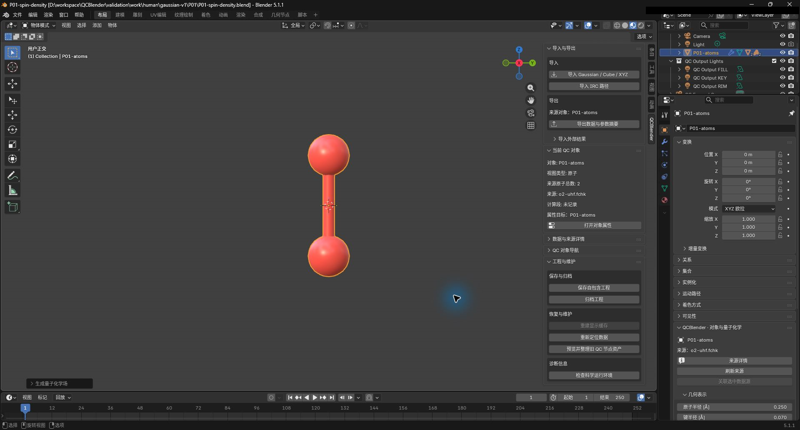
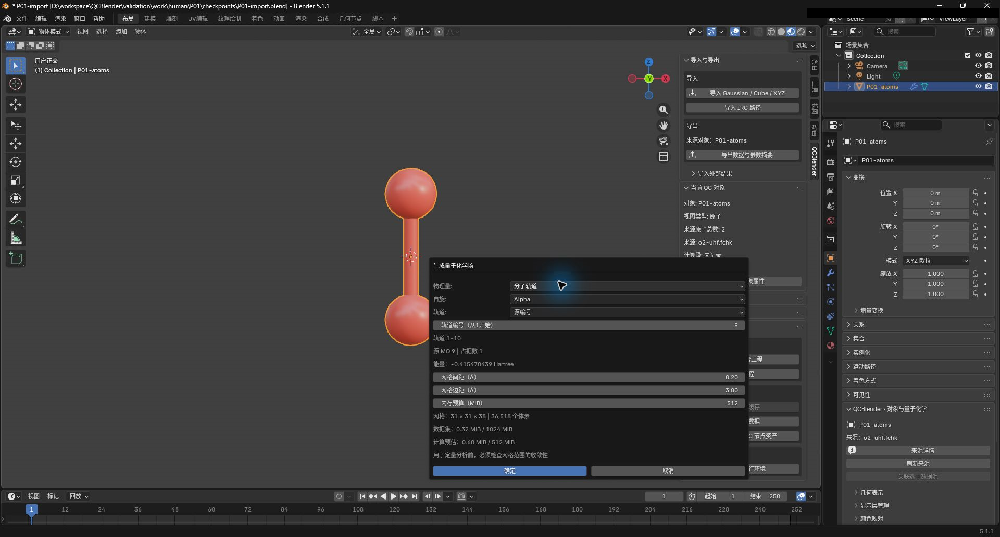
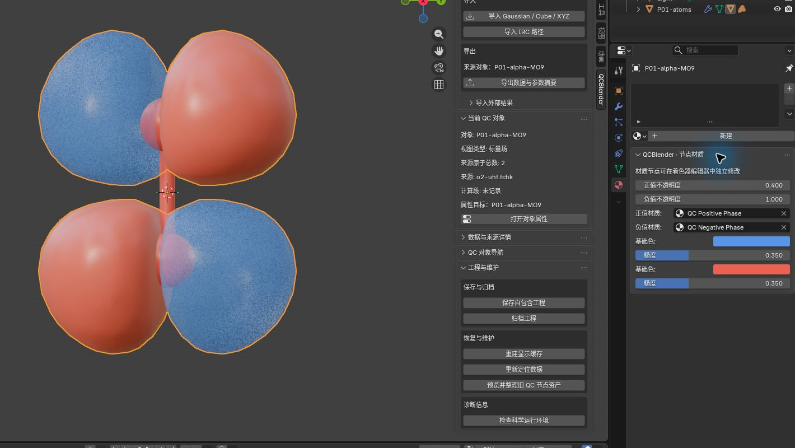
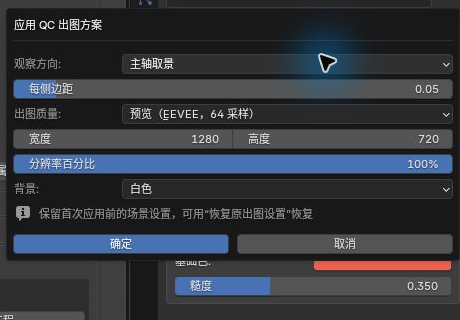
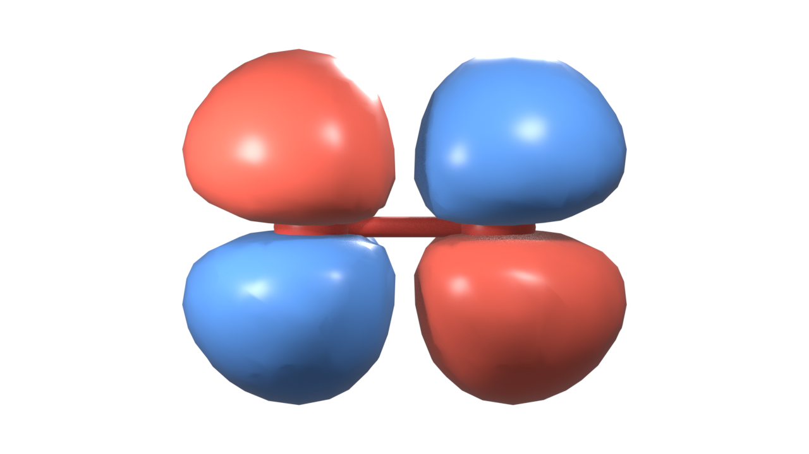
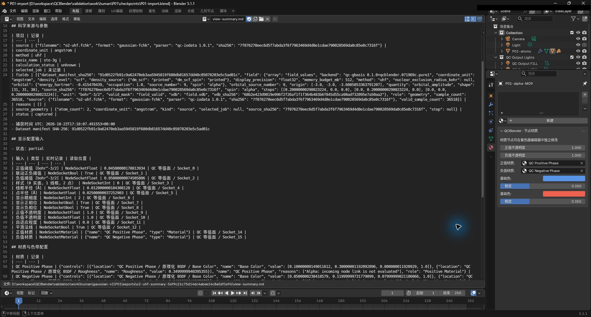
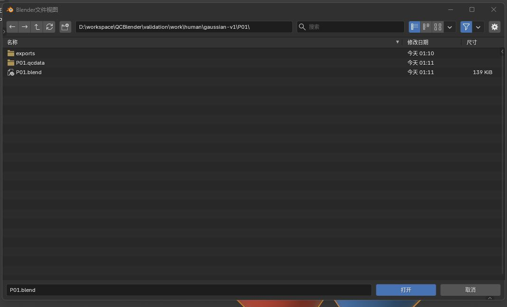
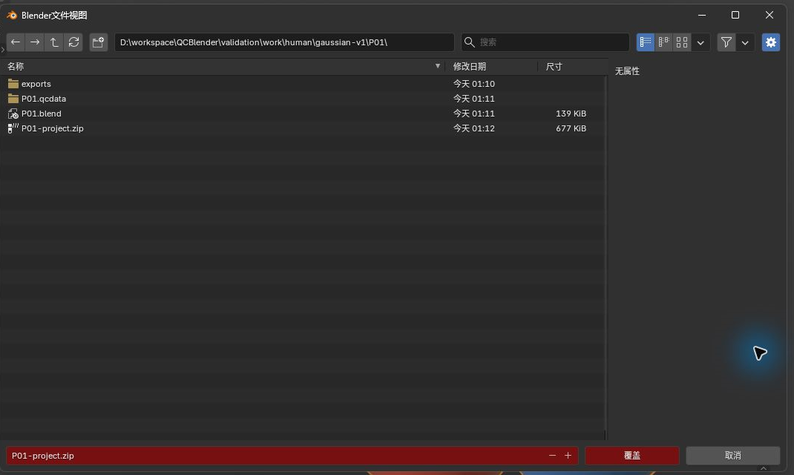

# QCBlender 安装与实操教程 (SOP)

## 目录

- [安装与环境配置](#install)
  - [1. 安装并启用插件](#step-01)
  - [2. 检查科学计算环境](#step-02)
  - [3. 准备工作区与视口](#step-03)
- [快速上手：分子轨道图](#orbital)
  - [4. 导入分子结构并核对来源](#step-04)
  - [5. 选择轨道并配置网格](#step-05)
  - [6. 调节轨道等值面](#step-06)
  - [7. 切换相位显示与材质透明度](#step-07)
- [场景出图与渲染](#render)
  - [8. 自动构图并应用出图方案](#step-08)
  - [9. 执行渲染并保存图片](#step-09)
- [导出计算数据与参数](#export)
  - [10. 导出参数摘要](#step-10)
  - [11. 检查摘要文件](#step-11)
- [工程保存与归档](#save)
  - [12. 保存自包含工程](#step-12)
  - [13. 退出并重开验证](#step-13)
  - [14. 核对恢复状态](#step-14)
  - [15. 打包归档工程](#step-15)
- [专题教程导航](#topics)
- [附录：参数、原理与输入规范](#appendix)
  - [A1. 了解安装入口与界面语言](#appendix-step-01)
  - [A2. 了解科学运行环境检查](#appendix-step-02)
  - [A3. 界面布局与对象属性](#appendix-step-03)
  - [A4. 了解 FCHK、数据集与坐标单位](#appendix-step-04)
  - [A5. 物理量、轨道选项与网格参数](#appendix-step-05)
  - [A6. 了解等值面、正负相位与科学记录](#appendix-step-06)
  - [A7. 了解材质与不透明度](#appendix-step-07)
  - [A8. 选择观察方向、出图质量与透明背景](#appendix-step-08)
  - [A9. 了解 PNG 与可编辑工程的用途](#appendix-step-09)
  - [A10. 了解导出内容与记录范围](#appendix-step-10)
  - [A11. 了解参数摘要、元数据与 CSV](#appendix-step-11)
  - [A12. 了解自包含工程与配套数据](#appendix-step-12)
  - [A13. 了解工程归档](#appendix-step-15)

---

### 说明与前置要求

- **适用版本**：Windows x64、Blender 5.1.1、QCBlender 0.1.0。
- **界面双语标注**：文中以“中文名称（English name）”形式注明，便于对照中英文界面。内部科学字段（如 `coordinate_unit`、`electron/bohr^3`、`qc_*`）均保持原样，无需翻译。
- **文件路径基准**：所有相对路径均相对于**教程根目录**（即同时包含 `human/` 和 `shared/` 的文件夹）。QCBlender 已内置计算库，无需配置外部 Python 环境或安装 Gaussian、Multiwfn。
- **截图与产物说明**：
  - 过程截图位于 `human/screenshots/`（以 `P01-` 开头）。
  - 渲染成品保存于 `human/renders/`。
  - 本主线工程与导出产物置于 `work/human/gaussian-v1/P01/`。专题 P04 原生 53 帧及 P06 三帧 XYZ 使用 `work/human/gaussian-v2/`；其余未变化工程沿用 `gaussian-v1/`。当前科学输入统一使用 `shared/data/public/gaussian-v2/`，旧工程与历史截图不能作为不同输入的数值依据。

---

## 安装与环境配置

### 1. 安装并启用插件

详细说明见[附录 A1：了解安装入口与界面语言](#appendix-step-01)。

从 [QCBlender 0.1.0 Release](https://github.com/psiQAQ/QCBlender/releases/tag/v0.1.0) 下载扩展包 `qcblender-0.1.0.zip`，并与 `SHA256SUMS.txt` 核对校验和。安装方式二选一：

- **从 ZIP 安装（推荐）**：
  打开 Blender，进入 **编辑（Edit） → 偏好设置（Preferences） → 获取扩展（Get Extensions） → 右上角菜单 → 从磁盘安装（Install from Disk）**，选中下载的 ZIP 文件。
- **从远程仓库安装**：
  1. 在 **偏好设置 → 系统（System） → 网络（Network）** 中启用 **允许在线访问（Allow Online Access）**。
  2. 在 **获取扩展 → 仓库（Repositories） → ＋ → 添加远程仓库（Add Remote Repository）** 中填入 `https://notes.psiqaq.cn/QCBlender/index.json`。
  3. 刷新扩展列表后搜索安装 **QCBlender**。

安装完成后，在偏好设置左侧 **插件（Add-ons）** 中搜索 **QCBlender** 并确认勾选启用。

### 2. 检查科学计算环境

详细说明见[附录 A2：了解科学运行环境检查](#appendix-step-02)。

1. 在 3D 视图按 `N` 打开侧边栏，切换到 **QCBlender** 标签。
2. 展开 **工程与维护（Project and Maintenance） → 诊断信息（Diagnostics）**，点击 **检查科学运行环境（Check Scientific Runtime）**。底部状态栏会提示检查结果。
3. 若需查看各项依赖详情，打开 **偏好设置 → 插件 → QCBlender**，展开后确认各模块的状态文本均显示通过。
4. 截图保存至 `human/screenshots/P01-install.png`。

### 3. 准备工作区与视口

详细说明见[附录 A3：界面布局与对象属性](#appendix-step-03)。

每次换对象后，重新点击 **N 侧栏 → 当前 QC 对象 → 打开对象属性**，核对按钮旁的目标对象名；属性编辑区可能仍固定在上一层。导航只选择对象，不自动显示隐藏层。显示层的眼睛控制视口，相机控制渲染。

1. 进入 **文件（File） → 新建（New） → 常规（General）**（如需保存旧工程请先保存）。
2. 在右上角 **大纲视图（Outliner）** 中选中默认的 **Cube** 并删除，保留相机和灯光。
3. 鼠标移入 **3D 视图（3D Viewport）**，切到 **物体模式（Object Mode）**，按 `N` 展开侧边栏并切到 **QCBlender**；在视口右上角切换为 **材质预览（Material Preview）** 模式。
4. 视口操作：按住鼠标中键拖动旋转视角，滚轮缩放，Shift + 中键平移。

---

## 快速上手：分子轨道图

### 4. 导入分子结构并核对来源

详细说明见[附录 A4：了解 FCHK、数据集与坐标单位](#appendix-step-04)。

1. 点击 **N 侧栏 → 导入与导出 → 导入 → 导入 Gaussian / Cube / XYZ**，选择样例文件 [shared/data/public/gaussian-v2/P01/o2-uhf.fchk](../shared/data/public/gaussian-v2/P01/o2-uhf.fchk)。视口中将出现两个氧原子。
2. 在大纲视图中选中该对象，按 `F2` 重命名为 **P01-atoms**。
3. 在 N 侧栏 **当前 QC 对象** 面板确认原子总数为 **2**。点击 **打开对象属性**，再在属性面板点击 **来源详情（Source Details）**，核对文件名 `o2-uhf.fchk` 与单位 `angstrom`。
4. 截图保存至 `human/screenshots/P01-sidebar-summary.png`。

### 5. 选择轨道并配置网格

详细说明见[附录 A5：物理量、轨道选项与网格参数](#appendix-step-05)。

1. 保持选中 **P01-atoms**，在属性面板进入 **创建视图与工具（Create Views and Tools） → 计算（Compute） → 生成量子化学场（Generate Quantum Field）**。
2. 等待独立科学预检通过，再在参数对话框中配置以下参数；若预检失败，先按提示核对输入及科学运行环境。

| 参数项 | 设置值 | 说明 |
| --- | --- | --- |
| 物理量（Quantity） | 分子轨道（Molecular orbital） | 计算选定轨道的波函数振幅 |
| 自旋（Spin） | Alpha | 观察 Alpha 自旋通道 |
| 轨道（Orbital） | 源编号（Source number） | 使用源文件中的原始轨道序号 |
| 轨道编号（Orbital number） | 9 | Alpha 第 9 号轨道（能量约为 −0.4155 hartree） |
| 网格间距（Grid spacing） | 0.2 Å | 空间网格离散采样步长 |
| 网格边距（Grid margin） | 3.0 Å | 分子边界外延的采样区域 |
| 内存预算（Memory budget） | 512 MiB | 供求值程序估算需求与分批计算的预算，不是 Blender 总内存硬上限 |

3. 截图保存至 `human/screenshots/P01-orbital-dialog.png`。
4. 点击 **确定（OK）**，等待后台网格计算完成。

### 6. 调节轨道等值面

详细说明见[附录 A6：了解等值面、正负相位与科学记录](#appendix-step-06)。

正负表面表示轨道相位，不表示正负电荷。

1. 选中视口中新生成的场对象 **QC orbital_amplitude**，按 `F2` 重命名为 **P01-alpha-MO9**。
2. 点击 N 侧栏的 **打开对象属性**，进入 **几何表示（Geometry Representation）** 面板。
3. 勾选 **联动正负阈值（Link Thresholds）**，将 **正值阈值（Positive Isovalue）** 改为 **0.045**。视口中将同步显示正相位与负相位两个闭合曲面。
4. 在 **科学记录与振动模式** 面板核对 `spin: alpha`、`source_number: 9` 以及物理量单位 `bohr^-3/2`。
5. 截图保存至 `human/screenshots/P01-orbital.png`。

### 7. 切换相位显示与材质透明度

详细说明见[附录 A7：了解材质与不透明度](#appendix-step-07)。

1. 在 **几何表示** 面板中取消勾选 **显示负相位（Show Negative Phase）**，确认负相曲面隐藏；随后重新勾选恢复。
2. 切换至 Blender 右侧 **材质属性（Material Properties） → QCBlender · 节点材质** 面板，将 **正值不透明度（Positive Opacity）** 调整为 **0.4**。观察正相位呈现半透明状态。
3. 截图保存至 `human/screenshots/P01-phase-opacity.png`。
4. 截图完成后，将正值不透明度改回 **1.0**，准备出图。

---

## 场景出图与渲染

### 8. 自动构图并应用出图方案

详细说明见[附录 A8：选择观察方向、出图质量与透明背景](#appendix-step-08)。

1. 在本地工作区预先建立输出文件夹 `work/human/gaussian-v1/P01/exports/`。
2. 选中 **P01-alpha-MO9**，在属性面板进入 **创建视图与工具 → 相机（Camera） → 应用 QC 出图方案（Apply QC Output）**。
3. 在设置弹窗中填入以下参数：
   - **观察方向**：主轴取景（Principal Axes）
   - **每侧边距**：0.05
   - **出图质量**：预览（EEVEE，64 采样）
   - **图像尺寸**：1280 × 720，分辨率 100%
   - **背景颜色**：白色（White）
4. 截取弹窗设置，保存至 `human/screenshots/P01-output.png`。
5. 点击确认应用。系统将自动生成正交取景相机，并调整三点柔光与中性环境照明。按小键盘 `0` 可预览相机画面。

### 9. 执行渲染并保存图片

详细说明见[附录 A9：了解 PNG 与可编辑工程的用途](#appendix-step-09)。

1. 按快捷键 `F12` 开始渲染。
2. 渲染完成后，在弹出的窗口菜单点击 **图像（Image） → 另存为（Save As）**。
3. 保存为 `human/renders/P01-final.png`，格式选择 PNG。

---

## 导出计算数据与参数

### 10. 导出参数摘要

详细说明见[附录 A10：了解导出内容与记录范围](#appendix-step-10)。

先创建输出目录，再用文件浏览器选中它，让控件填入实际绝对路径。专题导出 CSV 时，先选包含相应记录的对象，并将 **数据（Data）** 改为专题指定类型；支持筛选的类型还须选择 **行（Rows）**。

1. 按 `F11` 关闭渲染窗口，选中 **P01-alpha-MO9**。
2. 进入 **N 侧栏 → 导入与导出 → 导出 → 导出数据与参数摘要**。
3. 将 **数据（Data）** 设置为 **当前视图参数摘要（Current View Parameter Summary）**，在 **输出目录** 中选择 `work/human/gaussian-v1/P01/exports/`。
4. 截图保存至 `human/screenshots/P01-summary.png`，随后点击确定导出。

### 11. 检查摘要文件

详细说明见[附录 A11：了解参数摘要、元数据与 CSV](#appendix-step-11)。

1. 导出完成后，进入刚才生成的子文件夹，确认生成了 `view-summary.md` 与 `metadata.json`。
2. 在 Blender 中将任意窗口切至 **文本编辑器（Text Editor）**，打开新导出的 `view-summary.md`，确认包含 Alpha 自旋、源轨道 9、0.2 Å 间距与 0.045 阈值等参数。
3. 截图保存至 `human/screenshots/P01-summary-preview.png`。

---

## 工程保存与归档

### 12. 保存自包含工程

详细说明见[附录 A12：了解自包含工程与配套数据](#appendix-step-12)。

1. 进入 **N 侧栏 → 工程与维护 → 保存与归档 → 保存自包含工程**。
2. 选择路径并保存为 `work/human/gaussian-v1/P01/P01.blend`。
3. 打开文件管理器或 Blender 文件浏览器，确认当前目录下同时存在 **P01.blend** 文件与同名数据目录 **P01.qcdata/**。
4. 截图保存至 `human/screenshots/P01-project-sidecar.png`。

> [!IMPORTANT]
> `.blend` 仅存储场景节点与材质；`.qcdata/` 存储网格数组和科学元数据。迁移工程时必须将两者一同拷贝，切勿单独重命名或删除 `.qcdata/`。

### 13. 退出并重开验证

1. 点击 **文件（File） → 退出（Quit）** 关闭 Blender。
2. 重新启动 Blender，通过 **文件 → 打开（Open）** 加载 `work/human/gaussian-v1/P01/P01.blend`。

### 14. 核对恢复状态

1. 选中 **P01-alpha-MO9** 并切换为 **材质预览** 模式。
2. 确认双相位等值面正常可见，阈值保持为 0.045；按小键盘 `0` 确认相机取景完好。

### 15. 打包归档工程

详细说明见[附录 A13：了解工程归档](#appendix-step-15)。

若归档前修改过场景，先再次执行 **保存自包含工程**。归档读取磁盘上已保存的工程，不自动收录另行导出的 PNG、CSV 或参数摘要；分享时按需附上。

1. 进入 **N 侧栏 → 工程与维护 → 保存与归档 → 归档工程（Archive Project）**。
2. 归档保存为 `work/human/gaussian-v1/P01/P01-project.zip`。
3. 核对目录下已完整生成包含工程与数据的 ZIP 文件。
4. 截图保存至 `human/screenshots/P01-project-archive.png`。

---

## 专题教程导航

完成基础入门流程后，可按需选择专题。接续专题须先完成其列明的前置步骤，其余从[准备新工程](#new-scene)开始。渲染、保存与导出沿用上述方法，并将 P01 对象名和路径替换为当前案例名称，避免覆盖主线工程：

| 研究需求 | 对应专题文档 |
| --- | --- |
| 球棍模型、显示层控制、测量标注与多帧 XYZ 离散浏览 | [01. 分子结构与 XYZ 帧浏览](topics/01-molecule-xyz.md) |
| Cube 标量场导入、物理量声明、多场叠加与跨场映射 | [02. Cube 空间场管理](topics/02-cube.md) |
| 电子密度曲面按静电势（ESP）着色、图例色条、电荷与偶极 | [03. 电子密度与静电势分析](topics/03-density-esp.md) |
| 空间剖面切片、等值线轮廓、空间点探针与 CSV 数据提取 | [04. 空间观测工具与剖面导出](topics/04-spatial-tools.md) |
| IGMH / IRI 弱相互作用区域识别与成对场过滤 | [05. IGMH 与 IRI 分析](topics/05-igmh-iri.md) |
| ESP 表面极值点定位、面积统计与 AIM 拓扑分析（临界点与键径） | [06. 外部 ESP 极值与 AIM 分析](topics/06-esp-aim.md) |
| IRC 反应路径演化追踪、沿步构型标注与 Mayer 键级矩阵 | [07. IRC 路径与 Mayer 键级](topics/07-irc-mayer.md) |
| ETS-NOCV 电荷转移通道表与形变密度等值面 | [08. ETS-NOCV 相互作用分析](topics/08-ets-nocv.md) |
| 深入利用原生 Geometry Nodes 组合自定义可视化管线 | [09. 几何节点管线定制](topics/09-nodes.md) |
| 分子表面距离投影图、原子投影与等值线映射 | [10. 表面距离投影分析](topics/10-surface-projection.md) |
| AICD 电流响应张量、Aniso 等值面与单位磁场响应 | [11. AICD 张量与电流响应](topics/11-aicd.md) |
| Gaussian 日志解析：几何优化历程、简正振动模式与 NBO / E(2) | [12. Gaussian 优化、振动与 NBO](topics/12-gaussian-log.md) |

---

## 附录：参数、原理与输入规范

### A1. 了解安装入口与界面语言

> 获取扩展（Get Extensions）用于管理扩展；从磁盘安装（Install from Disk）安装本地 ZIP；插件（Add-ons）用于启停插件。

选择 English 时显示英文原文。QCBlender 的面板、操作、参数、节点、插口及资产目录随界面语言显示。切换语言不会改变科学数据；节点或资产显示名更新可能使工程出现“已修改”状态，按后面的保存步骤保存即可。自行改过的名称会保留。

### A2. 了解科学运行环境检查

> 检查科学运行环境（Check Scientific Runtime）检查插件执行量子化学数值计算所需的运行环境是否可用。

### A3. 界面布局与对象属性

#### 了解编辑器、场景对象与自定义属性

> 大纲视图（Outliner）是场景对象列表；3D 视图（3D Viewport）是观察和选择三维对象的视口，物体模式（Object Mode）用于操作整个对象。材质预览（Material Preview）显示分子和表面的颜色。

> Cube、Camera、Light 分别是默认立方体、取景相机和灯光；本教程导入的原子和场表面也都是场景对象。

> 自定义属性（Custom Properties）是附在 Blender 对象或数据上的额外记录。选中 QCBlender 对象，在 **属性（Properties） → 物体（Object） → 自定义属性（Custom Properties）** 展开对应记录；将鼠标停在属性名称上，可查看内部键和用途。界面显示的友好名称可随语言切换，内部 `qc_*` 键保持原样，用于插件和脚本读取。日常调整优先使用教程指定的面板，不手动改科学记录。节点几何上的命名属性另见[节点专题](topics/09-nodes.md#attributes)。

> 属性（Properties）用于查看和修改对象及场景设置。“对象属性”指 **属性（Properties） → 物体（Object） → QCBlender · 对象与量子化学（QCBlender · Object and Quantum Chemistry）**。打开入口会固定按钮注明的 QC 目标；选中标注或辅助部件时，目标是其所属 QC 对象。侧栏摘要跟随 3D 视图的活动对象，属性编辑区可能仍固定在上一层。

#### 查阅五区侧栏与对象工具分组

N 侧栏依次包含下列五区；**当前 QC 对象（Current QC Object）** 默认展开，数据详情、对象导航及工程维护默认折叠。先选当前案例对象，再展开需要的一组。按钮的悬停说明会解释用途、作用对象、结果和必要前提。

| 面板 | 分组与用途 |
| --- | --- |
| 导入与导出（Import and Export） | 导入 Gaussian/Cube/XYZ、IRC 和外部分析；导出已有数据与参数摘要。需要参考对象的操作先核对目标。 |
| 当前 QC 对象（Current QC Object） | 只读显示对象名、视图类型、来源原子总数、源文件、计算段及当前 XYZ/优化/IRC 步；**打开对象属性（Open Object Properties）** 是侧栏唯一的对象属性入口。 |
| 数据与来源详情（Data and Source Details） | 按类别汇总方法、基组、计算状态及已有场、轨道、振动、轨迹和外部分析的数量、单位、维度；缺失信息明确提示。完整来源查看、刷新和关联在对象属性中操作。 |
| QC 对象导航（QC Object Navigation） | 按来源分组选择 QC 对象；不修改显隐、参数或数据。 |
| 工程与维护（Project and Maintenance） | 保存自包含工程与归档；重新定位数据、重建显示缓存、整理旧节点资产以及检查科学运行环境。 |

> 侧栏摘要是轻量的只读概览，读取已有来源记录和数组描述，不在绘制界面时读取科学数组、加载磁盘数据或运行计算。来源原子总数指源数据的全部原子，不是局部选择、氢隐藏或裁剪后看到的数量；例如六原子水二聚体只显示两个氧时，来源总数仍为 6。选中标注、偶极等辅助对象时，还应核对摘要注明的来源所属对象。普通对象或空选择不会沿用上一 QC 对象的摘要。

对象内部操作集中在 **对象属性 → 创建视图与工具（Create Views and Tools）**：**计算（Compute）** 生成量子化学场，**显示视图（Display Views）** 创建等值面、体积雾和局部层，**空间工具（Spatial Tools）** 创建切片、裁剪和偶极，**场值采样（Field Sampling）** 取点与采样剖面，**相机（Camera）** 设置取景。四类标注的创建、编辑和朝向操作统一在 **局部选择与标注（Local Selection and Annotations）**。只有当前对象适用的操作才会提供；没有所需数据时先检查对象和来源。

标注的黑色文字、引线和测量几何，以及二面角的半透明三角面，见[分子与标注案例](topics/01-molecule-xyz.md#step-05)。标注属于对应的原子显示层，显示设置和材质随工程保存；它们的颜色、尺寸与朝向不改变源构型或测量值。

显示层管理还提供复制、移除和排序。

### A4. 了解 FCHK、数据集与坐标单位

> FCHK 是格式化的量子化学计算结果文件，提供分子构型和波函数。构型是原子的空间位置；波函数提供计算轨道等物理量所需的信息。本例的计算条件见[样本说明](../shared/data/public/NOTICE.md)。

> 数据集是导入的科学数据及其来源记录；`filename` 是源文件名，`coordinate_unit` 是坐标单位。`angstrom` 即 Å（埃），1 Å = 0.1 nm。

### A5. 物理量、轨道选项与网格参数

> 活动对象是本次操作针对的对象；只选一个对象时就是它，多选时通常为最后选中的对象。生成量子化学场（Generate Quantum Field）会在空间网格上计算所选物理量，网格是规则排列的采样点。

> MO 是分子轨道；Alpha 和 Beta 是两种自旋通道的标记。轨道振幅的正负表示波函数的相位。

> 物理量（Quantity）决定生成哪一种场；先按要观察的内容选择，再设置计算网格。网格是数值计算的采样位置，与表面的配色和透明度分开设置。

- **分子轨道（Molecular orbital）**：生成一个轨道的振幅，用正负相位表面观察轨道形状；需要继续选择自旋通道和轨道。
- **电子密度（Electron density）**：生成 Alpha 与 Beta 通道相加的总电子密度，用于观察整体电子分布。
- **Alpha 密度（Alpha density） / Beta 密度（Beta density）**：分别生成一个自旋通道的电子密度。
- **自旋密度（Spin density）**：生成 Alpha 密度减 Beta 密度，用于观察两个自旋通道分布的差别。
- **静电势（Electrostatic potential）**：生成静电势，可给密度表面着色；操作见[密度与 ESP](topics/03-density-esp.md)。

> 选择分子轨道（Molecular orbital）后，自旋（Spin）指定 Alpha 或 Beta 通道；轨道（Orbital）决定如何在该通道中找到轨道。

- **HOMO**：自动选择该通道中能量最高的已占据轨道。
- **LUMO**：自动选择该通道中能量最低的未占据轨道。
- **源编号（Source number）**：使用源文件里的轨道编号，填写源文件中从 1 开始的轨道编号（Orbital number）。本例固定使用 Alpha 轨道 9，便于核对同一结果。

本文件中 Alpha 轨道 8/9 的能量同为 **−0.415470439 hartree**，Beta 轨道 6/7 同为 **−0.438746226 hartree**（按 FCHK 打印精度）。因此，本例 HOMO 预览定位的 8/6 与固定源编号练习中的 9 都是已占据轨道；编号不同不表示固定源轨道 9 未占据。

> MiB 是内存容量单位，1 MiB = 1024² 字节；这里的预算用于本次数值计算，不是 Blender 总内存的硬限制。本文参数用于学习显示操作。

| 控件 | 用途 |
| --- | --- |
| 物理量（Quantity） | 选择计算的物理量；本例为分子轨道振幅 |
| 自旋（Spin） | 选择 Alpha 自旋通道 |
| 轨道（Orbital） | 按源文件编号选择轨道 |
| 轨道编号（从1开始）（Orbital number (1-based)） | 指定轨道编号；1-based 表示从 1 开始编号 |
| 网格间距（Å）（Grid spacing (angstrom)） | 相邻采样点的间距；越小采样越密，计算量也越大 |
| 网格边距（Å）（Grid margin (angstrom)） | 在分子外围扩展计算区域的距离 |
| 内存预算（MiB）（Memory budget (MiB)） | 供计算程序估算内存需求并安排分批计算的预算 |

### A6. 了解等值面、正负相位与科学记录

> 等值面连接场值达到某个阈值的位置；调整阈值会改变轨道表面的形状和大小。联动正负阈值（Link Thresholds）用于决定正、负相位是否采用相同的阈值幅度，显示开关则决定对应表面是否可见。

- **联动正负阈值（Link Thresholds）开启**：负相位沿用正相位的阈值幅度，适合用相同尺度观察两种相位。
- **联动正负阈值（Link Thresholds）关闭**：可以分别设置正、负相位的阈值幅度。
- **显示正相位（Show Positive Phase） / 显示负相位（Show Negative Phase）**：分别控制两种表面的可见性；只想暂时隐藏一种相位时，操作它的显示开关。

> `orbital_amplitude` 表示轨道振幅；bohr 是原子尺度的长度单位，约等于 0.529 Å，轨道振幅的单位 `bohr^-3/2` 表示 bohr 的 −3/2 次方。

> `spin` 记录自旋通道，`source_number` 记录源轨道编号。科学记录用于核对当前表面对应哪份计算数据。

### A7. 了解材质与不透明度

> 材质（Material）是材质设置区，节点材质通过相连的计算单元控制颜色和透明度。正值不透明度（Positive Opacity）调整正相位表面的不透明度；0 为全透明，1 为不透明。

### A8. 选择观察方向、出图质量与透明背景

> 主轴取景（Principal Axes）根据当前显示几何的空间分布展开主体；不旋转分子或改变科学数组。减少遮挡（Reduce Overlap）搜索有限候选方向，以近似减少投影重叠，不计算透明材质和体积雾的光学遮挡。

| 选择 | 适用情形与效果 |
| --- | --- |
| 当前视角 | 已手动选好角度；保持当前三维视图方向 |
| 主轴取景 | 平面、长条或一般分子；对称结构参考当前方向保持稳定 |
| 减少遮挡 | 重叠较多的几何；结果仍需观察，不能保证所有结构都可见 |

纯体积雾或图表无法提供合适主体点时会提示使用当前方向。图例不参与主体方向计算，但会纳入最终画面边界。自动换角度后，沿用图例旋转和标注朝向工具调整文字，再重新取景。

> 渲染是按相机、灯光和材质生成图片。1280 × 720 是宽、高像素数，100% 表示按此尺寸输出；画幅比例在相机取景前确定。

**预览**使用 EEVEE、64 采样；**标准**使用 Cycles、128 最大采样和 0.02 自适应噪声阈值；**精细**使用 Cycles、512 最大采样和 0.005 阈值。质量档位不改变输出尺寸。Cycles 默认降噪，检查细薄结构时可关闭；已有 GPU 设置不能渲染时，在 Blender 的设备设置选择 CPU。同一组正式图片建议保持相同引擎和档位。

**透明 PNG（Transparent PNG）**设置透明胶片与 RGBA，保存图像时也选择 PNG、RGBA。白色、黑色与自定义背景使用 RGB PNG；背景色不改变中性环境照明。Standard 色彩变换、零曝光和 Gamma 1 统一显示设置，但表面的受光颜色仍会与自发光图例有差异。已有合成器可能继续改变最终颜色或透明度。

透明图应放到目标背景上检查。只显示 RGB、不使用 Alpha 的查看方式可能显示本应透明的颜色，体数据边缘尤其明显；需要核对主体颜色时，可先用白色背景出图比较。

首次应用前的相机、世界、灯光可见性和相关输出设置随工程保存。点击 **恢复原出图设置（Restore Original Output）** 可恢复这些值；也可用 Blender 撤销/重做。共享或实例集合中的灯光不能安全隔离时，操作会说明具体对象并取消；先将相关灯光放入本场景独有的集合再应用。相机、主体或显示尺寸改变后，重新应用方案以更新取景和灯光。

### A9. 了解 PNG 与可编辑工程的用途

这张 PNG 是可直接用于教程、报告或演示的静态图片。需要调整视角、表面或材质时，使用后面保存的工程继续编辑，再重新渲染。原有 [P01-mo.png](renders/P01-mo.png) 保留为历史渲染，本轮 Gaussian 输入对应 `P01-final.png`。

### A10. 了解导出内容与记录范围

> 导出数据与参数摘要（Export Data and Parameter Summary）用于把当前视图的说明或已有科学记录保存成文件。数据（Data）选择输出内容，可用选项随活动对象的数据变化；先选要导出的对象，再打开对话框。输出目录（Output directory）选择保存目录，文件浏览器会填入从盘符开始的实际绝对路径。

- **当前视图参数摘要（Current View Parameter Summary）**：导出供人阅读的 view-summary.md 与配套 metadata.json，用于核对图中的来源和显示参数。本主线使用这一项。
- **线剖面（profile）、成对场（paired）、ESP_AREA 等科学数据项**：导出对应对象已有的数值记录及 metadata.json，供表格或绘图软件使用；各专题说明应选哪一项。

> paired 与 ESP_AREA 还提供行（Rows），用于决定导出完整记录还是选中的部分。

- **全部来源记录（All source records）**：导出该类数据的全部记录。
- **当前筛选（Current filter）**：按当前筛选条件导出成对场的有效网格点或 ESP 面积区间。先在专题中设置筛选条件，再选这一项。

### A11. 了解参数摘要、元数据与 CSV

这两个文件记录图中数据的来源和导出时读取的参数，方便以后核对与追溯。

> 计算方法规定采用的量子化学近似，基组是表达轨道的一组基础函数；它们帮助区分计算条件。色带把数值映射为颜色。

> `.md` 是 Markdown 文本，可用文本编辑器阅读；JSON 是便于程序读取的结构化文本。

| 文件 | 用途与内容 |
| --- | --- |
| `view-summary.md` | 供人阅读的参数说明：来源、已记录的计算方法与基组、轨道与自旋、网格、表面阈值、材质和色带，以及未记录或未验证的项目。 |
| `metadata.json` | 供程序读取的结构化记录：数据来源、科学参数、导出类型、数据身份和文件校验信息；本次参数摘要导出还包含当前视图参数，便于自动检查和比较。 |

> CSV 是以逗号分隔各列的数值表格，可用表格或绘图软件打开。[剖面专题](topics/04-spatial-tools.md#profile)会练习一次科学数据 CSV 导出。

> 参数摘要是导出时的快照；未记录或未验证项表示记录的边界，摘要不保证完整记录节点内部效果或渲染结果。

插件每次自动创建一个不同名称的子目录。同目录的 `metadata.json` 记录数据来源、列名、单位和适用的筛选条件。

### A12. 了解自包含工程与配套数据

> 自包含工程把场景及它引用的科学数据保存到配套位置，便于重新打开和移动。

> `.blend` 是 Blender 工程，保存场景对象、显示设置、材质、节点和相机等内容；同名 `.qcdata/` 保存工程需要的科学数据和场缓存。

### A13. 了解工程归档

> 归档把已保存的工程及配套数据打包成一个 ZIP 压缩文件，便于备份或传递。
