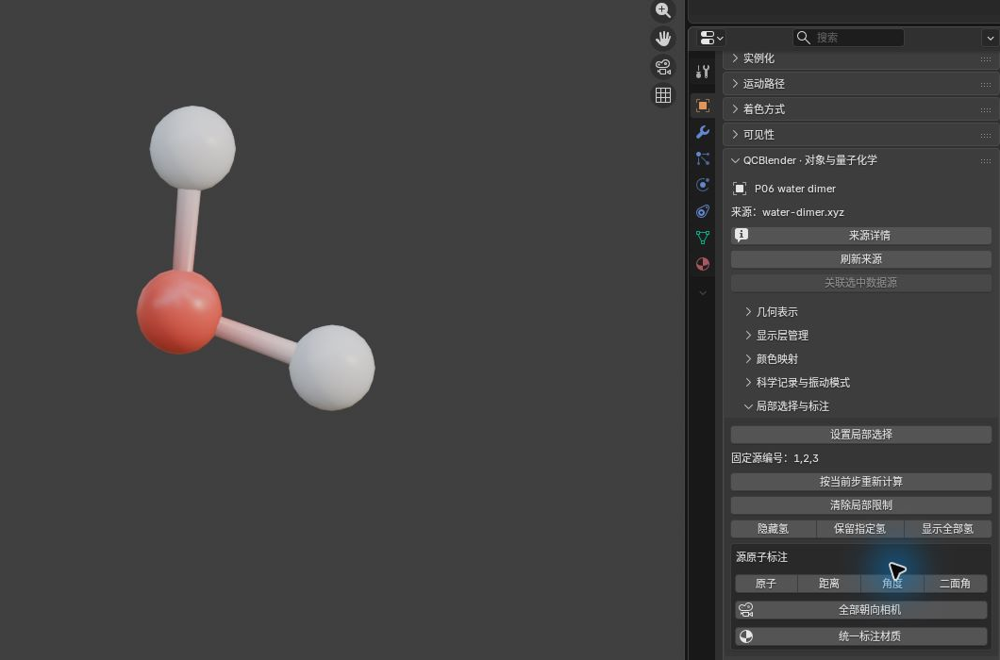
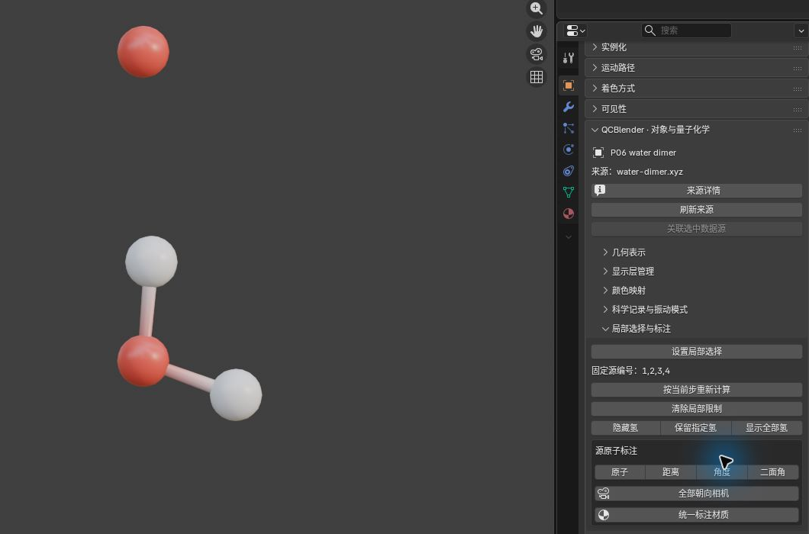
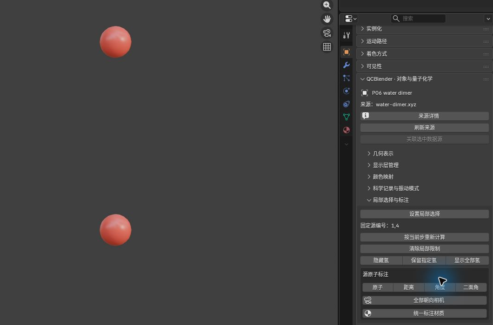
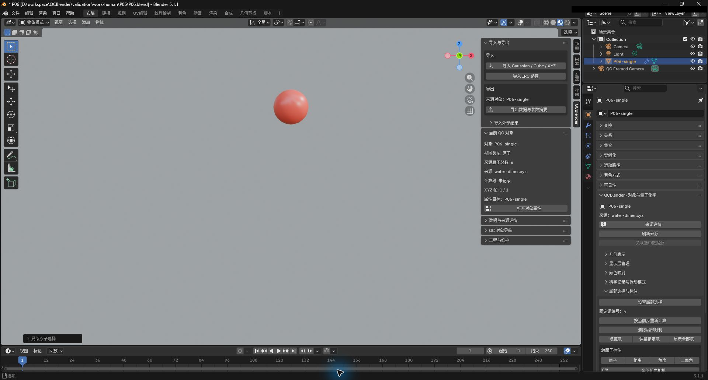
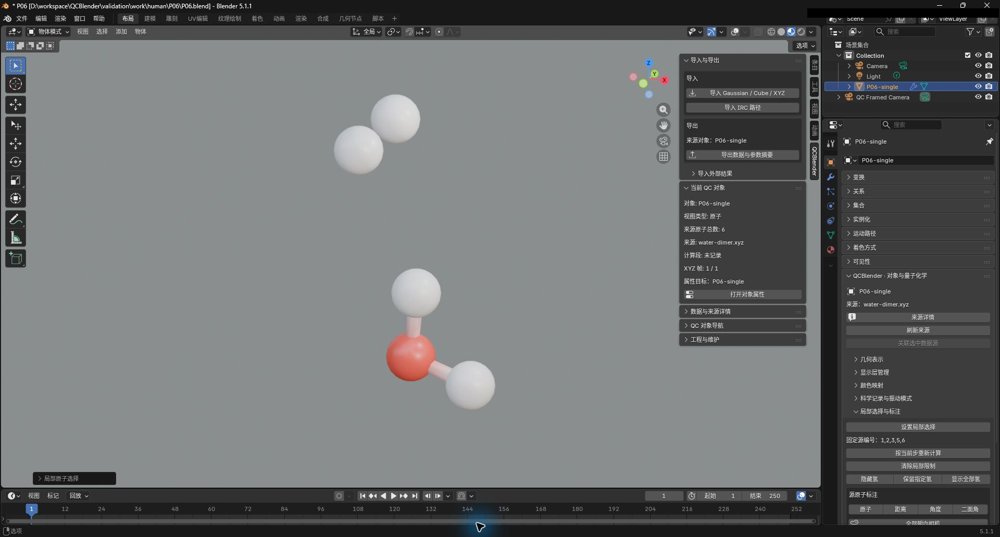
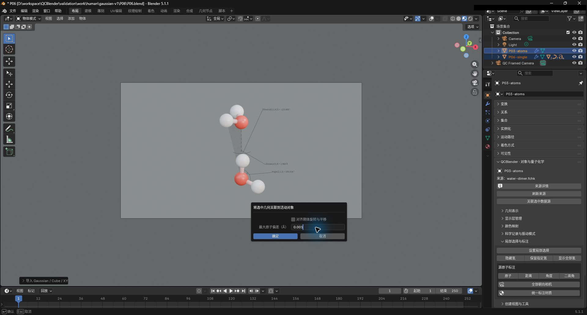

# 01. 分子显示与 XYZ

[返回教程目录](../SOP.md#topics)

## 目录

- [分子与标注](#atoms)
  - [1. 导入水二聚体并命名原子层](#step-01)
  - [2. 切换分子样式并调整半径](#step-02)
  - [3. 练习氢的显隐](#step-03)
  - [4. 逐步设置局部选择范围](#step-04)
  - [5. 创建原子与几何测量标注](#step-05)
- [显示层](#layers)
  - [6. 创建局部显示层](#step-06)
  - [7. 复制显示层并比较独立参数](#step-07)
  - [8. 复制显示参数并创建当前版本视图](#step-08)
- [关联与多帧](#frames)
  - [9. 关联 XYZ 与 FCHK 数据源](#step-09)
  - [10. 导入并切换多帧 XYZ](#step-10)
  - [11. 观察随帧更新的二面角](#step-11)
- [附录：参数、原理与输入规范](#appendix)
  - [A1. 了解 XYZ、坐标与源编号](#appendix-step-01)
  - [A2. 了解三种分子样式与半径](#appendix-step-02)
  - [A3. 了解隐藏氢与保留指定氢](#appendix-step-03)
  - [A4. 了解局部选择的七种模式与距离邻域](#appendix-step-04)
  - [A5. 标注设置、材质与朝向](#appendix-step-05)
  - [A6. 了解局部层、复制层与当前版本视图](#appendix-step-06)
  - [A7. 了解三组显示参数的复制范围](#appendix-step-08)
  - [A8. 了解数据源关联与构型容差](#appendix-step-09)
  - [A9. 了解 XYZ 帧与来源行](#appendix-step-10)

路径均相对教程材料根目录（同时含 `human/` 和 `shared/`）。先完成[安装](../SOP.md#install)，按[准备新工程](../SOP.md#new-scene)开始；每次换对象后重新打开其对象属性。

---

## 分子与标注

### 1. 导入水二聚体并命名原子层

详细说明见[附录 A1：了解 XYZ、坐标与源编号](#appendix-step-01)。

1. 点击 **N 侧栏 → 导入与导出 → 导入 → 导入 Gaussian / Cube / XYZ**。
2. 选择文件 `shared/data/public/gaussian-v2/P06/water-dimer.xyz`。
3. 选中新生成的原子对象，按 `F2` 命名为 **P06-single**。场景中应出现 6 个原子（顺序为 O/H/H/O/H/H）。
4. 视口切换至 **材质预览（Material Preview）**。

### 2. 切换分子样式并调整半径

详细说明见[附录 A2：了解三种分子样式与半径](#appendix-step-02)。

1. 保持 **P06-single** 活动，点击 **N 侧栏 → 当前 QC 对象 → 打开对象属性**。
2. 在 **几何表示 → 样式（Style）** 下依次体验三种表现样式：
   - **球棍（Ball and Stick）**
   - **空间填充（Space Filling）**
   - **键线（Bonds）**
3. 切换回球棍样式，调整以下参数：
   - **原子半径（Atom Radius）**：`0.35 Å`
   - **键半径（Bond Radius）**：`0.12 Å`

### 3. 练习氢的显隐

详细说明见[附录 A3：了解隐藏氢与保留指定氢](#appendix-step-03)。

在 **对象属性 → 局部选择与标注** 面板中控制氢原子的可见性：

1. 点击 **隐藏氢（Hide Hydrogen）**，视口中仅保留 1 号与 4 号氧原子。
2. 点击 **保留指定氢（Keep Specified Hydrogen）**，在弹窗中配置参数：
   - **氢原子编号（从1开始）**：`2`
   - 点击 **确定（OK）**，视口中显示 1、2、4 号原子。
3. 点击 **显示全部氢（Show All Hydrogen）**，恢复全部 6 个原子显示。

### 4. 逐步设置局部选择范围

原子编号按源文件从 1 开始；隐藏、筛选和裁剪不改变编号或来源原子总数。清除局部限制也会清除已保存的选择操作，其他显示设置仍生效。

详细说明见[附录 A4：了解局部选择的七种模式与距离邻域](#appendix-step-04)。

保持 **P06-single** 活动且全部氢可见，按顺序执行以下局部布尔操作：

1. **A：指定单个水分子（Replace 模式）**：
   - 点击 **设置局部选择（Set Local Selection）**。
   - 配置参数：
     - **显示范围更新方式**：替换（Replace）
     - **源原子编号**：`1`
     - **纳入距离邻域**：勾选开启
     - **半径**：`1.0 Å`
     - **包含种子原子**：勾选开启
   - 确定后固定源编号更新为 `1,2,3`（第 1 个水分子）。截图保存至 `human/screenshots/P06-selection-replace.png`。

2. **B：添加原子（Union 模式）**：
   - 再次点击 **设置局部选择**。
   - 配置参数：
     - **显示范围更新方式**：并集（Union）
     - **源原子编号**：`4`
     - **纳入距离邻域**：关闭
   - 确定后固定源编号更新为 `1,2,3,4`。截图保存至 `human/screenshots/P06-selection-union.png`。

3. **C：求交集（Intersect 模式）**：
   - 点击 **设置局部选择**。
   - 配置参数：
     - **显示范围更新方式**：交集（Intersect）
     - **源原子编号**：`1,4`
     - **纳入距离邻域**：关闭
   - 确定后固定编号更新为 `1,4`（只保留两氧原子，源原子总数仍为 6）。截图保存至 `human/screenshots/P06-selection-intersect.png`。

4. **D：做差集（Difference 模式）**：
   - 点击 **设置局部选择**。
   - 配置参数：
     - **显示范围更新方式**：差集（Difference）
     - **源原子编号**：`1`
     - **纳入距离邻域**：关闭
   - 确定后固定编号仅剩 `4`。截图保存至 `human/screenshots/P06-selection-difference.png`。

5. **E：查看其余原子（Invert 模式）**：
   - 点击 **设置局部选择**，选择 **反选（Invert）**（无需输入编号），确定后固定编号为 `1,2,3,5,6`。截图保存至 `human/screenshots/P06-selection-invert.png`。

6. **重算与恢复**：
   - 点击 **按当前步重新计算（Recompute for Current Step）**，编号仍维持 `1,2,3,5,6`。
   - 点击 **清除局部限制（Clear Local Restriction）**，恢复 6 原子完整显示。

### 5. 创建原子与几何测量标注

标注使用独立整数控件，不填逗号分隔字符串。保持 **前缀模式=默认**；距离、角度和二面角均勾选 **显示测量几何**。编号须互不重复且在 1–6 内。需要改变顺序时优先使用相邻交换按钮，确认前核对最终顺序。

详细说明见[附录 A5：标注设置、材质与朝向](#appendix-step-05)。

保持 **P06-single** 活动并打开对象属性，在 **局部选择与标注** 中依次创建四项标注：

1. **原子标注**：
   - 点击 **原子（Atoms）**。
   - 参数配置：
     - **原子标注数量**：`1`
     - **原子 1**：`1`
   - 确定后氧 1 旁显示 `O` 标签。
2. **距离标注**：
   - 点击 **距离（Distance）**。
   - 参数配置：
     - **原子 1**：`1`
     - **原子 2**：`4`
     - **小数位数**：`3`
     - **显示测量几何**：勾选
   - 确定后两氧之间生成测量虚线与 `Distance(1,4) = 2.964 Å` 文本。
3. **角度标注**：
   - 点击 **角度（Angle）**。
   - 通过 **1 ↔ 2** 交换按钮调整为：`原子 1=2`、`原子 2=1`、`原子 3=3`。
   - **小数位数**：`3`
   - 确定后生成内角圆弧与 `Angle(2,1,3) = 105.514 °`。
4. **二面角标注**：
   - 点击 **二面角（Dihedral）**。
   - 调整序号为 `2/1/4/5`。
   - **小数位数**：`3`
   - 确定后生成半透明辅助三角面与 `Dihedral(2,1,4,5) = −123.860 °`。
5. 选回 **P06-single** 并重新打开属性，在 **局部选择与标注 → 源原子标注** 找到对应行，点击设置图标修改 **偏移（Offset）** 并确认。核对六原子与测量几何，截图保存至 `human/screenshots/P06-annotations.png`。

---

## 显示层

### 6. 创建局部显示层

详细说明见[附录 A6：了解局部层、复制层与当前版本视图](#appendix-step-06)。

1. 选中 **P06-single**，打开对象属性。
2. 点击 **创建视图与工具 → 显示视图 → 创建局部显示层**。
3. 配置参数：
   - **源原子编号**：`1,4`
   - **纳入距离邻域**：关闭
4. 确定后生成名为 **P06-single / Local Selection** 的独立显示层，仅展示两个氧原子。
5. 在大纲视图中隐藏原层观察局部层；看完后恢复原层并隐藏局部层，再继续后续练习。

### 7. 复制显示层并比较独立参数

1. 在 **N 侧栏 → QC 对象导航** 中选中 **P06-single**。
2. 重新打开 **P06-single** 的对象属性，在 **显示层管理** 面板点击 **复制（Duplicate）**。
3. 将新副本按 `F2` 命名为 **P06-copy**。
4. 打开 **P06-copy** 的属性，修改参数：
   - **原子半径（Atom Radius）**：`0.25 Å`
5. 分别检查原层（0.35 Å）与副本（0.25 Å），验证参数互不干扰。截图保存至 `human/screenshots/P06-layers.png`。

### 8. 复制显示参数并创建当前版本视图

详细说明见[附录 A7：了解三组显示参数的复制范围](#appendix-step-08)。

1. 在大纲视图中同时多选 **P06-copy** 与 **P06-single**（保持 **P06-single** 为活动对象）。
2. 在 3D 视口菜单中进入 **物体 → QCBlender → 复制显示参数到选中视图**。
3. 仅勾选 **几何表示（Geometry Representation）** 并确定。副本的半径将同步恢复为 `0.35 Å`。
4. 选中 **P06-copy** 并重新打开其对象属性，在 **显示层管理 → 移除（Remove）** 删除该副本，核对原层仍在。
5. 保持 **P06-single** 活动，点击 **创建视图与工具 → 显示视图 → 创建当前版本视图**，生成新视图。观察后隐藏新层，保留 **P06-single** 可见。

---

## 关联与多帧

### 9. 关联 XYZ 与 FCHK 数据源

详细说明见[附录 A8：了解数据源关联与构型容差](#appendix-step-09)。

1. 点击 **导入 Gaussian / Cube / XYZ**，导入 `shared/data/public/gaussian-v2/P03/water-dimer.fchk`，命名为 **P03-atoms**。
2. 在大纲视图中多选 **P06-single** 与 **P03-atoms**（以 **P03-atoms** 为活动对象）。
3. 打开对象属性，点击 **关联选中数据源（Associate Selected Sources）**。
4. 配置参数：
   - **最大原子偏差（Å）**：`0.001`
   - **对齐刚体旋转与平移**：关闭
5. 确定后提示结构完全匹配并成功关联。截图保存至 `human/screenshots/P06-source-association.png`。

### 10. 导入并切换多帧 XYZ

先隐藏本页已有原子层。该 XYZ 的三帧分别来自 P04 第 1、27、53 步，源映射见 [P06/source.json](../../shared/data/public/gaussian-v2/P06/source.json)；帧序本身不表示物理时间。此多帧工程保存到 `work/human/gaussian-v2/P06/P06.blend`，按[共同保存方法](../SOP.md#save)保留配套目录。

详细说明见[附录 A9：了解 XYZ 帧与来源行](#appendix-step-10)。

1. 点击导入文件 `shared/data/public/gaussian-v2/P06/p04-three-frames.xyz`，命名为 **P06-frames**。
2. 打开对象属性，在 **XYZ 帧（XYZ Frames）** 面板中依次点击 **下一步（Next） → 下一步（Next） → 上一步（Previous）**。
3. 观察构型按第 1 帧（负二面角端点）→ 第 2 帧（过渡态）→ 第 3 帧（正二面角端点）→ 第 2 帧离散切换；每帧均为 O/O/H/H 四原子。

### 11. 观察随帧更新的二面角

1. 保持 **P06-frames** 活动，进入 **局部选择与标注 → 二面角**。
2. 配置参数：
   - **原子顺序**：调整为 `3/1/2/4`
   - **小数位数**：`3`
   - **显示测量几何**：勾选
3. 当前在第 2 帧，先点 **上一步** 回到第 1 帧，再连续点两次 **下一步**，核对：
   - 第 1 帧：读数显示约 `-124.948°`
   - 第 2 帧：读数显示约 `+180.000°`
   - 第 3 帧：读数显示约 `+124.948°`
4. 确认测量数值、弧线及三角面随当前构型实时自动重算。回退至第 2 帧，截图保存至 `human/screenshots/P06-xyz-frames.png`。

---

## 附录：参数、原理与输入规范

### A1. 了解 XYZ、坐标与源编号

> XYZ 文件保存原子元素与坐标。本教程的坐标单位是 Å，1 Å = 0.1 nm；源原子编号从 1 开始。

### A2. 了解三种分子样式与半径

> 几何表示中的样式决定分子怎样画出来。显示键根据原子距离推断；改变样式只改变显示方式。

- **球棍（Ball and Stick）**：用球表示原子、棍表示键，适合同时查看原子位置和连接关系。**原子半径（Atom Radius）** 调整原子球半径，**键半径（Bond Radius）** 调整键的粗细。
- **空间填充（Space Filling）**：按各元素的范德华半径画球，适合观察分子占据的空间与外形；**范德华半径缩放（VDW Scale）** 调整这些球的整体大小比例。
- **键线（Bonds）**：只显示键，适合减少原子球遮挡、查看连接关系；**键半径（Bond Radius）** 调整键的粗细。

> 范德华半径是表示原子空间大小的一种参考半径。

### A3. 了解隐藏氢与保留指定氢

- **隐藏氢（Hide Hydrogen）**：隐藏全部氢，只查看其他元素。
- **保留指定氢（Keep Specified Hydrogen）**：显示输入编号对应的氢，隐藏其他氢；其他元素仍可见。**氢原子编号（从1开始）（Hydrogen atom numbers (1-based)）** 填源文件中的氢原子编号。
- **显示全部氢（Show All Hydrogen）**：恢复全部氢的可见性。

### A4. 了解局部选择的七种模式与距离邻域

> 局部选择用于限定当前原子显示层的显示范围，例如只查看一个水分子或某个原子附近的区域，不删除源文件中的原子。显示范围更新方式（Display Range Update Mode）决定怎样修改这个范围：先根据本次输入找出一组原子，再用所选模式替换、扩大或缩小已有范围；反选、清除和重新计算则直接处理已有范围。第一次设置时通常使用替换（Replace）；尚未设置局部限制时，原范围视为全部原子。

- **替换（Replace）**：只保留本次选出的原子，适合重新指定要看的区域。
- **并集（Union）**：保留原范围，再加入本次选出的原子，适合逐步扩大范围。
- **交集（Intersect）**：只保留原范围和本次结果中共有的原子，适合进一步缩小范围。
- **差集（Difference）**：从原范围中移除本次选出的原子，适合排除某些原子或区域。
- **反选（Invert）**：改为选择源数据中原范围以外的所有原子，无需输入编号。
- **清除限制（Clear）**：取消局部范围限制；也可直接点击面板中的 **清除局部限制（Clear Local Restriction）**。
- **重新计算（Recompute）**：用当前构型的坐标重新执行已保存的选择操作；切换 XYZ 帧、优化步或 IRC 步后，可点击面板中的 **按当前步重新计算（Recompute for Current Step）** 更新距离邻域。切换构型本身不会自动改变已选定的原子编号。

> 源原子编号（从1开始）（Source atom numbers (1-based)）填源文件中从 1 开始的原子编号，例如 `1,3,7-10`；隐藏部分原子后，编号仍保持不变。关闭纳入距离邻域（Include distance neighborhood）时，本次只选输入的原子；开启时，以输入的原子为搜索中心，这些中心称为“种子原子”，距任一种子不超过半径（Å）（Radius (Å)）的原子都会选入。包含种子原子（Include seed atoms）勾选时保留种子，取消勾选时排除所有输入的种子，只保留周围原子。距离按源数据中当前构型的 Å 坐标计算，不受 Blender 对象的移动和缩放影响。

- A：编号 1 是搜索中心，2、3 在其 1.0 Å 内。
- C：本次输入的两个氧都在原范围内，因此保留；原范围中的氢 2、3 被排除。
- D：从两个氧中移除氧 1。

### A5. 标注设置、材质与朝向

#### 了解测量几何、坐标、字号与尺寸

> 标注由文字、可选引线和测量几何组成。引线把文字连到标注位置；距离虚线和角度圆弧表达所测的几何关系。小数位数（Decimal places）控制显示精度；偏移（Offset）只移动文字，不改变原子位置或测量值。

> 二面角描述两组三原子平面的相对转角。按输入顺序，第二、第三个原子确定转轴；圆弧的圆心位于这两个原子的中点，圆弧平面垂直于转轴。两个半透明三角面分别连接输入的第 1–2–3 和第 2–3–4 个原子，帮助辨认测量的两个平面。

每个编号右侧同行显示对应的元素符号和 **全局坐标（World coordinates）**，XYZ 坐标保留两位小数。全局坐标由当前源构型经过原子视图对象及父级的移动、旋转和缩放得到，使用 Blender 场景单位；它不包含振动演示位移，也不改变测量值所使用的科学坐标。修改编号、交换位置或增减标注数量时，同行信息随之更新。

原子标注可以批量创建：先设置 **原子标注数量（Number of atom labels）**，再逐项选择不同的源原子。每条原子标注后续只编辑自身的一个编号；距离、角度和二面角分别使用 2、3、4 个编号，创建和后期设置都可修改。来源原子不足以提供该种测量所需的不同编号时，会拒绝创建；局部隐藏原子不等于来源原子不足。

四类标注新建时的 **字号（场景局部单位）（Text size (local scene units)）** 默认为 **0.5**，已有标注的字号保留。新建和设置窗口中的 **偏移（Offset）** 使用同一行等宽的 **X、Y、Z** 控件，可分别调整三个方向。

距离虚线的实线段与间隔长度为 1:1，两端对称，节距自动均匀分配，不需填写单独的虚线长度。**测量线直径（场景局部单位）（Measurement diameter (local scene units)）** 独立于 **引线直径（场景局部单位）（Leader diameter (local scene units)）**，默认 **0.01**。对角度和二面角，这个测量线直径控制圆弧粗细；**圆弧半径（场景局部单位）（Arc radius (local scene units)）** 默认 **0.5**。这些尺寸可在创建和后续设置中调整，使用原子视图的局部场景单位，用于安排显示大小；测量文字的 Å 或 ° 来自源构型。角度圆弧位于两条角臂的内角范围；二面角圆弧保留有符号角的方向。

键角和二面角的引线从圆弧的角度二分点连向文字；调整圆弧半径或切换构型时，起点随圆弧更新。文字的偏移仍以所选原子的几何中心为基准。

创建窗口的 **颜色（Color）** 默认为黑色，也可在创建时选择其他颜色。新标注的文字、引线、虚线或圆弧采用 **金属度（Metallic）=1** 的材质；二面角三角面使用另一份初始同色、金属度为 0、**Alpha=0.2** 的材质。

> **来源原子范围（Source atom range）** 显示可用编号 1 到来源原子总数；超出范围的输入会限制在边界内。本例为 1–6，不受当前可见原子数影响。同一组编号必须互不重复：输入或步进结果若已被另一项占用，本项保留原值，不会自动跳到其他编号。要调整测量顺序，用 **1 ↔ 2**、**2 ↔ 3**、**3 ↔ 4** 等相邻位置交换按钮，整体交换仍保持编号唯一。编号先后决定角顶点与二面角方向，确认前应核对最终顺序。

**显示引线（Show leader）**、**显示测量几何（Show measurement geometry）** 和 **显示二面角三角面（Show dihedral planes）** 分别控制文字引线、虚线或圆弧、两个三角面；关闭整条标注的 **可见（Visible）** 会隐藏它的所有部件。

#### 了解默认前缀与自定义文字

原子标注默认仅显示元素符号，例如 `O`；已有原子文字在编辑确认或构型刷新时也应用此规则。测量标注的默认前缀使用上述 `Distance(...) = `、`Angle(...) = `、`Dihedral(...) = ` 格式，不随界面语言切换。

自定义内容整体替换默认前缀；中文、空串和输入的空格均原样保留，后面仍追加实际的元素符号，或测量值及单位。

#### 了解标注材质的共享范围与后期颜色设置

同一条标注的文字、引线、虚线或圆弧共享这份材质，会一起换色；不同条标注各用独立材质。二面角三角面使用另一份共享材质，需要改面颜色或透明度时选中对应三角面对象再编辑。标注设置窗口不再提供后期颜色控件，编辑布局、切换构型或更新标注均保留手工节点设置。

#### 了解旧标注材质如何统一与保全

它以每条标注当前的文字材质为基准建立独立副本，并让该条的文字、引线和测量线共享；二面角三角面另用一份材质。

仅修改旧标注的布局或首次补齐测量部件，不会自动统一其材质。

#### 了解朝向更新与无效测量

创建标注时，文字会自动朝向当前活动相机一次；此后移动相机不会让文字持续跟随。没有活动相机时仍可创建，文字保持默认朝向。

标注会随 XYZ 帧、优化步或 IRC 步读取当前源构型并更新测量几何；对象移动、缩放和振动演示位移不改变科学测量值。两原子重合时，距离仍可显示为零，零长虚线隐藏；0° 角的零长圆弧隐藏，180° 角仍有圆弧。构型无法定义角度或二面角时，文字显示 `undefined`（未定义）及原因，无效测量几何隐藏，不保留上一帧的图形。

#### 练习编辑标注、材质与朝向

- 在 **源原子标注** 对应行点击设置图标，将距离标注的 **原子 2** 从 4 改为 5 并确认，核对文字编号及虚线端点更新；随后恢复为 4，回到 `2.964 Å`。这不会改变源坐标或局部选择范围。
- 将 **前缀模式** 改为 **自定义**，填写 `氧间距：`，应显示 `氧间距：2.964 Å`；练习后恢复 **默认**。
- 在 Outliner 展开 **P06-single**，选中目标标注文字，在 **着色（Shading） → 着色器编辑器（Shader Editor）** 编辑 **QC annotation material → 原理化 BSDF → 基础色**。把距离文字改红，再调整偏移，颜色应保留；最后恢复黑色。
- 旧工程若需要组内共享标注材质，先选原子显示层，在 **源原子标注 → 统一标注材质** 查看预览数量后确认。旧材质保留为备份，可撤销；完成后保存工程。
- 先按[共同取景方法](../SOP.md#render)设置活动相机，再选回 **P06-single**、重新打开属性，点击某行相机图标或 **全部朝向相机**。只转动对应文字，测量几何和源构型保持原位。
- 显示层管理的 **上移／下移** 改变导航顺序，眼睛与相机分别控制视口、渲染可见性。比较原层与副本半径时交替只显示一层；完成后恢复需要保留的层。

### A6. 了解局部层、复制层与当前版本视图

> 显示层是同一科学数据的一种展示。**N 侧栏 → QC 对象导航（QC Object Navigation）** 按来源分组列出这些对象，只负责选择；**对象属性（Object Properties） → 显示层管理（Display Layer Management）** 负责当前层的显隐、复制、移除及排序。创建额外显示层后，可以单独调整其参数和可见性。

- **创建局部显示层（Create Local Display Layer）**：新建只显示选定原子的层，适合突出一个分子片段，同时保留完整分子的原层。
- **复制（Duplicate）**：复制当前层及其显示参数，适合并排或交替比较不同效果；副本的材质和几何参数可以单独调整。
- **创建当前版本视图（Create Current-Version View）**：从科学数据新建使用当前插件版本的显示层，适合重新建立视图；原有显示层仍保留。

### A7. 了解三组显示参数的复制范围

> 多选时最后选中的是活动对象；这里由活动对象提供要复制的参数。QC 对象导航（QC Object Navigation）的选择图标只选一层并保留原来的显隐，多选使用大纲视图（Outliner）。

**复制显示参数到选中视图（Copy Display Parameters to Selected Views）** 用于让同类视图采用一致的显示设置。对话框按用途分成三组，可只勾选需要同步的部分：

- **几何表示（Geometry Representation）**：复制样式、球或键的半径等外形设置；本例用它统一两层的原子球大小。
- **外观（Appearance）**：复制材质、颜色、透明度及图例显隐等显示设置。
- **数值设置（Numeric Settings）**：复制等值阈值、颜色数值范围等设置；涉及场时，需要相容的物理量与单位。

### A8. 了解数据源关联与构型容差

> 数据源关联用于确认两份文件能否作为同一原子顺序和构型的数据一起使用。关联后，每份文件仍保留自己的计算信息。

- **最大原子偏差（Å）（Maximum atom deviation (angstrom)）**：对应原子允许的最大距离偏差；本例保持 **0.001 Å**，用于核对 XYZ 与 FCHK 的坐标是否一致。
- **对齐刚体旋转与平移（Align rigid rotation/translation）**：关闭时直接比较原坐标；开启时允许先整体旋转和平移再比较，适合同一构型以不同朝向或位置保存的情况。整体对齐不改变分子内部构型。

### A9. 了解 XYZ 帧与来源行

> XYZ 帧是同一原子顺序的一组坐标，下一步（Next）/上一步（Previous）逐帧切换；来源行（Source lines）标示该帧在原文件中的行区间。帧序本身不提供物理时间。本例只抽取三个代表构型练习 XYZ 切帧，完整53步原生路径及电子能量请看 [IRC专题](07-irc-mayer.md#step-01)；XYZ 不包含这些波函数和能量。
