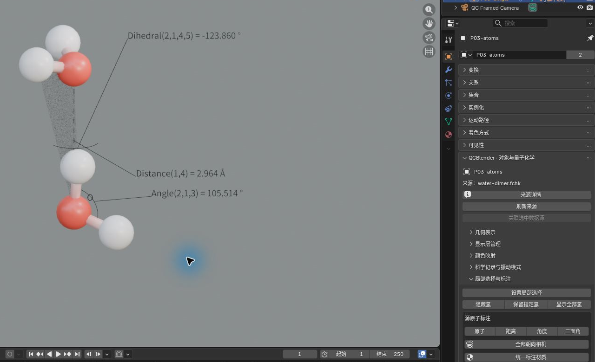
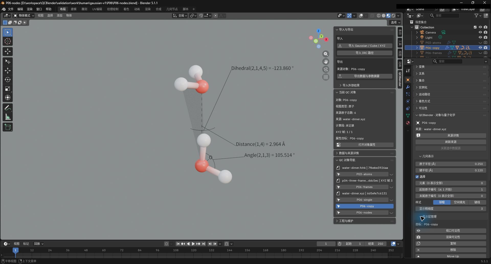
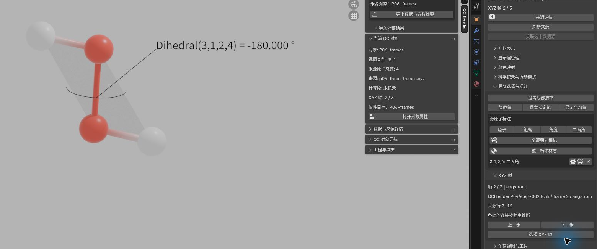

# 分子显示与 XYZ

[返回教程目录](../SOP.md#topics)

## 目录

- [分子与标注](#atoms)
  - [1. 导入水二聚体并命名原子层](#step-01)
  - [2. 切换分子样式并调整半径](#step-02)
  - [3. 练习氢的显隐](#step-03)
  - [4. 逐步设置局部选择范围](#step-04)
  - [5. 创建原子编号与几何测量标注](#step-05)
- [显示层](#layers)
  - [6. 创建局部显示层](#step-06)
  - [7. 复制显示层并比较独立参数](#step-07)
  - [8. 复制显示参数并创建当前版本视图](#step-08)
- [关联与多帧](#frames)
  - [9. 关联 XYZ 与 FCHK 数据源](#step-09)
  - [10. 导入并切换多帧 XYZ](#step-10)
  - [11. 观察随帧更新的二面角](#step-11)

路径相对材料根目录。已完成[插件安装](../SOP.md#install)；按[准备新工程](../SOP.md#new-scene)创建场景，再开始本页操作。

本页截图使用案例 `P06-` 前缀。

> XYZ 文件保存原子元素与坐标。本教程的坐标单位是 Å，1 Å = 0.1 nm；源原子编号从 1 开始。

## 分子与标注

### 1. 导入水二聚体并命名原子层

点击 **N 侧栏 → 工作流（Workflow） → 导入（Import） → 导入 Gaussian / Cube / XYZ（Import Gaussian / Cube / XYZ）**，选择 [shared/data/public/P06/water-dimer.xyz](../../shared/data/public/P06/water-dimer.xyz)。选中导入的原子对象，按 `F2` 命名为 **P06-single**。应出现两个水分子，共 **6 个原子，顺序 O/H/H/O/H/H**。切到 **材质预览（Material Preview）**。

### 2. 切换分子样式并调整半径

> 几何表示中的样式决定分子怎样画出来。显示键根据原子距离推断；改变样式只改变显示方式。

- **球棍（Ball and Stick）**：用球表示原子、棍表示键，适合同时查看原子位置和连接关系。**原子半径（Atom Radius）** 调整原子球半径，**键半径（Bond Radius）** 调整键的粗细。
- **空间填充（Space Filling）**：按各元素的范德华半径画球，适合观察分子占据的空间与外形；**范德华半径缩放（VDW Scale）** 调整这些球的整体大小比例。
- **键线（Bonds）**：只显示键，适合减少原子球遮挡、查看连接关系；**键半径（Bond Radius）** 调整键的粗细。

> 范德华半径是表示原子空间大小的一种参考半径。

保持 **P06-single** 活动，点击 **N 侧栏 → 工作流（Workflow） → 对象属性与显示参数（Object Properties and Display Parameters）**。在 **几何表示（Geometry Representation） → 样式（Style）** 依次选择 **球棍（Ball and Stick）、空间填充（Space Filling）、键线（Bonds）**，应看到三种表示。回到球棍，将 **原子半径（Atom Radius）** 设为 **0.35 Å**、**键半径（Bond Radius）** 设为 **0.12 Å**，球和键应变粗。

### 3. 练习氢的显隐

在 **对象属性（Object Properties） → 局部选择与标注（Local Selection and Annotations）** 调整氢的可见性。这组按钮适合在简化分子外形的同时，保留需要观察的氢：

- **隐藏氢（Hide Hydrogen）**：隐藏全部氢，只查看其他元素。
- **保留指定氢（Keep Specified Hydrogen）**：显示输入编号对应的氢，隐藏其他氢；其他元素仍可见。**氢原子编号（从1开始）（Hydrogen atom numbers (1-based)）** 填源文件中的氢原子编号。
- **显示全部氢（Show All Hydrogen）**：恢复全部氢的可见性。

先点击 **隐藏氢（Hide Hydrogen）**，应只剩氧 1、4；点击 **保留指定氢（Keep Specified Hydrogen）**，在弹窗的 **氢原子编号（从1开始）（Hydrogen atom numbers (1-based)）** 输入 **2**，点击 **确定（OK）**，应显示 1、2、4；最后点击 **显示全部氢（Show All Hydrogen）**，恢复六个原子。

### 4. 逐步设置局部选择范围

> 局部选择用于限定当前原子显示层的显示范围，例如只查看一个水分子或某个原子附近的区域，不删除源文件中的原子。显示范围更新方式（Display Range Update Mode）决定怎样修改这个范围：先根据本次输入找出一组原子，再用所选模式替换、扩大或缩小已有范围；反选、清除和重新计算则直接处理已有范围。第一次设置时通常使用替换（Replace）；尚未设置局部限制时，原范围视为全部原子。

- **替换（Replace）**：只保留本次选出的原子，适合重新指定要看的区域。
- **并集（Union）**：保留原范围，再加入本次选出的原子，适合逐步扩大范围。
- **交集（Intersect）**：只保留原范围和本次结果中共有的原子，适合进一步缩小范围。
- **差集（Difference）**：从原范围中移除本次选出的原子，适合排除某些原子或区域。
- **反选（Invert）**：改为选择源数据中原范围以外的所有原子，无需输入编号。
- **清除限制（Clear）**：取消局部范围限制；也可直接点击面板中的 **清除局部限制（Clear Local Restriction）**。
- **重新计算（Recompute）**：用当前构型的坐标重新执行已保存的选择操作；切换 XYZ 帧、优化步或 IRC 步后，可点击面板中的 **按当前步重新计算（Recompute for Current Step）** 更新距离邻域。切换构型本身不会自动改变已选定的原子编号。

> 源原子编号（从1开始）（Source atom numbers (1-based)）填源文件中从 1 开始的原子编号，例如 `1,3,7-10`；隐藏部分原子后，编号仍保持不变。关闭纳入距离邻域（Include distance neighborhood）时，本次只选输入的原子；开启时，以输入的原子为搜索中心，这些中心称为“种子原子”，距任一种子不超过半径（Å）（Radius (Å)）的原子都会选入。包含种子原子（Include seed atoms）勾选时保留种子，取消勾选时排除所有输入的种子，只保留周围原子。距离按源数据中当前构型的 Å 坐标计算，不受 Blender 对象的移动和缩放影响。

保持 **P06-single** 活动，按下表从上到下演示局部范围的变化。每行都重新点击 **设置局部选择（Set Local Selection）**，选择对应 **显示范围更新方式（Display Range Update Mode）**，输入原子编号并调整邻域设置，再点击 **确定（OK）**；后一行接着使用前一行的结果。保持全部氢可见，观察分子形状和面板中的 **固定源编号（Fixed source numbers）**。

| 顺序与目的 | 显示范围更新方式（Display Range Update Mode） | 源原子编号（从1开始）（Source atom numbers (1-based)） | 邻域设置 | 应看到的结果 |
| --- | --- | --- | --- | --- |
| A：指定一个完整水分子 | 替换（Replace） | `1` | 开启纳入距离邻域（Include distance neighborhood）；半径（Å）（Radius (Å)）=`1.0 Å`；勾选包含种子原子（Include seed atoms） | 原子 `1,2,3`：第一个水分子的氧和两个氢。编号 1 是搜索中心，2、3 在其 1.0 Å 内。 |
| B：向已有范围添加一个原子 | 并集（Union） | `4` | 关闭纳入距离邻域（Include distance neighborhood） | 原子 `1,2,3,4`：第一个水分子仍在，另加第二个水分子的氧。 |
| C：只保留两个范围共有的原子 | 交集（Intersect） | `1,4` | 保持邻域搜索关闭 | 原子 `1,4`：本次输入的两个氧都在原范围内，因此保留；原范围中的氢 2、3 被排除。 |
| D：从已有范围减去一个原子 | 差集（Difference） | `1` | 保持邻域搜索关闭 | 原子 `4`：从两个氧中移除氧 1，只剩氧 4。 |
| E：查看范围以外的原子 | 反选（Invert） | 无需填写 | 无需设置 | 原子 `1,2,3,5,6`：选中六个原子中除氧 4 以外的全部原子。 |

完成后点击 **清除局部限制（Clear Local Restriction）**，应恢复两个完整水分子，共六个原子，再继续创建标注。清除只解除局部限制；氢显隐等其他显示设置仍然生效。

### 5. 创建原子编号与几何测量标注

> 标注由文字、可选引线和测量几何组成。引线把文字连到标注位置；距离虚线和角度圆弧表达所测的几何关系。小数位数（Decimal places）控制显示精度；偏移（Offset）只移动文字，不改变原子位置或测量值。

> 二面角描述两组三原子平面的相对转角。按输入顺序，第二、第三个原子确定转轴；圆弧的圆心位于这两个原子的中点，圆弧平面垂直于转轴。两个半透明三角面分别连接输入的第 1–2–3 和第 2–3–4 个原子，帮助辨认测量的两个平面。

保持 **P06-single** 活动，在 **N 侧栏 → 创建视图与检查工具（Create Views and Inspection Tools） → 原子与几何标注（Atom and Geometry Annotations）** 依次点击下表四个按钮。每次填入对应的 **源原子编号（Source atom numbers）**，将 **前缀模式（Prefix mode）** 保持为 **默认（Default）**；后三种测量标注的 **小数位数（Decimal places）** 设为 **3**，勾选 **显示测量几何（Show measurement geometry）**，然后点击 **确定（OK）**。创建窗口的 **颜色（Color）** 默认为黑色，也可在创建时选择其他颜色。新标注的文字、引线、虚线或圆弧采用 **金属度（Metallic）=1** 的材质；二面角三角面使用另一份初始同色、金属度为 0、**Alpha=0.2** 的材质。

| 按钮 | 源原子编号（Source atom numbers） | 应看到的内容 |
| --- | --- | --- |
| 原子编号（Atom numbers） | 1 | `Atom: O1`，文字可用引线指向氧 1 |
| 距离（Distance） | 1,4 | `Distance(1,4) = 2.900 Å`，两氧之间出现虚线 |
| 角度（Angle） | 2,1,3 | `Angle(2,1,3) = 112.770 °`，以氧 1 为圆心画内角圆弧 |
| 二面角（Dihedral） | 2,1,4,5 | `Dihedral(2,1,4,5) = 0.000 °`，圆弧位于氧 1 与氧 4 的中点，两个三角面对应 H2–O1–O4 与 O1–O4–H5 |

距离虚线的实线段与间隔长度为 1:1，两端对称，节距自动均匀分配，不需填写单独的虚线长度。**测量线直径（场景局部单位）（Measurement diameter (local scene units)）** 独立于 **引线直径（场景局部单位）（Leader diameter (local scene units)）**，默认 **0.01**。对角度和二面角，这个测量线直径控制圆弧粗细；**圆弧半径（场景局部单位）（Arc radius (local scene units)）** 默认 **0.5**。这些尺寸可在创建和后续设置中调整，使用原子视图的局部场景单位，用于安排显示大小；测量文字的 Å 或 ° 来自源构型。角度圆弧位于两条角臂的内角范围；二面角圆弧保留有符号角的方向。

标注若重叠，选回 **P06-single**，点击 **对象属性与显示参数（Object Properties and Display Parameters）**，在 **对象属性（Object Properties） → 局部选择与标注（Local Selection and Annotations） → 源原子标注（Source Atom Annotations）** 找到对应原子编号的行，点击设置图标，修改 **偏移（Offset）** 后点击 **确定（OK）**。**显示引线（Show leader）**、**显示测量几何（Show measurement geometry）** 和 **显示二面角三角面（Show dihedral planes）** 分别控制文字引线、虚线或圆弧、两个三角面；关闭整条标注的 **可见（Visible）** 会隐藏它的所有部件。旋转视角，确认六原子球棍、读数、单位和相应测量几何可见。截图保存为 `human/screenshots/P06-annotations.png`。

默认前缀固定使用上述 `Atom: `、`Distance(...) = `、`Angle(...) = `、`Dihedral(...) = ` 格式，不随界面语言切换。需要自己的说明文字时，在设置中将 **前缀模式（Prefix mode）** 改为 **自定义（Custom）**，例如将距离标注的 **前缀（Prefix）** 填为 `氧间距：`，应显示 `氧间距：2.900 Å`。自定义内容整体替换默认前缀；中文、空串和输入的空格均原样保留，后面仍追加实际的原子符号及编号，或测量值及单位。练习后改回 **默认（Default）**，方便继续对照本页。

后续改颜色和材质时，直接使用 Blender 的材质节点。先在大纲视图（Outliner）展开 **P06-single** 并选中目标标注的文字对象，切到 **着色（Shading）** 工作区，在 **着色器编辑器（Shader Editor）** 中编辑其 **QC annotation material**：例如修改 **原理化 BSDF（Principled BSDF） → 基础色（Base Color）**。同一条标注的文字、引线、虚线或圆弧共享这份材质，会一起换色；不同条标注各用独立材质。二面角三角面使用另一份共享材质，需要改面颜色或透明度时选中对应三角面对象再编辑。标注设置窗口不再提供后期颜色控件，编辑布局、切换构型或更新标注均保留手工节点设置。可以先把距离文字改成红色，再回到标注设置中调整偏移，确认文字与虚线仍为红色；练习后在材质节点中恢复黑色。

已有工程的标注不会在打开时自动统一材质。要让旧标注的文字、引线与测量几何采用上述组内共享方式，先选中所属的原子显示层，打开 **对象属性（Object Properties） → 局部选择与标注（Local Selection and Annotations） → 源原子标注（Source Atom Annotations） → 统一标注材质（Unify Annotation Materials）**，查看预览的待处理标注数量，再确认。它以每条标注当前的文字材质为基准建立独立副本，并让该条的文字、引线和测量线共享；二面角三角面另用一份材质。旧材质及其节点保留为可随工程保存的备份，不会被删除；需要取消本次统一时可使用 **编辑（Edit） → 撤销（Undo）**。仅修改旧标注的布局或首次补齐测量部件，不会自动统一其材质。完成后按共同方法保存工程，保留新设置和旧材质备份。

需要文字正对渲染相机时，先按[共同取景方法](../SOP.md#render)为当前案例设置活动相机。选回 **P06-single**，打开源原子标注面板，点击 **全部朝向相机（Face All to Camera）** 可旋转本层全部标注文字；各行的相机图标只处理该行文字。可先点一行的相机图标，再点击全部朝向，确认该层其他文字也转向相机。操作只转动文字，虚线、圆弧、三角面和源构型保持原位，其他原子显示层也不受影响。未设置活动相机时先创建相机，再执行朝向操作。

标注会随 XYZ 帧、优化步或 IRC 步读取当前源构型并更新测量几何；对象移动、缩放和振动演示位移不改变科学测量值。两原子重合时，距离仍可显示为零，零长虚线隐藏；0° 角的零长圆弧隐藏，180° 角仍有圆弧。构型无法定义角度或二面角时，文字显示 `undefined`（未定义）及原因，无效测量几何隐藏，不保留上一帧的图形。保存、重新打开和归档仍按[共同保存方法](../SOP.md#save)保留 `.blend` 与同名 `.qcdata/`。

## 显示层

> 显示层（Display Layers）是显示层列表；显示层是同一科学数据的一种展示。创建额外显示层后，可以单独调整其参数和可见性。

- **创建局部显示层（Create Local Display Layer）**：新建只显示选定原子的层，适合突出一个分子片段，同时保留完整分子的原层。
- **复制（Duplicate）**：复制当前层及其显示参数，适合并排或交替比较不同效果；副本的材质和几何参数可以单独调整。
- **创建当前版本视图（Create Current-Version View）**：从科学数据新建使用当前插件版本的显示层，适合重新建立视图；原有显示层仍保留。

### 6. 创建局部显示层

选 **P06-single**，点击 **N 侧栏 → 创建视图与检查工具（Create Views and Inspection Tools） → 显示视图（Display Views） → 创建局部显示层（Create Local Display Layer）**，在 **源原子编号（从1开始）（Source atom numbers (1-based)）** 输入 **1,4**，关闭 **纳入距离邻域（Include distance neighborhood）**，点击 **确定（OK）**。新层成为活动对象，名称为 **P06-single / Local Selection**，只显示两个氧；原层保留六个原子。在 **显示层（Display Layers）** 关闭原层的眼睛图标，便于观察新层；看完后恢复原层、隐藏局部层。

### 7. 复制显示层并比较独立参数

在 **显示层（Display Layers）** 点击 **P06-single** 行最左侧的选择图标，点击 **复制（Duplicate）**。新副本成为活动对象，按 `F2` 命名为 **P06-copy**，重新点击 **对象属性与显示参数（Object Properties and Display Parameters）**，将 **原子半径（Atom Radius）** 改为 **0.25 Å**。用眼睛图标交替只显示原层或副本，应看到它们的半径分别为 **0.35/0.25 Å**。本层标注及其测量部件也随之复制，副本采用独立数据和材质；副本内同一条标注仍共享自己的材质，修改副本配色不会改原层标注。副本行的相机图标控制是否参与渲染，上下箭头调整列表顺序。截图保存为 `human/screenshots/P06-layers.png`。

### 8. 复制显示参数并创建当前版本视图

> 多选时最后选中的是活动对象；这里由活动对象提供要复制的参数。显示层（Display Layers）的选择图标只选一层并显示它，多选使用大纲视图（Outliner）。

**复制显示参数到选中视图（Copy Display Parameters to Selected Views）** 用于让同类视图采用一致的显示设置。对话框按用途分成三组，可只勾选需要同步的部分：

- **几何表示（Geometry Representation）**：复制样式、球或键的半径等外形设置；本例用它统一两层的原子球大小。
- **外观（Appearance）**：复制材质、颜色、透明度及图例显隐等显示设置。
- **数值设置（Numeric Settings）**：复制等值阈值、颜色数值范围等设置；涉及场时，需要相容的物理量与单位。

先用眼睛图标显示 **P06-copy** 和 **P06-single**。在大纲视图（Outliner）单击 **P06-copy**，再按住 `Ctrl` 单击 **P06-single**，使这两层同时选中、原层为活动对象。将鼠标移入 **3D 视图（3D Viewport）**，打开 **物体（Object） → QCBlender → 复制显示参数到选中视图（Copy Display Parameters to Selected Views）**，只勾 **几何表示（Geometry Representation）** 并点击 **确定（OK）**。选回 **P06-copy**，打开它的对象属性，半径应变为 **0.35 Å**。在 **显示层（Display Layers） → 移除（Remove）** 删除副本；原层应仍在。选回 **P06-single**，点击 **创建视图与检查工具（Create Views and Inspection Tools） → 显示视图（Display Views） → 创建当前版本视图（Create Current-Version View）**，应新建一个显示层；观察后在列表隐藏新层，保留 **P06-single** 可见。

## 关联与多帧

### 9. 关联 XYZ 与 FCHK 数据源

> 数据源关联用于确认两份文件能否作为同一原子顺序和构型的数据一起使用。关联后，每份文件仍保留自己的计算信息。

- **最大原子偏差（Å）（Maximum atom deviation (angstrom)）**：对应原子允许的最大距离偏差；本例保持 **0.001 Å**，用于核对 XYZ 与 FCHK 的坐标是否一致。
- **对齐刚体旋转与平移（Align rigid rotation/translation）**：关闭时直接比较原坐标；开启时允许先整体旋转和平移再比较，适合同一构型以不同朝向或位置保存的情况。整体对齐不改变分子内部构型。

通过 **导入 Gaussian / Cube / XYZ（Import Gaussian / Cube / XYZ）** 导入 [shared/data/public/P03/water-dimer.fchk](../../shared/data/public/P03/water-dimer.fchk)，将新原子对象命名为 **P03-atoms**。在大纲视图（Outliner）单击 **P06-single**，再按住 `Ctrl` 单击 **P03-atoms**，只选这两层，并使 **P03-atoms** 活动。点击 **对象属性与显示参数（Object Properties and Display Parameters） → 关联选中数据源（Associate Selected Sources）**，保持 **最大原子偏差（Å）（Maximum atom deviation (angstrom)）=0.001**、关闭 **对齐刚体旋转与平移（Align rigid rotation/translation）**，点击 **确定（OK）**。应提示原子顺序和构型匹配。在 **显示层（Display Layers）** 隐藏本页已有的全部原子层，方便继续看多帧。

### 10. 导入并切换多帧 XYZ

> XYZ 帧是同一原子顺序的一组坐标，下一步（Next）/上一步（Previous）逐帧切换；来源行（Source lines）标示该帧在原文件中的行区间。帧序本身不提供物理时间。

导入 [shared/data/public/P06/p04-three-frames.xyz](../../shared/data/public/P06/p04-three-frames.xyz)，选中新原子对象，命名为 **P06-frames**。点击 **对象属性与显示参数（Object Properties and Display Parameters）**，在 **XYZ 帧（XYZ Frames）** 点击 **下一步（Next） → 下一步（Next） → 上一步（Previous）**，应按 **1→2→3→2** 切换；每帧都是 **O/O/H/H** 四个原子。展开原注释与 **来源行（Source lines）** 可看到当前帧来源。

### 11. 观察随帧更新的二面角

保持 **P06-frames** 活动，点击 **创建视图与检查工具（Create Views and Inspection Tools） → 原子与几何标注（Atom and Geometry Annotations） → 二面角（Dihedral）**，填 **源原子编号（Source atom numbers）=3,1,2,4**、**小数位数（Decimal places）=3**，保持默认前缀和测量几何可见，点击 **确定（OK）**。当前已在第 2 帧，先点击 **上一步（Previous）** 回第 1 帧，再点击 **下一步（Next） → 下一步（Next）** 观察三帧；应依次看到约 **171.761°、−180.000°、−171.761°**，文字读数、圆弧和三角面随当前构型更新。当前帧号在 **XYZ 帧（XYZ Frames）** 面板核对，来源构型保留在科学记录中，不额外拼入默认标注文字。最后点击 **上一步（Previous）** 回第 2 帧。截图保存为 `human/screenshots/P06-xyz-frames.png`。

