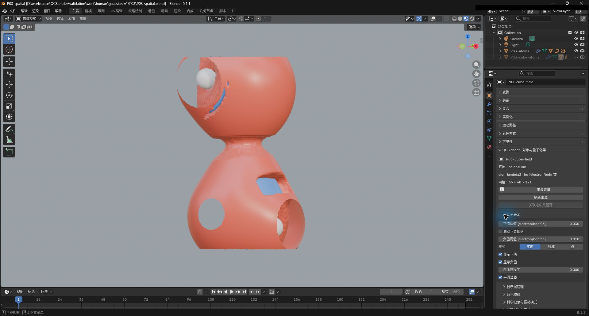
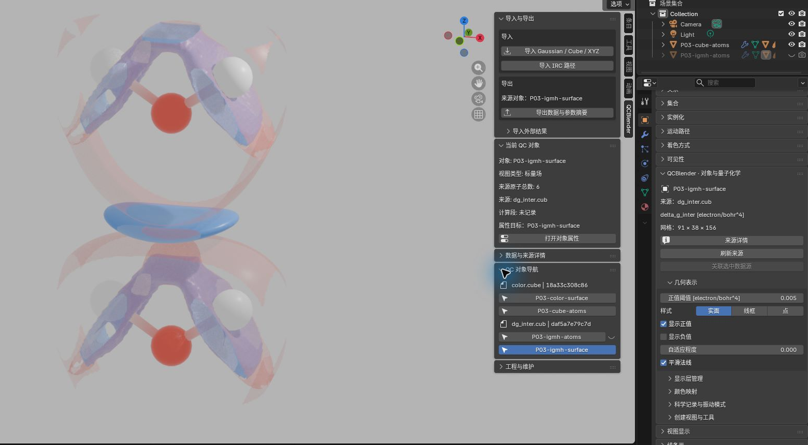

# Cube 场与多场叠加

[返回教程目录](../SOP.md#topics) · [单场与双符号](#single) · [多 Cube 叠加](#overlay) · [跨场着色](#mapping)

路径相对材料根目录。本专题从 **File → New → General** 开始，在 Outliner 删除默认 Cube。

本页截图使用案例 `P03-` 前缀。

> Cube 保存规则网格上的场值；标量场在每个网格点有一个数值。网格尺寸的三个数分别表示三个轴的采样点数。Other externally computed scalar field 表示这是外部计算的场，Physical quantity 填它的量名，Unit 填原数值的单位；声明操作不会换算数值。

## 单场与双符号

> `sign_lambda2_rho` 是外部分析生成的带符号电子密度，用于给相互作用区域着色；electron/bohr^3 表示每立方 bohr 的电子数。本例直接使用样本的原始数值。

1. 点击 **N 侧栏 → 工作流 → 导入 Gaussian / Cube / XYZ**，选择 [shared/data/public/P03/color.cube](../../shared/data/public/P03/color.cube)。选中导入的场表面，按 `F2` 命名为 **P03-color-surface**。在 **对象属性 → 声明 Cube 物理量与单位** 中选择 **Other externally computed scalar field**，填 **Physical quantity=sign_lambda2_rho**、**Unit (use unknown if unavailable)=electron/bohr^3**，确认。应看到六原子水二聚体，对象属性应显示 **91×38×156 网格**与上述量、单位。

> 负值阈值填写负侧等值的绝对大小。Link Thresholds 让负侧沿用正侧阈值的大小；取消后可分别设置，显示正值、显示负值分别控制两侧表面是否可见。

2. 在 **对象属性 → 几何表示** 开启 **显示正值、显示负值**，取消 **Link Thresholds**，设 **正值阈值=0.03、负值阈值=0.01**。在 **Material Preview** 中应看到两种符号的表面；分别关开正值、负值开关，确认对应部分能够独立显隐。截图保存为 `human/screenshots/P03-cube.png`。

> 实面显示连续表面，线框显示表面的网格边，点显示表面的网格顶点。Positive/Negative Opacity 分别控制正、负表面的不透明度，值越小越透明。

3. 将 **样式** 依次切换为 **实面、线框、点**，应看到表面表示改变，最后恢复实面。在 **Properties → Material → QCBlender · 节点材质** 设 **Positive Opacity=0.6、Negative Opacity=0.3**，两种表面应有不同透明度。

## 多 Cube 叠加

> `delta_g_inter` 是该样本的片段间密度梯度差，单位 electron/bohr^4 比密度单位多除以一个长度单位。这里两份 Cube 来自同一水二聚体构型，原子顺序均为 O/H/H/O/H/H；两种场各自保留物理量和单位。

4. 再导入 [shared/data/public/P03/igmh/dg_inter.cub](../../shared/data/public/P03/igmh/dg_inter.cub)。选中新场表面，命名为 **P03-igmh-surface**，使用同一声明按钮，选择 **Other externally computed scalar field**，填写 **Physical quantity=delta_g_inter、Unit (use unknown if unavailable)=electron/bohr^4**。确认后，设 **正值阈值=0.005**，只开启 **显示正值**。

5. 在 **N 侧栏 → Display Layers** 保持 **P03-color-surface** 与 **P03-igmh-surface** 的眼睛、相机图标开启，只保留一份原子层可见。将 **P03-color-surface** 的正值阈值暂改为 **0.02**，再选 **P03-igmh-surface**，它的阈值应仍为 **0.005**；将后者暂改为 **0.008**，前者仍应为 **0.02**。最后分别恢复 **0.03 / 0.005**。换对象后，若对象属性仍固定上一层，点击 **N 侧栏 → 工作流 → 对象属性与显示参数** 更新它。

6. 分别关闭、再开启两层的眼睛图标，应只切换对应表面的视口可见性；相机图标控制该层是否参与渲染。最后让两层都可见，转到能分辨两个表面的角度。截图保存为 `human/screenshots/P03-cube-overlay.png`。

在材料根目录创建 `work/human/P03/`，按[保存自包含工程](../SOP.md#save)保存为 `work/human/P03/P03-overlay.blend`，连同 `work/human/P03/P03-overlay.qcdata/` 一起保留。需要移动时，创建 `work/human/移动案例/`，将两者一起复制到该目录，重新打开其中的 `P03-overlay.blend`，两层应保留各自阈值与可见性。

## 用另一个场着色

> 几何场决定表面在哪里，着色场决定表面上各点的颜色。隐藏独立着色场表面后，其科学数据仍用于映射，图例采用着色场的单位。

> Color Minimum/Maximum 指定色带两端对应的数值，Color Center 指定中点对应的数值；范围外的有效值使用端点颜色，不会从科学数据中删去。

7. 选 **P03-igmh-surface**，点击 **对象属性 → 颜色映射 → 选择／替换着色场**，选择步骤 1 的 **P03-color-surface**，填 **Color minimum=−0.05、Color maximum=0.05**。在 **Display Layers** 关闭 **P03-color-surface** 的眼睛和相机图标，保留新映射表面及一份原子层。应看到 `delta_g_inter` 表面按 `sign_lambda2_rho` 场着色；开启 **图例排版 → 显示图例**，图例单位应为 **electron/bohr^3**。

需要更换配色时，接着使用[色带预设](03-density-esp.md#presets)；本专题保持 **Color Minimum=−0.05、Color Center=0、Color Maximum=0.05**，单位仍为 **electron/bohr^3**。
