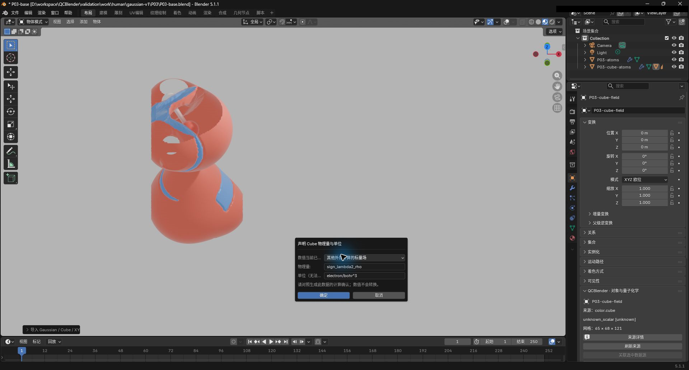
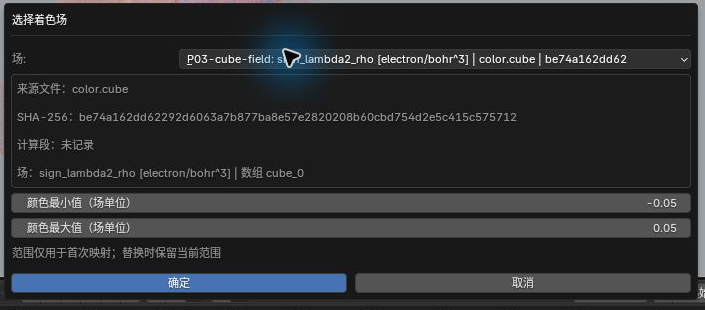
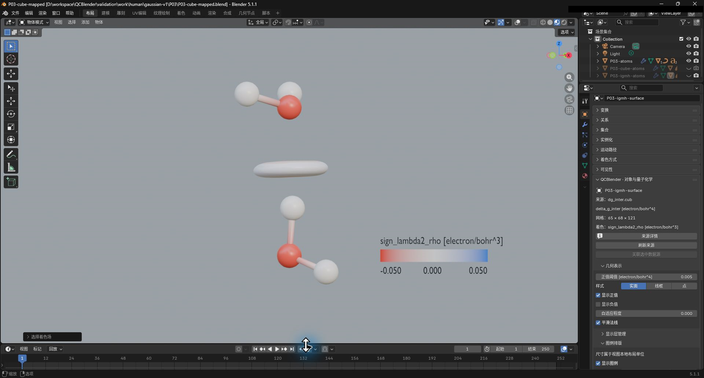

# 02. Cube 场与多场叠加

[返回教程目录](../SOP.md#topics)

## 目录

- [单场与双符号](#single)
  - [1. 导入 Cube 并声明物理量与单位](#step-01)
  - [2. 分别设置正负表面的阈值与显隐](#step-02)
  - [3. 切换表面样式并调整透明度](#step-03)
- [多 Cube 叠加](#overlay)
  - [4. 导入第二个 Cube 并设置等值表面](#step-04)
  - [5. 保留一份原子层并核对两场的独立阈值](#step-05)
  - [6. 观察叠加表面并保存工程](#step-06)
- [用另一个场着色](#mapping)
  - [7. 选择着色场并显示图例](#step-07)
- [附录：参数、原理与输入规范](#appendix)
  - [A1. 了解 Cube 物理量、自旋与单位声明](#appendix-step-01)
  - [A2. 了解正负阈值、联动与显隐](#appendix-step-02)
  - [A3. 了解实面、线框、点与不透明度](#appendix-step-03)
  - [A4. 了解片段间 delta-g 场与单位](#appendix-step-04)
  - [A5. 了解几何场、着色场与色带范围](#appendix-step-07)

路径均相对教程材料根目录（同时含 `human/` 和 `shared/`）。先完成[安装](../SOP.md#install)，按[准备新工程](../SOP.md#new-scene)开始；每次换对象后重新打开其对象属性。

---

## 单场与双符号

### 1. 导入 Cube 并声明物理量与单位

先核对 Cube 的生成条件；物理量和单位声明只记录已有数值的含义，不执行单位换算。

详细说明见[附录 A1：了解 Cube 物理量、自旋与单位声明](#appendix-step-01)。

1. 点击 **N 侧栏 → 导入与导出 → 导入 → 导入 Gaussian / Cube / XYZ**。
2. 选择文件 `shared/data/public/gaussian-v2/P03/color.cube` 并导入。
3. 选中新生成的场表面对象，按 `F2` 命名为 **P03-cube-field**。
4. 点击 **打开对象属性**，在属性面板中点击 **声明 Cube 物理量与单位（Identify Cube Quantity and Unit）**。
5. 配置声明参数：
   - **类别**：其他外部计算的标量场（Other externally computed scalar field）
   - **物理量（Physical quantity）**：`sign_lambda2_rho`
   - **单位**：`electron/bohr^3`
6. 点击 **确定（OK）**，确认对象属性中显示 **65×68×121 网格** 及上述量与单位。截图保存至 `human/screenshots/P03-cube-quantity-dialog.png`。

### 2. 分别设置正负表面的阈值与显隐

详细说明见[附录 A2：了解正负阈值、联动与显隐](#appendix-step-02)。

1. 在 **对象属性 → 几何表示** 面板中设置参数：
   - **显示正值（Show Positive Values）**：开启
   - **显示负值（Show Negative Values）**：开启
   - **联动正负阈值（Link Thresholds）**：关闭
   - **正值阈值（Positive Isovalue）**：`0.03`
   - **负值阈值（Negative Isovalue）**：`0.01`
2. 视口切换至 **材质预览（Material Preview）**，交替开关正负显示，确认两符号表面可独立显隐。截图保存至 `human/screenshots/P03-cube.png`。

### 3. 切换表面样式并调整透明度

详细说明见[附录 A3：了解实面、线框、点与不透明度](#appendix-step-03)。

1. 在 **几何表示 → 样式（Style）** 下依次切换 **实面（Solid）**、**线框（Wireframe）**、**点（Points）**，观察表现差异后切回实面。
2. 进入右侧 **材质属性 → QCBlender · 节点材质**，调整不透明度参数：
   - **正值不透明度（Positive Opacity）**：`0.6`
   - **负值不透明度（Negative Opacity）**：`0.3`

---

## 多 Cube 叠加

### 4. 导入第二个 Cube 并设置等值表面

详细说明见[附录 A4：了解片段间 delta-g 场与单位](#appendix-step-04)。

1. 再次点击导入，选择文件 `shared/data/public/gaussian-v2/P03/igmh/dg_inter.cub`。
2. 选中新场表面命名为 **P03-igmh-surface**。
3. 点击 **声明 Cube 物理量与单位**，配置参数：
   - **类别**：其他外部计算的标量场
   - **物理量**：`delta_g_inter`
   - **单位**：`electron/bohr^4`
4. 确认后在 **几何表示** 中设置参数：
   - **显示正值**：开启
   - **显示负值**：关闭
   - **正值阈值**：`0.005`

### 5. 保留一份原子层并核对两场的独立阈值

1. 在大纲视图中隐藏 `dg_inter.cub` 自带的重复原子层，仅保留 `color.cube` 的原子层可见。
2. 在 **N 侧栏 → QC 对象导航** 中交替选中两个场对象，每次重新点击 **打开对象属性**，核对独立阈值：
   - **P03-cube-field**：正值阈值保持 `0.03`
   - **P03-igmh-surface**：正值阈值保持 `0.005`

### 6. 观察叠加表面并保存工程

1. 旋转视口角度，确认两个不同标量场曲面在同一分子骨架周围清晰叠加。
2. 截图保存至 `human/screenshots/P03-cube-overlay.png`。
3. 在 N 侧栏通过 **保存自包含工程** 将场景保存至 `work/human/gaussian-v1/P03/P03-overlay.blend`。

---

## 用另一个场着色

### 7. 选择着色场并显示图例

几何场决定表面位置，着色场决定颜色；两者须有相同构型和兼容网格。填完下列参数后点击 **确定** 应用绑定，再隐藏独立着色表面。

详细说明见[附录 A5：了解几何场、着色场与色带范围](#appendix-step-07)。

1. 选中 **P03-igmh-surface** 并打开对象属性。
2. 点击 **颜色映射 → 选择／替换着色场（Select / Replace Color Field）**。
3. 配置参数：
   - **场（Field）**：选择 `P03-cube-field`
   - **颜色最小值（Color minimum）**：`-0.05`
   - **颜色最大值（Color maximum）**：`0.05`
4. 截图保存至 `human/screenshots/P03-cube-color-binding.png`。

5. 在大纲视图中隐藏原 **P03-cube-field** 几何曲面。
6. 在 **P03-igmh-surface** 的对象属性中开启 **图例排版 → 显示图例（Show Legend）**。
7. 确认 `delta_g_inter` 表面成功按 `sign_lambda2_rho` 数值着色，且图例单位标明为 `electron/bohr^3`。截图保存至 `human/screenshots/P03-cube-mapped.png`。

---

## 附录：参数、原理与输入规范

### A1. 了解 Cube 物理量、自旋与单位声明

> Cube 保存规则网格上的场值；标量场在每个网格点有一个数值。网格尺寸的三个数分别表示三个轴的采样点数。

> `sign_lambda2_rho` 是外部分析生成的带符号电子密度，用于给相互作用区域着色；electron/bohr^3 表示每立方 bohr 的电子数。本例直接使用样本的原始数值。

**声明 Cube 物理量与单位（Identify Cube Quantity and Unit）** 用于告诉插件这些数值表示什么，供阈值、图例和后续分析使用。先根据生成 Cube 的计算确认量名与单位，再选择匹配的选项；声明操作不会换算数值。

> Alpha、Beta 是两个自旋通道；自旋密度在这里采用 Alpha 密度减去 Beta 密度的约定。轨道振幅表示轨道波函数的值，正负表示相位。

- **电子密度 [electron/bohr^3]（Electron density [electron/bohr^3]）**：用于电子总密度。
- **Alpha 减 Beta 自旋密度 [electron/bohr^3]（Alpha-minus-beta spin density [electron/bohr^3]）**：用于 Alpha 密度减去 Beta 密度的自旋密度。
- **静电势 [hartree/e]（ESP [hartree/e]）**：用于静电势。
- **轨道振幅 [bohr^-3/2]（Orbital amplitude [bohr^-3/2]）**：用于带正负相位的轨道振幅。
- **其他外部计算的标量场（Other externally computed scalar field）**：用于上面几项未涵盖的量。本例选择它，在 **物理量（Physical quantity）** 填量名，在 **单位（Unit）** 填原数值的单位；单位无法确认时填 `unknown`。

### A2. 了解正负阈值、联动与显隐

> 等值表面连接场值相同的位置。正、负阈值决定取哪一个场值画表面，单位沿用该场的单位；负值阈值（Negative Isovalue）填写绝对大小，例如填 `0.01` 表示取值为 `−0.01` 的表面。

- **显示正值（Show Positive Values）／显示负值（Show Negative Values）**：分别控制正侧和负侧表面是否可见，适合单独查看某一侧。
- **联动正负阈值（Link Thresholds）**：开启时，负侧沿用正侧阈值的大小，适合用相同绝对值比较两侧；取消后可分别设置两侧阈值。本例使用不同阈值，因此取消它。

### A3. 了解实面、线框、点与不透明度

> 样式决定等值表面怎样画出来；切换样式时仍使用同一场和阈值。

- **实面（Solid）**：显示连续表面，适合观察整体外形和颜色。
- **线框（Wireframe）**：显示表面的网格边，适合查看网格结构或减少遮挡；**线框半径（Wire Radius）** 调整线的粗细。
- **点（Points）**：显示表面的网格顶点，适合查看顶点分布；**点半径（Point Radius）** 调整点的大小。

> 正值不透明度（Positive Opacity）与负值不透明度（Negative Opacity）分别控制正、负表面的不透明度，值越小越透明；叠加场时可降低它们，让另一层表面更容易看见。

### A4. 了解片段间 delta-g 场与单位

> `delta_g_inter` 是该样本的片段间密度梯度差，单位 electron/bohr^4 比密度单位多除以一个长度单位。这里两份 Cube 来自同一水二聚体构型，原子顺序均为 O/H/H/O/H/H；两种场各自保留物理量和单位。

### A5. 了解几何场、着色场与色带范围

> 几何场（Geometry Field）决定表面在哪里，着色场决定表面上各点的颜色。隐藏独立着色场表面后，其科学数据仍用于映射，图例采用着色场的单位。

**选择／替换着色场（Select / Replace Color Field）** 的 **场（Field）** 用来选提供颜色数值的场。本例保留 `delta_g_inter` 的表面外形，选择 `sign_lambda2_rho` 判断表面不同位置的场值。首次建立映射时，对话框的 **颜色最小值（Color minimum） / 颜色最大值（Color maximum）** 设置颜色范围；之后替换着色场会保留现有范围，需要按新场的单位自行核对。

> 色带把场值映射为颜色。颜色最小值（Color Minimum） / 颜色最大值（Color Maximum）指定色带两端对应的数值，颜色中心值（Color Center）指定中点对应的数值；范围外的有效值使用端点颜色，不会从科学数据中删去。
