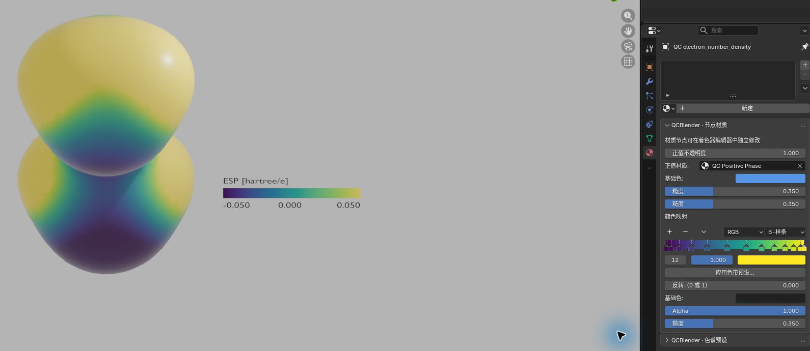
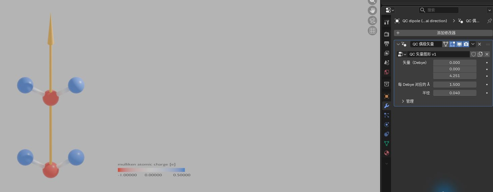
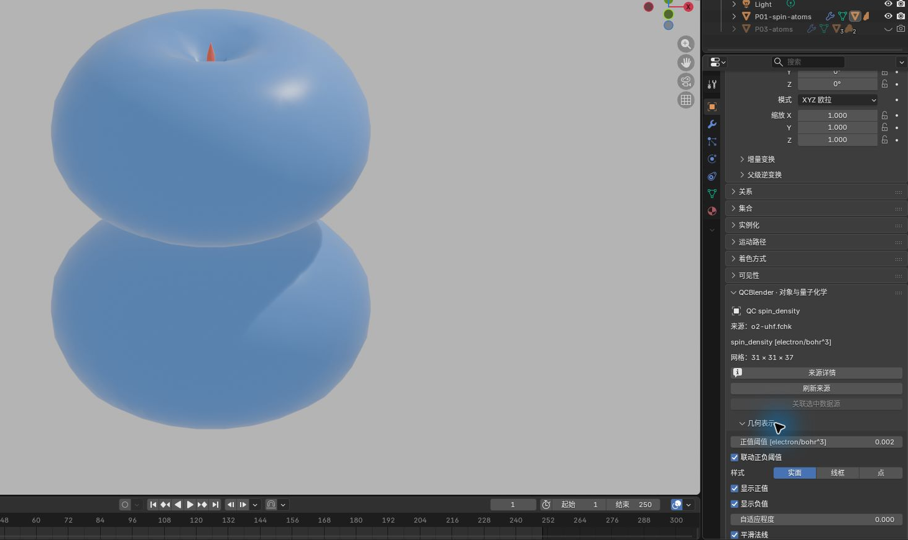

# 密度、ESP、电荷与偶极

[返回教程目录](../SOP.md#topics)

## 目录

- [密度表面按 ESP 着色](#mapping)
  - [1. 导入水二聚体并查看计算记录](#step-01)
  - [2. 生成电子密度场](#step-02)
  - [3. 生成静电势场](#step-03)
  - [4. 用 ESP 为密度表面着色](#step-04)
  - [5. 设置颜色范围与图例布局](#step-05)
- [应用色带预设](#presets)
  - [6. 应用 Viridis 色带预设](#step-06)
  - [7. 比较 Cividis 并练习撤销与重做](#step-07)
  - [8. 核对颜色反转与预设保留的参数](#step-08)
- [原子电荷与偶极](#charges)
  - [9. 按 Mulliken 电荷为原子着色](#step-09)
  - [10. 创建偶极箭头并调整显示长度](#step-10)
- [选择其他密度](#densities)
  - [11. 生成氧分子的非零自旋密度](#step-11)

路径相对材料根目录。按[准备新工程](../SOP.md#new-scene)创建场景。完成本页步骤 1–5 后，即可接着做[空间观察](04-spatial-tools.md)或[外部 ESP 与 AIM](06-esp-aim.md)，两页继续使用这里的 P03 对象。

本页水二聚体截图使用 `P03-` 前缀，氧分子自旋密度截图使用 `P01-` 前缀。

> 电子密度表示空间中电子数的分布。ESP 是静电势，描述单位正试探电荷在该位置的势能。

## 密度表面按 ESP 着色

### 1. 导入水二聚体并查看计算记录

> Eh（Hartree）是能量单位；RHF 是本例所用计算方法的名称，6-31G(d) 是基组名称，两者说明这份能量的计算条件。

点击 **N 侧栏 → 工作流（Workflow） → 导入 Gaussian / Cube / XYZ（Import Gaussian / Cube / XYZ）**，选择 [shared/data/public/P03/water-dimer.fchk](../../shared/data/public/P03/water-dimer.fchk)并完成导入。选中新原子对象，按 `F2` 命名为 **P03-atoms**。应有 **O/H/H/O/H/H** 六个原子；点击 **对象属性与显示参数（Object Properties and Display Parameters）**，在 **科学记录与振动模式（Scientific Records and Vibration Modes）** 查看电子总能量，应约为 **−152.013820 Eh**。本样本计算条件为 **RHF/6-31G(d)**。

### 2. 生成电子密度场

> electron/bohr^3 表示每立方 bohr 的电子数；hartree/e 表示每单位元电荷的势能，用于描述 ESP。网格和内存参数的用途见[主线参数表](../SOP.md#orbital)。

**生成量子化学场（Generate Quantum Field） → 物理量（Quantity）** 决定要从这份计算结果生成哪一种空间场。本节先生成两种场，分别用来确定表面外形和颜色：

> Alpha、Beta 是两个自旋通道。电子总密度是两通道密度之和，自旋密度在这里采用 Alpha 密度减去 Beta 密度的约定。

- **电子密度（Electron density）**：电子总密度，即 Alpha 与 Beta 两个自旋通道密度之和。用于画出分子周围的密度表面。
- **静电势（Electrostatic potential）**：包含核与电子贡献的静电势。本例用它为密度表面着色，观察同一表面上不同位置的 ESP。

其他密度选项的区别与自旋密度案例见本页[选择其他密度](#densities)；轨道选项 **分子轨道（Molecular orbital）** 见[主线轨道案例](../SOP.md#orbital)。

选 **P03-atoms**，点击 **工作流（Workflow） → 生成量子化学场（Generate Quantum Field）**。首次使用先等待自动检查，在生成对话框设 **物理量（Quantity）=电子密度（Electron density）**、**网格间距（Grid spacing）=0.2**、**网格边距（Grid margin）=3**、**内存预算（Memory budget）=512**，点击 **确定（OK）** 并等待完成。应生成 **QC electron_number_density**，单位为 **electron/bohr^3**。

### 3. 生成静电势场

在 **显示层（Display Layers）** 点击 **P03-atoms** 行最左侧的选择图标，用相同入口和网格参数生成 **物理量（Quantity）=静电势（Electrostatic potential）**，点击 **确定（OK）** 并等待完成。应生成 **QC electrostatic_potential**，单位为 **hartree/e**。

### 4. 用 ESP 为密度表面着色

> 这里用密度确定表面位置，用 ESP 确定颜色。隐藏独立 ESP 表面后，着色仍使用它的场数据。

**选择／替换着色场（Select / Replace Color Field） → 场（Field）** 选择提供颜色数值的场。首次建立映射时，**颜色最小值（Color minimum） / 颜色最大值（Color maximum）** 设置色带范围；以后替换着色场会保留现有范围，需要按新场的单位核对。本例选择 ESP，图例和颜色范围因此采用 **hartree/e**。

选 **QC electron_number_density**，重新点击 **对象属性与显示参数（Object Properties and Display Parameters）**，在 **几何表示（Geometry Representation）** 设 **正值阈值（Positive Isovalue）=0.004**。点击 **颜色映射（Color Mapping） → 选择／替换着色场（Select / Replace Color Field）**，在 **场（Field）** 选 **QC electrostatic_potential**，设 **颜色最小值（Color minimum）=−0.05、颜色最大值（Color maximum）=0.05** 并点击 **确定（OK）**。在 **显示层（Display Layers）** 关闭独立 **QC electrostatic_potential** 表面的眼睛和相机图标，保留映射后的密度表面与 **P03-atoms**。在 **材质预览（Material Preview）** 中，密度表面应出现随位置变化的颜色。

### 5. 设置颜色范围与图例布局

> 色带把数值范围映射为颜色。颜色范围决定哪些数值对应色带的低端、中点和高端，适合让不同视图使用同一尺度比较；范围外的有效值使用端点颜色。

- **颜色最小值（Color Minimum）**：色带低端对应的值，本例设为 **−0.05 hartree/e**。
- **颜色中心值（Color Center）**：色带中点对应的值，本例设为 **0 hartree/e**，将正负 ESP 分开放在中点两侧。
- **颜色最大值（Color Maximum）**：色带高端对应的值，本例设为 **0.05 hartree/e**。
- **反转（0 或 1）（Reverse (0 or 1)）**：`0` 使用当前颜色顺序，`1` 反转颜色顺序；适合调整配色方向，不改变 ESP 场值。

> 图例标出颜色对应的数值和单位。长度、宽度调整色条尺寸，字号调整文字大小；位置以当前视图对象为参考，尺寸和位置均使用视图局部布局单位。小数位数控制图例标签的显示精度。

保持密度表面活动，在 **颜色映射（Color Mapping）** 设 **颜色最小值（Color Minimum）=−0.05、颜色中心值（Color Center）=0、颜色最大值（Color Maximum）=0.05**。在 **图例排版（Legend Layout）** 开启 **显示图例（Show Legend）**，设 **图例长度（Legend Length）=2.6、图例宽度（Legend Width）=0.25、图例字号（Legend Text Size）=0.2、图例小数位数（Legend Decimals）=3、图例位置（Legend Position）=(3.5,0,0)**。转到能读清图例的视角；图例应显示 **hartree/e** 与上述范围。在 **属性（Properties） → 材质（Material） → QCBlender · 节点材质（QCBlender · Node Materials）** 把 **反转（0 或 1）（Reverse (0 or 1)）** 设为 **1**，表面和图例应一起反转颜色，再恢复 **0**。

## 应用色带预设

本节接续上面的密度/ESP 表面，也可在 [Cube 专题](02-cube.md#mapping)已完成着色的表面或已有标量着色的切片上操作。先选要改变配色的视图，保持它的图例可见。由其他专题跳到本节时，完成步骤 6–8 后返回原专题；继续本页步骤 9 则需要步骤 1–5 的 P03 工程。

### 6. 应用 Viridis 色带预设

**色带预设（Color Ramp Preset）** 提供一组颜色与插值设置，适合快速统一图的配色。物理量、单位和数值范围继续由当前视图决定。按当前图的阅读目的选择：

- **QC 默认（QC Default）**：低端红、中点白、高端蓝，适合在本例中区分零点两侧的正负 ESP。
- **Viridis**：从紫色经蓝绿色到黄色连续变化，适合观察数值由低到高的分布；零点的位置仍按图例读取。
- **Cividis**：从深蓝到黄色连续变化，也适合观察数值高低；可与 Viridis 比较，选择更容易辨认细节的一种。

上述颜色顺序以 **反转（Reverse）=0** 为准。本节先应用 Viridis，再比较 Cividis，并练习取消、撤销和重做。

打开 **属性（Properties） → 材质（Material） → QCBlender · 节点材质（QCBlender · Node Materials）**，在 **颜色映射（Color map）** 下点击 **应用色带预设…（Apply Color Ramp Preset…）**。查看对话框中的目标材质，将 **色带预设（Color Ramp Preset）** 选为 **Viridis**，点击 **确定（OK）**。表面与图例应一起换色；图例的量名、单位和数值范围保持原样。使用本页密度/ESP 案例时，截图保存为 `human/screenshots/P03-color-presets.png`。

### 7. 比较 Cividis 并练习撤销与重做

再次打开对话框，选择 **Cividis** 后点击 **取消（Cancel）**，应保留刚才的 Viridis；重新打开，选择 **Cividis** 并点击 **确定（OK）**。确认后可用 **编辑（Edit） → 撤销（Undo）** 恢复上一次色带，再用 **编辑（Edit） → 重做（Redo）** 重做。

### 8. 核对颜色反转与预设保留的参数

将 **反转（0 或 1）（Reverse (0 or 1)）** 设为 **1**，表面和图例应一起反转颜色。此时再次应用一个预设，反转值应仍为 **1**；最后恢复 **反转（Reverse）=0**。观察 **颜色最小值（Color Minimum） / 颜色中心值（Color Center） / 颜色最大值（Color Maximum）**、透明度和图例位置，应用预设后这些值应保持原样。

> 材质可以被多个视图共享。对话框中所列材质的所有使用者，以及使用它的图例，都会一起更新。需要独立配色时，先用 **N 侧栏 → 显示层（Display Layers） → 复制（Duplicate）** 创建展示副本，再选副本应用预设。

如果提示目标改变、材质只读或无法确认色带，先取消，重新选中可编辑的标准 QC 着色视图，再打开对话框。确认会替换当前的自定义色阶和插值；希望保留手工配色时可先复制显示层。

## 原子电荷与偶极

### 9. 按 Mulliken 电荷为原子着色

> Mulliken 电荷是按一种电子分配方法得到的原子部分电荷，单位 e 为元电荷。电荷最大值（Charge Maximum）设置色带高端对应的电荷值，不改变原子电荷数据。

**设置原子电荷着色（Set Atomic Charge Colors） → 电荷方法（Charge method）** 选择源文件中已有的原子电荷方法；列表随文件内容变化，操作不会重新计算另一种电荷。本例源文件提供 **Mulliken**，选它后可用原子颜色查看各原子的部分电荷。**最小值（e）（Minimum (e)）** 和 **最大值（e）（Maximum (e)）** 设置初始颜色范围，后续在 **颜色映射（Color Mapping）** 调整。

在 **显示层（Display Layers）** 暂时关闭密度表面的眼睛图标，点击 **P03-atoms** 行最左侧的选择图标。重新点击 **对象属性与显示参数（Object Properties and Display Parameters）**，在 **科学记录与振动模式（Scientific Records and Vibration Modes） → 设置原子电荷着色（Set Atomic Charge Colors）** 选 **Mulliken**，点击 **确定（OK）**。在 **图例排版（Legend Layout）** 开启 **显示图例（Show Legend）**；氧应显示为负电荷一侧的红色，氢为正电荷一侧的蓝色，图例单位为 **e**。在 **颜色映射（Color Mapping）** 将 **电荷最大值（Charge Maximum）** 改为 **0.5 e**，观察颜色范围变化。原子电荷也可按上面的 **应用色带预设…（Apply Color Ramp Preset…）** 更换配色；图例继续使用当前布居方法与 **e**，颜色对应关系以该图例为准。

### 10. 创建偶极箭头并调整显示长度

> 偶极矢量用大小和方向描述电荷分布；Debye 是偶极矩单位。修改器（Modifiers）是调节几何处理参数的修改器面板；每 Debye 的埃数（Angstrom per Debye）设置每 Debye 对应的箭头显示长度，单位为 Å，不改变源偶极矩。

保持 **P03-atoms** 活动，点击 **N 侧栏 → 创建视图与检查工具（Create Views and Inspection Tools） → 创建偶极矢量（Create Dipole Vector）**。在 **显示层（Display Layers）** 点击新对象 **QC dipole (Debye; physical direction)** 行最左侧的选择图标，重新点击 **对象属性与显示参数（Object Properties and Display Parameters）**，再切到 **属性（Properties） → 修改器（Modifiers）**。将 **每 Debye 的埃数（Angstrom per Debye）** 从 **0.5** 改为 **1.5**；箭头应沿 **+Z**，长度变为三倍。截图保存为 `human/screenshots/P03-charge-dipole.png`。

继续空间观察前，在 **显示层（Display Layers）** 关闭偶极层的眼睛、相机图标，恢复密度表面；独立 ESP 表面保持隐藏。

## 选择其他密度

### 11. 生成氧分子的非零自旋密度

当需要区分两个自旋通道，或观察它们的差异时，在 **生成量子化学场（Generate Quantum Field） → 物理量（Quantity）** 选择下面的密度，网格操作与步骤 2 相同。

> 闭壳层指电子成对占据空间轨道，本例水二聚体的两个通道相同。

- **Alpha 密度（Alpha density）**：只看 Alpha 自旋通道的电子密度，适合单独观察该通道的空间分布。
- **Beta 密度（Beta density）**：只看 Beta 自旋通道的电子密度，可与 Alpha 密度比较。
- **自旋密度（Spin density）**：Alpha 密度减去 Beta 密度，适合查看两个通道的差异；正值表示 Alpha 密度较大，负值表示 Beta 密度较大。

本页水二聚体是闭壳层，两个通道相同，自旋密度为零。下面改用开壳层氧分子生成非零自旋密度；完成后恢复水二聚体的显示，继续其他 P03 专题。

若要看非零自旋密度，在同一工程导入 [shared/data/public/P01/o2-uhf.fchk](../../shared/data/public/P01/o2-uhf.fchk)，选新氧分子原子对象，按 `F2` 命名为 **P01-spin-atoms**。生成 **物理量（Quantity）=自旋密度（Spin density）**，使用 **0.2 Å / 3 Å / 512 MiB**，点击 **确定（OK）** 并等待完成。选 **QC spin_density**，点击 **对象属性与显示参数（Object Properties and Display Parameters）**，设 **正值阈值（Positive Isovalue）=0.002 electron/bohr^3**。在 **显示层（Display Layers）** 暂时关闭 P03 分子和密度表面的眼睛图标，应看到氧分子周围的自旋密度。截图保存为 `human/screenshots/P01-spin-density.png`。

看完后关闭 **P01-spin-atoms** 和 **QC spin_density** 的眼睛、相机图标，恢复 **P03-atoms** 与按 ESP 着色的密度表面；独立 **QC electrostatic_potential** 表面和偶极层保持隐藏，便可继续 P03 专题。
