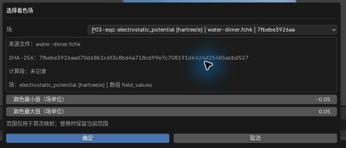
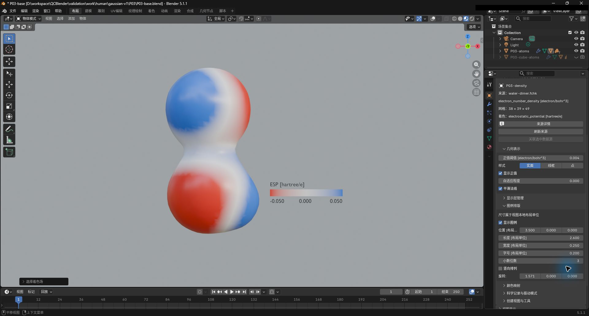

# 03. 密度、ESP、电荷与偶极

[返回教程目录](../SOP.md#topics)

## 目录

- [密度表面按 ESP 着色](#mapping)
  - [1. 导入水二聚体并查看计算记录](#step-01)
  - [2. 生成电子密度场](#step-02)
  - [3. 生成静电势场](#step-03)
  - [4. 用 ESP 为密度表面着色](#step-04)
  - [5. 设置颜色范围与图例布局](#step-05)
- [应用色带预设](#presets)
  - [6. 应用 Viridis 色带预设](#step-06)
  - [7. 比较 Cividis 并练习撤销与重做](#step-07)
  - [8. 核对颜色反转与预设保留的参数](#step-08)
- [原子电荷与偶极](#charges)
  - [9. 按 Mulliken 电荷为原子着色](#step-09)
  - [10. 创建偶极箭头并调整显示长度](#step-10)
- [选择其他密度](#densities)
  - [11. 生成氧分子的非零自旋密度](#step-11)
- [附录：参数、原理与输入规范](#appendix)
  - [A1. 了解电子密度、ESP、计算段与能量单位](#appendix-step-01)
  - [A2. 了解电子密度、ESP 与自旋通道](#appendix-step-02)
  - [A3. 了解密度几何与 ESP 着色](#appendix-step-04)
  - [A4. 了解颜色范围与图例布局](#appendix-step-05)
  - [A5. 比较 QC Default、Viridis 与 Cividis](#appendix-step-06)
  - [A6. 了解共享材质与图例同步](#appendix-step-08)
  - [A7. 了解 Mulliken 电荷与颜色范围](#appendix-step-09)
  - [A8. 了解偶极矩与显示长度](#appendix-step-10)
  - [A9. 了解 Alpha、Beta、自旋密度与闭壳层](#appendix-step-11)

路径均相对教程材料根目录（同时含 `human/` 和 `shared/`）。先完成[安装](../SOP.md#install)，按[准备新工程](../SOP.md#new-scene)开始；每次换对象后重新打开其对象属性。

---

## 密度表面按 ESP 着色

### 1. 导入水二聚体并查看计算记录

详细说明见[附录 A1：了解电子密度、ESP、计算段与能量单位](#appendix-step-01)。

1. 点击 **N 侧栏 → 导入与导出 → 导入 → 导入 Gaussian / Cube / XYZ**。
2. 选择文件 `shared/data/public/gaussian-v2/P03/water-dimer.fchk` 并完成导入。
3. 选中新原子对象，按 `F2` 命名为 **P03-atoms**（包含 6 个原子）。
4. 点击 **打开对象属性**，在 **科学记录与振动模式** 中确认电子总能量约为 `-152.027859 Eh`。

### 2. 生成电子密度场

详细说明见[附录 A2：了解电子密度、ESP 与自旋通道](#appendix-step-02)。

1. 选中 **P03-atoms**，在对象属性中点击 **创建视图与工具 → 计算 → 生成量子化学场**。
2. 配置参数：
   - **物理量（Quantity）**：电子密度（Electron density）
   - **网格间距（Grid spacing）**：`0.2 Å`
   - **网格边距（Grid margin）**：`3.0 Å`
   - **内存预算（Memory budget）**：`512 MiB`
3. 点击 **确定（OK）**，生成场对象并重命名为 **P03-density**。

### 3. 生成静电势场

1. 在 **N 侧栏 → QC 对象导航** 中切回 **P03-atoms** 并打开对象属性。
2. 再次点击 **生成量子化学场**，配置参数：
   - **物理量**：静电势（Electrostatic potential）
   - **网格间距**：`0.2 Å`
   - **网格边距**：`3.0 Å`
   - **内存预算**：`512 MiB`
3. 点击确定，生成场对象并重命名为 **P03-esp**（单位为 `hartree/e`）。

### 4. 用 ESP 为密度表面着色

详细说明见[附录 A3：了解密度几何与 ESP 着色](#appendix-step-04)。

1. 选中 **P03-density**，打开对象属性。
2. 在 **几何表示** 中设置参数：
   - **正值阈值（Positive Isovalue）**：`0.004`
3. 进入 **颜色映射 → 选择／替换着色场**，配置参数：
   - **场（Field）**：选择 `P03-esp`
   - **颜色最小值（Color minimum）**：`-0.05`
   - **颜色最大值（Color maximum）**：`0.05`
4. 点击确定，截图保存至 `human/screenshots/P03-density-esp-binding.png`。

5. 在大纲视图中隐藏独立的 **P03-esp** 表面，视口切至 **材质预览**，观察密度表面呈现位置相关的平滑渐变色。

### 5. 设置颜色范围与图例布局

详细说明见[附录 A4：了解颜色范围与图例布局](#appendix-step-05)。

1. 保持 **P03-density** 活动，在 **颜色映射** 中核对数值映射范围：
   - **颜色最小值**：`-0.05`
   - **颜色中心值**：`0`
   - **颜色最大值**：`0.05`
2. 展开 **图例排版（Legend Layout）**，配置图例参数：
   - **显示图例（Show Legend）**：开启
   - **长度（Length）**：`2.6`
   - **宽度（Width）**：`0.25`
   - **字号（Text Size）**：`0.2`
   - **小数位数（Decimal Places）**：`3`
   - **位置（Position）**：`(3.5, 0, 0)`
   - **旋转（Rotation）**：`(1.5707963, 0, 0)` 弧度
3. 按小键盘 `1` 切至前视图，核对表面与图例刻度。截图保存至 `human/screenshots/P03-legend-layout.png`。

4. 在 **材质属性 → QCBlender · 节点材质** 中测试将 **反转（0 或 1）** 设为 `1`，表面和图例颜色将同步翻转；测试完毕后改回 `0`。

---

## 应用色带预设

### 6. 应用 Viridis 色带预设

详细说明见[附录 A5：比较 QC Default、Viridis 与 Cividis](#appendix-step-06)。

1. 保持当前着色密度表面为活动对象。
2. 进入右侧 **材质属性 → QCBlender · 节点材质**。
3. 在 **颜色映射** 下点击 **应用色带预设…（Apply Color Ramp Preset…）**。
4. 在弹窗中选择参数：
   - **色带预设（Color Ramp Preset）**：`Viridis`
5. 点击 **确定（OK）**，表面与图例色彩同步更新。截图保存至 `human/screenshots/P03-color-presets.png`。

### 7. 比较 Cividis 并练习撤销与重做

1. 重新打开色带预设对话框，选择 `Cividis` 并点击确定。
2. 按 `Ctrl + Z`（撤销）恢复 Viridis，按 `Ctrl + Shift + Z`（重做）重新应用 Cividis。

### 8. 核对颜色反转与预设保留的参数

详细说明见[附录 A6：了解共享材质与图例同步](#appendix-step-08)。

1. 测试将 **反转（Reverse）** 设为 `1`，确认在 Cividis 预设下也能正确反转。
2. 测试完毕后恢复 **反转 = 0**。
3. 确认颜色范围（-0.05 至 +0.05）和图例位置在切换预设后保持完好。

---

## 原子电荷与偶极

### 9. 按 Mulliken 电荷为原子着色

详细说明见[附录 A7：了解 Mulliken 电荷与颜色范围](#appendix-step-09)。

1. 在大纲视图中隐藏密度表面，选中 **P03-atoms** 并打开对象属性。
2. 在 **科学记录与振动模式 → 设置原子电荷着色** 中选择：
   - **电荷类型**：`Mulliken`
3. 点击确定，在 **图例排版** 中开启 **显示图例**。
4. 调整 **颜色映射 → 电荷最大值** 为 `0.5 e`，观察氧显负电（红）、氢显正电（蓝）。

### 10. 创建偶极箭头并调整显示长度

详细说明见[附录 A8：了解偶极矩与显示长度](#appendix-step-10)。

1. 保持 **P03-atoms** 活动，点击 **创建视图与工具 → 空间工具 → 创建偶极矢量**。
2. 选中新生成的对象 **QC dipole**，进入右侧 **修改器属性**。
3. 调整参数：
   - **每 Debye 对应的 Å（Angstrom per Debye）**：从 `0.5` 改为 `1.5`
4. 确认箭头方向保持不变、长度放大至三倍。截图保存至 `human/screenshots/P03-charge-dipole.png`。

5. 隐藏偶极对象并关闭原子电荷图例，重新恢复密度表面可见。

---

## 选择其他密度

### 11. 生成氧分子的非零自旋密度

自旋密度采用 Alpha−Beta 约定；本页闭壳层水二聚体的自旋密度为零，因此改用开壳层氧分子。完成本步后隐藏氧分子及其场，恢复 P03 原子和密度表面、保持独立 ESP 表面隐藏，再继续其他 P03 专题。

详细说明见[附录 A9：了解 Alpha、Beta、自旋密度与闭壳层](#appendix-step-11)。

1. 在当前工程中导入开壳层样例 `shared/data/public/gaussian-v2/P01/o2-uhf.fchk`，原子对象命名为 **P01-spin-atoms**。
2. 选中 **P01-spin-atoms**，点击 **生成量子化学场**，配置参数：
   - **物理量**：自旋密度（Spin density）
   - **网格间距**：`0.2 Å`
   - **网格边距**：`3.0 Å`
   - **内存预算**：`512 MiB`
3. 确定后生成对象并重命名为 **P01-spin-density**。
4. 在 **几何表示** 中设置参数：
   - **正值阈值**：`0.002 electron/bohr^3`
5. 隐藏 P03 对象，观察氧分子周围的非零自旋密度曲面。截图保存至 `human/screenshots/P01-spin-density.png`。

---

## 附录：参数、原理与输入规范

### A1. 了解电子密度、ESP、计算段与能量单位

> 电子密度表示空间中电子数的分布。ESP 是静电势，描述单位正试探电荷在该位置的势能。

> Eh（Hartree）是能量单位；RHF 是本例所用计算方法的名称，6-31G(d) 是基组名称，两者说明这份能量的计算条件。

### A2. 了解电子密度、ESP 与自旋通道

> electron/bohr^3 表示每立方 bohr 的电子数；hartree/e 表示每单位元电荷的势能，用于描述 ESP。网格和内存参数的用途见[主线参数表](../SOP.md#orbital)。

**生成量子化学场（Generate Quantum Field） → 物理量（Quantity）** 决定要从这份计算结果生成哪一种空间场。本节先生成两种场，分别用来确定表面外形和颜色：

> Alpha、Beta 是两个自旋通道。电子总密度是两通道密度之和，自旋密度在这里采用 Alpha 密度减去 Beta 密度的约定。

- **电子密度（Electron density）**：电子总密度，即 Alpha 与 Beta 两个自旋通道密度之和。用于画出分子周围的密度表面。
- **静电势（Electrostatic potential）**：包含核与电子贡献的静电势。本例用它为密度表面着色，观察同一表面上不同位置的 ESP。

其他密度选项的区别与自旋密度案例见本页[选择其他密度](#densities)；轨道选项 **分子轨道（Molecular orbital）** 见[主线轨道案例](../SOP.md#orbital)。

### A3. 了解密度几何与 ESP 着色

> 这里用密度确定表面位置，用 ESP 确定颜色。隐藏独立 ESP 表面后，着色仍使用它的场数据。

**选择／替换着色场（Select / Replace Color Field） → 场（Field）** 选择提供颜色数值的场。首次建立映射时，**颜色最小值（Color minimum） / 颜色最大值（Color maximum）** 设置色带范围；以后替换着色场会保留现有范围，需要按新场的单位核对。本例选择 ESP，图例和颜色范围因此采用 **hartree/e**。

### A4. 了解颜色范围与图例布局

> 色带把数值范围映射为颜色。颜色范围决定哪些数值对应色带的低端、中点和高端，适合让不同视图使用同一尺度比较；范围外的有效值使用端点颜色。

- **颜色最小值（Color Minimum）**：色带低端对应的值，本例设为 **−0.05 hartree/e**。
- **颜色中心值（Color Center）**：色带中点对应的值，本例设为 **0 hartree/e**，将正负 ESP 分开放在中点两侧。
- **颜色最大值（Color Maximum）**：色带高端对应的值，本例设为 **0.05 hartree/e**。
- **反转（0 或 1）（Reverse (0 or 1)）**：`0` 使用当前颜色顺序，`1` 反转颜色顺序；适合调整配色方向，不改变 ESP 场值。

> 图例标出颜色对应的数值和单位。长度、宽度调整色条尺寸，字号调整文字大小；位置以当前视图对象为参考，尺寸和位置均使用视图局部布局单位。小数位数控制图例标签的显示精度。

### A5. 比较 QC Default、Viridis 与 Cividis

**色带预设（Color Ramp Preset）** 提供一组颜色与插值设置，适合快速统一图的配色。物理量、单位和数值范围继续由当前视图决定。按当前图的阅读目的选择：

- **QC 默认（QC Default）**：低端红、中点白、高端蓝，适合在本例中区分零点两侧的正负 ESP。
- **Viridis**：从紫色经蓝绿色到黄色连续变化，适合观察数值由低到高的分布；零点的位置仍按图例读取。
- **Cividis**：从深蓝到黄色连续变化，也适合观察数值高低；可与 Viridis 比较，选择更容易辨认细节的一种。

上述颜色顺序以 **反转（Reverse）=0** 为准。本节先应用 Viridis，再比较 Cividis，并练习取消、撤销和重做。

### A6. 了解共享材质与图例同步

> 材质可以被多个视图共享。对话框中所列材质的所有使用者，以及使用它的图例，都会一起更新。

### A7. 了解 Mulliken 电荷与颜色范围

> Mulliken 电荷是按一种电子分配方法得到的原子部分电荷，单位 e 为元电荷。电荷最大值（Charge Maximum）设置色带高端对应的电荷值，不改变原子电荷数据。

**设置原子电荷着色（Set Atomic Charge Colors） → 电荷方法（Charge method）** 选择源文件中已有的原子电荷方法；列表随文件内容变化，操作不会重新计算另一种电荷。本例源文件提供 **Mulliken**，选它后可用原子颜色查看各原子的部分电荷。**最小值（e）（Minimum (e)）** 和 **最大值（e）（Maximum (e)）** 设置初始颜色范围，后续在 **颜色映射（Color Mapping）** 调整。

### A8. 了解偶极矩与显示长度

> 偶极矢量用大小和方向描述电荷分布；Debye 是偶极矩单位。修改器（Modifiers）是调节几何处理参数的修改器面板；每 Debye 对应的 Å（Angstrom per Debye）设置每 Debye 对应的箭头显示长度，单位为 Å，不改变源偶极矩。

### A9. 了解 Alpha、Beta、自旋密度与闭壳层

当需要区分两个自旋通道，或观察它们的差异时，在 **生成量子化学场（Generate Quantum Field） → 物理量（Quantity）** 选择下面的密度，网格操作与步骤 2 相同。

> 闭壳层指电子成对占据空间轨道，本例水二聚体的两个通道相同。

- **Alpha 密度（Alpha density）**：只看 Alpha 自旋通道的电子密度，适合单独观察该通道的空间分布。
- **Beta 密度（Beta density）**：只看 Beta 自旋通道的电子密度，可与 Alpha 密度比较。
- **自旋密度（Spin density）**：Alpha 密度减去 Beta 密度，适合查看两个通道的差异；正值表示 Alpha 密度较大，负值表示 Beta 密度较大。

本页水二聚体是闭壳层，两个通道相同，自旋密度为零。正文步骤 11 改用开壳层氧分子生成非零自旋密度；完成后恢复水二聚体的显示，继续其他 P03 专题。
