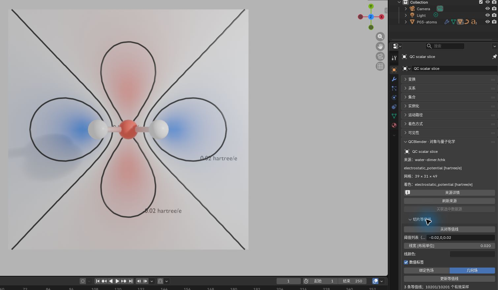
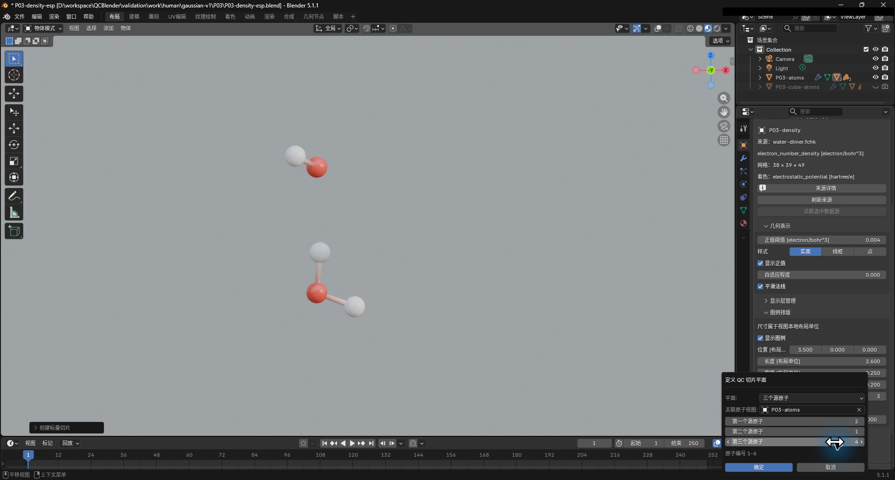
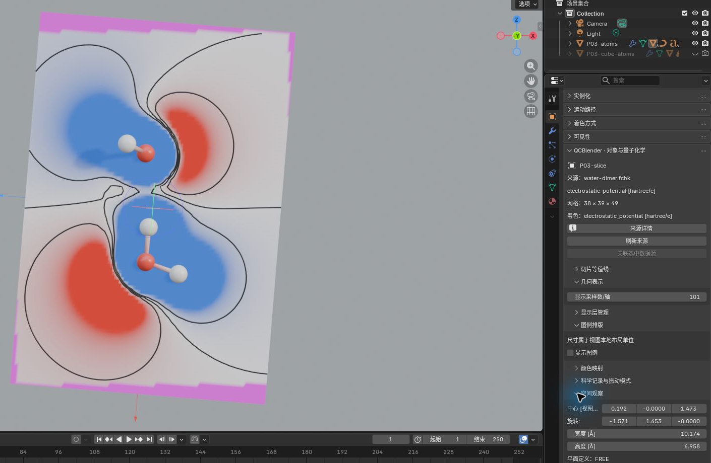
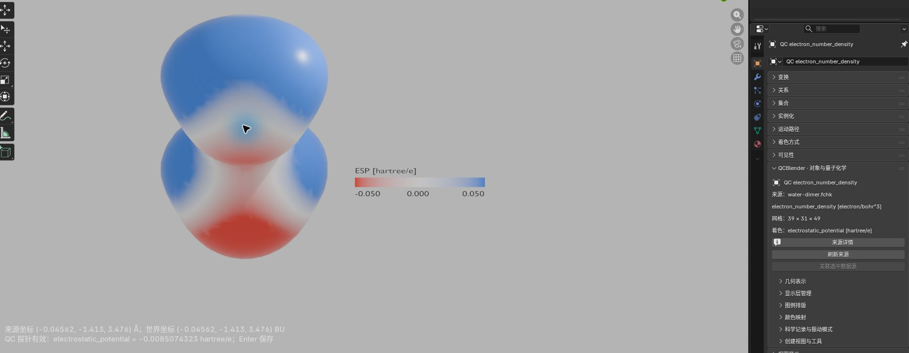
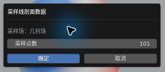
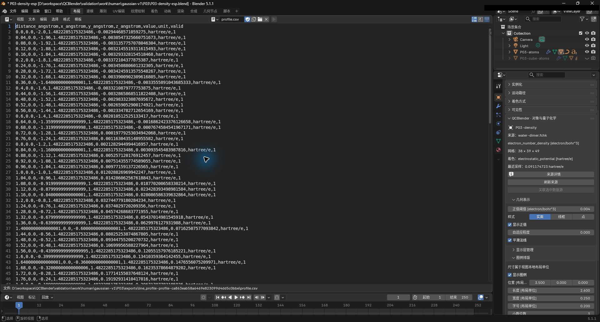
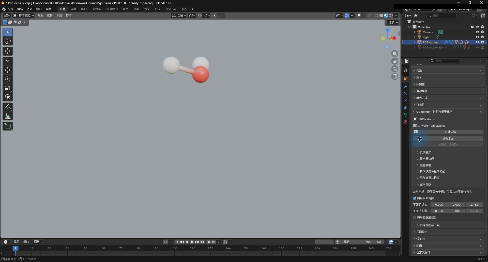
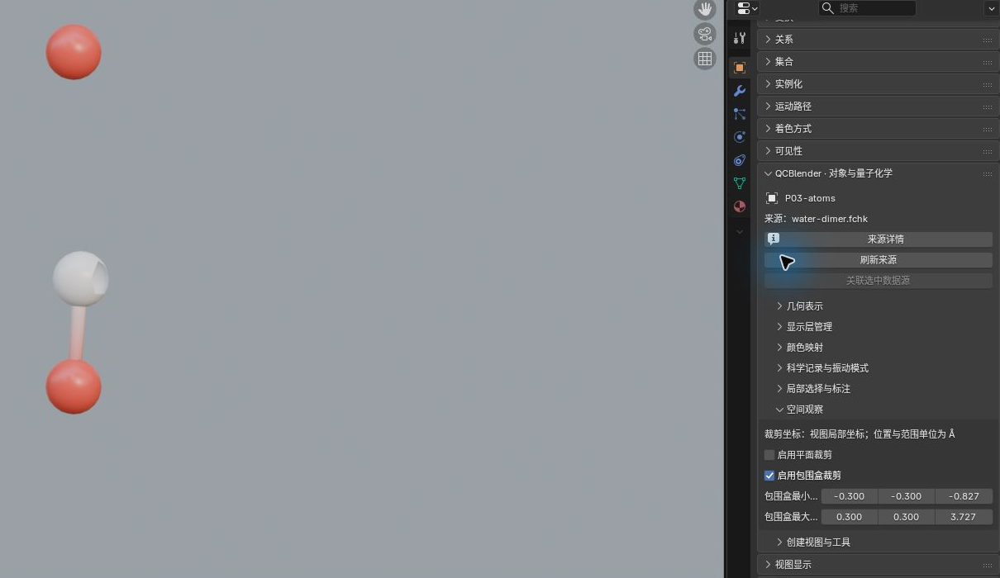
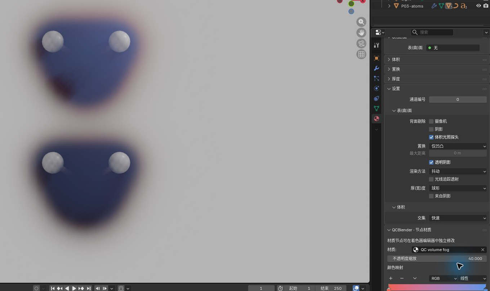

# 04. 空间观察与科学数据导出

[返回教程目录](../SOP.md#topics)

## 目录

- [切片与等值线](#slice)
  - [1. 创建 ESP 切片并设置观察范围](#step-01)
  - [2. 绘制 ESP 等值线](#step-02)
  - [3. 按原子定平面并拖动切片](#step-03)
- [取点与剖面 CSV](#profile)
  - [4. 读取指定坐标处的 ESP](#step-04)
  - [5. 在密度表面点击读取 ESP](#step-05)
  - [6. 沿两个游标位置采样 ESP 剖面](#step-06)
  - [7. 导出剖面 CSV 并核对采样范围](#step-07)
- [裁剪与体积雾](#display)
  - [8. 用平面和盒子裁剪分子显示](#step-08)
  - [9. 创建密度体积雾并调整不透明度](#step-09)
- [附录：参数、原理与输入规范](#appendix)
  - [A1. 了解切片坐标、尺寸与分辨率](#appendix-step-01)
  - [A2. 了解等值线与场来源](#appendix-step-02)
  - [A3. 了解自由平面、源网格与三原子定位](#appendix-step-03)
  - [A4. 了解 3D 游标与取点方式](#appendix-step-04)
  - [A5. 比较几何场与绑定色场探针](#appendix-step-05)
  - [A6. 了解剖面、采样场与点数](#appendix-step-06)
  - [A7. 了解 profile.csv 与有效标志](#appendix-step-07)
  - [A8. 了解平面裁剪与包围盒裁剪](#appendix-step-08)
  - [A9. 了解体积雾与不透明度](#appendix-step-09)

本页接续[专题 03 步骤 1–5](03-density-esp.md#step-01)，在同一工程中保留 **P03-atoms、P03-density、P03-esp**。开始时显示原子层和已按 ESP 着色的密度表面，独立 ESP 表面保持隐藏。路径相对教程材料根目录；每次换对象后重新打开其对象属性。

---

## 切片与等值线

### 1. 创建 ESP 切片并设置观察范围

详细说明见[附录 A1：了解切片坐标、尺寸与分辨率](#appendix-step-01)。

1. 在 **N 侧栏 → QC 对象导航** 中选中 **P03-esp**，打开对象属性。
2. 点击 **创建视图与工具 → 空间工具 → 创建切片（Create Slice）** 并确定。
3. 选中新生成的切片对象，按 `F2` 命名为 **P03-slice** 并打开其对象属性。
4. 在 **空间观察（Spatial View）** 面板中设置参数：
   - **中心（Center）**：`(0, 0, 1.4822285) Å`
   - **旋转（Rotation）**：`(0, 0, 0)`
   - **宽度（Width）**：`6.0 Å`
   - **高度（Height）**：`6.0 Å`
5. 在 **几何表示** 中设置参数：
   - **显示采样数/轴（Display Samples per Axis）**：`101`
6. 在 **颜色映射** 中核对范围：
   - **颜色最小值 / 中心值 / 最大值**：`-0.05 / 0 / +0.05 hartree/e`
7. 隐藏密度与独立 ESP 表面，按小键盘 `7` 从顶视图观察色彩平切面。

### 2. 绘制 ESP 等值线

详细说明见[附录 A2：了解等值线与场来源](#appendix-step-02)。

1. 保持 **P03-slice** 活动，展开 **切片等值线（Slice Contours）**。
2. 点击 **开启等值线（Enable Contours）**，配置参数：
   - **场源**：几何场（Geometry Field）
   - **阈值列表（空白：自动 9 条）**：填入 `-0.02, 0, 0.02`
   - **数值标签（Value Labels）**：勾选
3. 点击 **更新等值线（Update Contours）**，视口中将绘制平滑曲线并显示数值。截图保存至 `human/screenshots/P03-slice.png`。

### 3. 按原子定平面并拖动切片

详细说明见[附录 A3：了解自由平面、源网格与三原子定位](#appendix-step-03)。

1. 点击 **空间观察 → 按源网格或三个原子定平面**，配置参数：
   - **平面（Plane）**：三个源原子（Three source atoms）
   - **关联原子视图**：`P03-atoms`
   - **第一／第二／第三源原子**：分别填入 `2`、`1`、`4`
2. 点击确定，切片自动对齐至三原子所在平面。截图保存至 `human/screenshots/P03-slice-three-atoms.png`。

3. 激活左侧工具栏的 **QC 切片手柄（QC Slice Gizmo）**，手动平移旋转切面并再次点击 **更新等值线**。截图保存至 `human/screenshots/P03-slice-gizmo.png`。

---

## 取点与剖面 CSV

### 4. 读取指定坐标处的 ESP

无效或网格外采样不能解释为物理零值；读取时核对单位与有效性。

详细说明见[附录 A4：了解 3D 游标与取点方式](#appendix-step-04)。

1. 在 **QC 对象导航** 中选中 **P03-esp** 并打开对象属性。
2. 在 3D 视图按 `N` 切换至 **视图（View） → 3D 游标（3D Cursor）**，设置游标坐标：
   - **位置（Location）**：`(0, 0, 1.4822285) Å`
3. 在属性面板点击 **创建视图与工具 → 场值采样 → 读取游标处场值**。底部状态栏将回显精确插值数值（单位 `hartree/e`）。

### 5. 在密度表面点击读取 ESP

详细说明见[附录 A5：比较几何场与绑定色场探针](#appendix-step-05)。

1. 隐藏切片，重新显示 **P03-density** 表面并打开其属性。
2. 点击 **场值采样 → 点击探针 · 绑定色场（Click Probe · Bound Color Field）**。
3. 鼠标移入视口点击密度表面的有效采样位置，核对临时读数后按 `Enter` 保存；结果写入该对象的 `qc_probe` 并在状态栏报告，不创建三维标签。截图保存至 `human/screenshots/P03-probe.png`。

### 6. 沿两个游标位置采样 ESP 剖面

详细说明见[附录 A6：了解剖面、采样场与点数](#appendix-step-06)。

1. 选中 **P03-esp** 打开对象属性。
2. 将 3D 游标位置设为起点：`(0, -2, 1.4822285) Å`。
3. 点击 **场值采样 → 记录剖面起点（Mark Profile Start）**。
4. 将 3D 游标位置改至终点：`(0, +2, 1.4822285) Å`。
5. 点击 **采样线剖面数据（Sample Line Profile Data）**，配置参数：
   - **采样场（Sample field）**：几何（Geometry）
   - **采样点数（Samples）**：`101`
6. 点击确定，截图保存至 `human/screenshots/P03-profile-dialog.png`。

### 7. 导出剖面 CSV 并核对采样范围

先创建输出目录，按[共同导出方法](../SOP.md#export)选择目录。保留 CSV 与 `metadata.json`，核对 101 个采样点、起终点、单位及有效标志；无效点不按物理零解释。

详细说明见[附录 A7：了解 profile.csv 与有效标志](#appendix-step-07)。

1. 保持生成的 **QC line profile data** 活动，进入 **N 侧栏 → 导入与导出 → 导出 → 导出数据与参数摘要**。
2. 配置参数：
   - **数据（Data）**：线剖面（profile）
   - **输出目录**：选择 `work/human/gaussian-v1/P03/exports/`
3. 点击确定，生成包含 `profile.csv` 与 `metadata.json` 的子目录。
4. 确认 CSV 包含从 0 到 4 Å 的 101 行数据点及 `hartree/e` 量纲。截图保存至 `human/screenshots/P03-profile-csv.png`。

---

## 裁剪与体积雾

### 8. 用平面和盒子裁剪分子显示

详细说明见[附录 A8：了解平面裁剪与包围盒裁剪](#appendix-step-08)。

1. 仅显示 **P03-atoms**，在对象属性中点击 **空间工具 → 添加裁剪控件（Add Clipping Controls）**。
2. 在 **空间观察** 中开启 **启用平面裁剪（Plane Enabled）**，设置参数：
   - **平面原点（Plane Origin）**：`(0, 0, 1.4822285) Å`
   - **平面法向量（Plane Normal）**：`(0, 0, 1)`
   - 视口中仅显示上方水分子，截图保存至 `human/screenshots/P03-clip-plane.png`。

3. 关闭平面裁剪，开启 **启用包围盒裁剪（Box Enabled）**，设置参数：
   - **包围盒最小值（Box Minimum）**：`(-0.3, -0.3, -0.8271964) Å`
   - **包围盒最大值（Box Maximum）**：`(0.3, 0.3, 3.7269311) Å`
   - 视口保留 O1、O4 及靠轴 H2 局部区域，截图保存至 `human/screenshots/P03-clip-box.png`。

4. 测试完毕后关闭包围盒裁剪，恢复完整分子。

### 9. 创建密度体积雾并调整不透明度

详细说明见[附录 A9：了解体积雾与不透明度](#appendix-step-09)。

1. 选中 **P03-density**，在对象属性中点击 **显示视图 → 创建体积雾（Create Volume Fog）**，命名为 **QC volume fog**。
2. 隐藏密度表面，视口切至右上角 **渲染预览（Rendered）** 模式。
3. 在 **材质属性 → QCBlender · 节点材质** 中调节参数：
   - **不透明度缩放（Opacity Scale）**：设置为 `40`
4. 观察半透明连续弥散雾效果，截图保存至 `human/screenshots/P03-fog.png`。

---

## 附录：参数、原理与输入规范

### A1. 了解切片坐标、尺寸与分辨率

> 切片在一个平面上显示场值，适合观察分子内部或两分子之间的分布。视图局部坐标以该对象的原点和坐标轴为参考。

- **中心（Center）**：平面的中心位置，用于移动观察截面。
- **旋转（Rotation）**：平面的朝向；本例先用零旋转从顶面观察。
- **宽度（Width） / 高度（Height）**：平面的宽、高，用于确定观察范围。
- **显示采样数/轴（Display Samples per Axis）**：每个方向的显示采样点数。101 表示 101×101 个点；加密显示采样不会加密源网格，本例源网格仍为 0.2 Å。

### A2. 了解等值线与场来源

> 等值线连接平面上相同场值的位置，便于比较各区域的数值。阈值列表（空白：自动 9 条）（Levels (empty: 9 automatic levels)）指定要画出的各个场值，数值标签（Value Labels）在曲线旁标出该值。

- **几何场（Geometry Field）**：读取切片自身的场；本例是 ESP，线值单位为 hartree/e。
- **绑定色场（Bound Color Field）**：读取另外绑定的着色场，适合切片自身的场与着色量不同时使用；需要先有色场绑定。

### A3. 了解自由平面、源网格与三原子定位

**平面（Plane）** 用于选择平面的定位依据。需要复现某个截面时按网格或原子定位；需要探索附近分布时可自由调整。

- **自由（Free）**：保留当前平面，之后用中心（Center）、旋转（Rotation）或手柄调整。
- **网格 ij（Grid ij） / 网格 jk（Grid jk） / 网格 ki（Grid ki）**：分别沿源网格的两条轴展开，在剩余轴上用 **网格位置（Grid position）** 定位。0 和 1 是该轴的两端，0.5 是中间；这些名称按源网格轴定义。
- **三个源原子（Three source atoms）**：用三个不共线的源原子位置确定平面；**关联原子视图（Associated atom view）** 指定提供原子的视图，编号沿用源文件中的原子顺序。

> Gizmo 是可用鼠标拖动的视图操作手柄。

### A4. 了解 3D 游标与取点方式

> 3D 游标（3D Cursor）是可用坐标定位的三维游标；本页用它指定读取场值的位置和线剖面的两个端点。

已知坐标时使用 **读取游标处场值（Read Field Value at Cursor）**；想从可见表面上选位置时使用下一步的点击探针。

### A5. 比较几何场与绑定色场探针

> 探针（Probe）读取指定位置的场值；绑定色场（Bound Color Field）是这层表面所采用的着色数据。

- **点击探针 · 几何场（Click Probe · Geometry Field）**：读取形成当前表面的场；在本例密度表面上读取电子密度。
- **点击探针 · 绑定色场（Click Probe · Bound Color Field）**：在所点击的表面位置读取着色量；本例读取 ESP。

### A6. 了解剖面、采样场与点数

> 剖面沿一条直线采样，生成一组距离与场值，用于观察两点之间的数值变化。**QC line profile data** 是这次采样的记录对象，供查看属性和导出 CSV。

**采样场（Sample field）** 决定沿线读取哪份数据：

- **几何（Geometry）**：读取当前视图的几何场（Geometry Field）；本步选中独立 ESP 视图，因此读取 ESP。
- **颜色（Color）**：读取当前视图的绑定色场（Bound Color Field）；例如在按 ESP 着色的密度表面上选择它，可沿线读取 ESP。只有存在色场绑定时才提供这个选项。

**采样点数（Samples）** 是包括两个端点在内的采样点数；它决定沿线取值的密度，源网格保持原样。

### A7. 了解 profile.csv 与有效标志

> `profile.csv` 保存采样点的距离、坐标、场值和单位，可在表格或绘图软件中查看沿线变化。`valid` 表示该采样点是否有有效场值；无效点的场值留空。配套 `metadata.json` 用于核对来源、单位和采样条件，应与 CSV 一起保留。

**数据（Data）=线剖面（profile）** 导出上一步保存的采样记录；导出前选择 **QC line profile data**，即可取得这条剖面。

### A8. 了解平面裁剪与包围盒裁剪

> 裁剪作用于已生成的显示网格，用于看清被遮挡的内部区域；边界可穿过原子球面或键，源数据仍保留六个原子，原始坐标与科学数据不变。下列位置使用视图局部坐标。

- **启用平面裁剪（Plane Enabled）**：开启平面裁剪。**平面原点（Plane Origin）** 指定平面经过的位置，**平面法向量（Plane Normal）** 指向保留的一侧，适合沿一个截面观察。
- **启用包围盒裁剪（Box Enabled）**：开启盒子裁剪。**包围盒最小值（Box Minimum） / 包围盒最大值（Box Maximum）** 指定各轴的最小、最大坐标，盒外隐藏，适合保留一个有限区域。
- 两种裁剪同时开启时，仅保留同时满足两者的部分；要比较效果，先关闭一种再开启另一种。

### A9. 了解体积雾与不透明度

> 体积雾把场显示为空间中的半透明分布，用于观察密度的空间延展。渲染（Rendered）使用场景的渲染设置预览效果。

**不透明度缩放（Opacity Scale）** 是显示不透明度的缩放因子：增大时雾更浓，设为 0 时透明；电子密度值保持原样。
