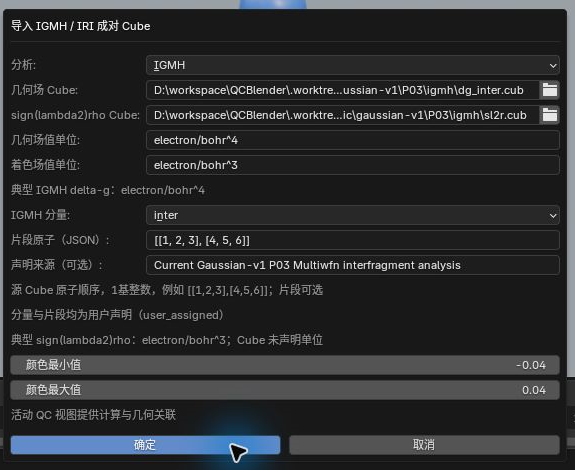
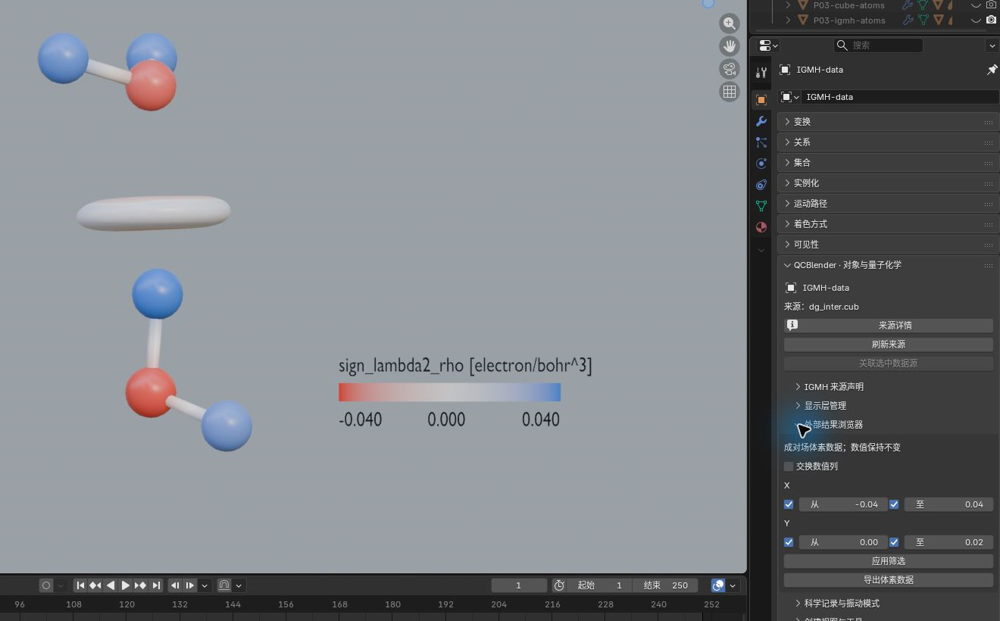
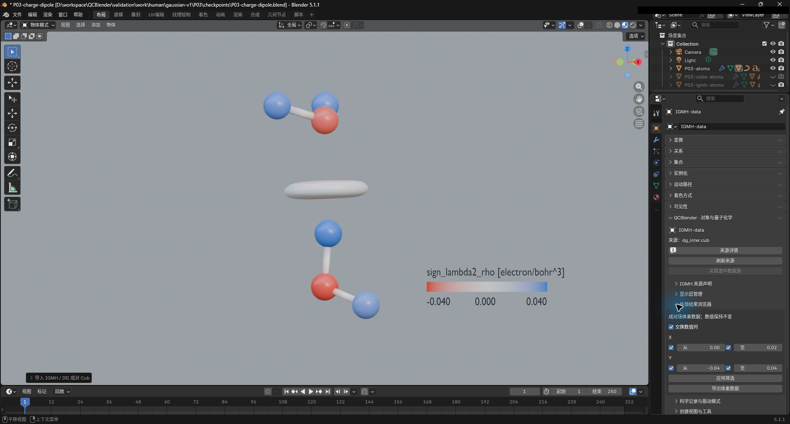

# 05. IGMH 与 IRI

[返回教程目录](../SOP.md#topics)

## 目录

- [1. 导入水二聚体作为共同参考](#step-01)
- [2. 导入 IGMH 成对场并声明片段](#step-02)
- [3. 设置 IGMH 表面阈值和着色图例](#step-03)
- [4. 导入 IRI 成对场并单独观察表面](#step-04)
- [5. 筛选成对场数值并导出 CSV](#step-05)
- [附录：参数、原理与输入规范](#appendix)
  - [A1. 了解 IGMH 与 IRI](#appendix-step-01)
  - [A2. 了解成对场、IGMH 分量与片段声明](#appendix-step-02)
  - [A3. 区分表面阈值与颜色范围](#appendix-step-03)
  - [A4. 了解 IRI 密度指数与原始单位](#appendix-step-04)
  - [A5. 了解 X/Y 列、筛选条件与 CSV 范围](#appendix-step-05)

路径均相对教程材料根目录（同时含 `human/` 和 `shared/`）。先完成[安装](../SOP.md#install)，按[准备新工程](../SOP.md#new-scene)开始；每次换对象后重新打开其对象属性。

---

### 1. 导入水二聚体作为共同参考

详细说明见[附录 A1：了解 IGMH 与 IRI](#appendix-step-01)。

1. 点击 **N 侧栏 → 导入与导出 → 导入 → 导入 Gaussian / Cube / XYZ**。
2. 选择文件 `shared/data/public/gaussian-v2/P03/water-dimer.fchk`。
3. 导入后将原子对象命名为 **P03-atoms**（包含两个水分子，共 6 个原子）。

### 2. 导入 IGMH 成对场并声明片段

两份 Cube 必须有相同原子顺序、构型和网格。inter/intra/total 与片段列表是生成条件的声明，不从一个 Cube 自动分解分量；单位声明不换算数组数值。

详细说明见[附录 A2：了解成对场、IGMH 分量与片段声明](#appendix-step-02)。

1. 保持选中 **P03-atoms**。
2. 点击 **N 侧栏 → 导入与导出 → 导入外部结果 → 空间场分析 → IGMH / IRI 成对场（IGMH / IRI Paired Fields）**。
3. 在弹出的对话框中配置以下参数：
   - **分析（Analysis）**：`IGMH`
   - **几何场 Cube（Geometry Cube）**：`shared/data/public/gaussian-v2/P03/igmh/dg_inter.cub`
   - **sign(lambda2)rho Cube**：`shared/data/public/gaussian-v2/P03/igmh/sl2r.cub`
   - **几何场值单位（Geometry value unit）**：`electron/bohr^4`
   - **着色场值单位（Color value unit）**：`electron/bohr^3`
   - **IGMH 分量（IGMH component）**：`inter`
   - **片段原子（JSON）（Fragment atoms (JSON)）**：`[[1,2,3],[4,5,6]]`
   - **声明来源（可选）**：`P03 Multiwfn fragment setup`
   - **颜色最小值 / 最大值**：`-0.04 / 0.04`
4. 确认并等待导入完成。在 N 侧栏导航中选中新生成的记录对象，按 `F2` 命名为 **IGMH-data**。截图保存至 `human/screenshots/P03-igmh-import.png`。

### 3. 设置 IGMH 表面阈值和着色图例

详细说明见[附录 A3：区分表面阈值与颜色范围](#appendix-step-03)。

1. 在 **QC 对象导航** 中选中 **QC delta_g**，点击 **打开对象属性**。
2. 在 **几何表示** 面板中设置参数：
   - **正值阈值（Positive Isovalue）**：`0.005`
3. 在 **颜色映射** 面板中配置参数：
   - **颜色最小值 / 中心值 / 最大值**：`-0.04 / 0 / 0.04`
4. 展开 **图例排版**，开启 **显示图例（Show Legend）**（单位回显为 `electron/bohr^3`）。
5. 检查 **IGMH 来源声明** 正确显示 `inter` 及两组片段。截图保存至 `human/screenshots/P03-igmh.png`。

### 4. 导入 IRI 成对场并单独观察表面

详细说明见[附录 A4：了解 IRI 密度指数与原始单位](#appendix-step-04)。

1. 重新选中 **P03-atoms**，再次点击进入 **IGMH / IRI 成对场** 导入弹窗。
2. 配置 IRI 分析参数：
   - **分析（Analysis）**：`IRI`
   - **几何场 Cube**：`shared/data/public/gaussian-v2/P03/iri/func2.cub`
   - **sign(lambda2)rho Cube**：`shared/data/public/gaussian-v2/P03/iri/func1.cub`
   - **几何场值单位**：`a.u. (electron^-0.1 bohr^-0.7)`
   - **着色场值单位**：`electron/bohr^3`
   - **IRI 密度指数 a**：`1.1`
   - **颜色最小值 / 最大值**：`-0.04 / 0.04`
3. 确认导入后，将新生成的记录对象命名为 **IRI-data**。
4. 选中曲面对象 **QC iri_function**，打开其对象属性，设置参数：
   - **正值阈值**：`1.0`
   - **颜色最小值 / 中心值 / 最大值**：`-0.04 / 0 / 0.04`
   - **显示图例**：开启
5. 在大纲视图中隐藏 **QC delta_g**，单独观察 IRI 表面。截图保存至 `human/screenshots/P03-iri.png`。

### 5. 筛选成对场数值并导出 CSV

此处筛选保存成对数值的导出条件，不裁剪三维等值面。先创建输出目录，再按[共同导出方法](../SOP.md#export)选择它。

详细说明见[附录 A5：了解 X/Y 列、筛选条件与 CSV 范围](#appendix-step-05)。

1. 选中 **IGMH-data** 并打开对象属性，展开 **外部结果浏览器（External Result Browser）**。
2. 保持 **交换数值列（Swap value columns）** 关闭，开启 X、Y 两行的范围开关，设置过滤参数：
   - **X 从（From） / 至（To）**：`-0.04 / 0.04`（对应 `sign_lambda2_rho`）
   - **Y 从（From） / 至（To）**：`0.001 / 0.02`（对应 `delta_g`）
3. 点击 **应用筛选（Apply Filter）**。截图保存至 `human/screenshots/P03-paired-filter.png`。

4. 点击 **N 侧栏 → 导入与导出 → 导出 → 导出数据与参数摘要**，配置参数：
   - **数据（Data）**：成对场（paired）
   - **行（Rows）**：当前筛选（Current filter）
   - **输出目录**：选择 `work/human/gaussian-v1/P03/exports/`
5. 确定后生成 `paired_voxels.csv` 与 `metadata.json`。
6. 测试开启 **交换数值列**，互换范围并再次应用筛选。截图保存至 `human/screenshots/P03-paired-filter-swapped.png`。
7. 测试完成后关闭交换数值列并恢复原始范围。

---

## 附录：参数、原理与输入规范

### A1. 了解 IGMH 与 IRI

> IGMH 是按原子片段分析相互作用区域的一种方法；IRI 是相互作用区域指标，用于显示化学键及弱相互作用区域。这里读取已经算好的 Cube。

### A2. 了解成对场、IGMH 分量与片段声明

> 成对场在相同网格位置保存两个场值：一份决定表面位置，一份提供着色量。**QC paired field data** 是绑定两份网格值及分析声明的记录对象，用于后面的筛选和数据导出；三维表面用于观察相互作用区域。

**分析（Analysis）** 应与生成 Cube 的分析方法一致：

- **IGMH**：几何场（Geometry Field）为 delta-g，可声明分量及原子片段；本例读取两个水分子间的分量。
- **IRI**：几何场（Geometry Field）为 IRI，需要填写原计算使用的电子密度指数；本页步骤 4 单独导入它。

> sign(lambda2)rho 是电子密度乘以密度 Hessian 第二特征值的符号，用作相互作用区域的着色量。

- **几何场 Cube（Geometry Cube）**：决定表面位置；本例使用 delta-g 的片段间分量。
- **sign(lambda2)rho Cube**：提供表面颜色；两种分析均使用这种着色量。
- **几何场值单位（Geometry value unit） / 着色场值单位（Color value unit）**：分别声明两份场值的单位，填写单位不会换算网格数值。

**IGMH 分量（IGMH component）** 记录源场的分量身份，应按原计算选择：

- **inter**：片段间分量，适合观察已定义片段之间的相互作用。
- **intra**：片段内分量，适合观察各片段内部的区域。
- **total**：总分量。
- **未声明 / unknown（Undeclared / unknown）**：尚未核实分量身份时保留此项。

**片段原子（JSON）（Fragment atoms (JSON)）** 用方括号列表列出各片段的源原子编号；**声明来源（Declaration source (optional)）** 记录声明的依据，optional 表示可留空。本例两组方括号分别指定两个水分子，成员编号沿用源 Cube 的原子顺序，从 1 开始。

### A3. 区分表面阈值与颜色范围

**正值阈值（Positive Isovalue）** 决定在哪个 delta-g 等值处生成表面；**颜色最小值（Color Minimum） / 颜色中心值（Color Center） / 颜色最大值（Color Maximum）** 决定如何将着色场的值分配到颜色，图例显示这份着色量及其单位。

### A4. 了解 IRI 密度指数与原始单位

> IRI 密度指数 a（IRI density exponent a）记录生成 IRI 时使用的电子密度指数；IRI 的单位随指数定义。a.u. 表示原子单位，本例括号中写出具体的单位幂次；此处按原计算填写，便于追溯这份场。

> 这份 IRI 使用指数 a=1.1，其单位沿用生成计算的定义。两种分析都用 `sign(lambda2)rho` 场着色，原值直接使用。

### A5. 了解 X/Y 列、筛选条件与 CSV 范围

> 外部结果浏览器（External Result Browser）用于筛选分析记录。这里 X、Y 表示两列场值，可按数值范围提取要比较的网格点。

**交换数值列（Swap value columns）** 决定两列各自使用哪份场：

- 关闭：X 为 `sign_lambda2_rho [electron/bohr^3]`，Y 为 `delta_g [electron/bohr^4]`。
- 开启：X 为 delta-g，Y 为 sign(lambda2)rho；相应范围也应按交换后的物理量填写。

每个 **从（From） / 至（To）** 左侧都有独立范围开关：开启从（From）后按下限筛选，开启至（To）后按上限筛选，关闭两端则该列不限范围。X、Y 的所有已启用条件须同时满足，边界值也包含在内。**应用筛选（Apply Filter）** 保存当前条件，三维表面继续由等值和颜色参数控制。

导出时 **行（Rows）** 决定选取哪些数据行：

- **全部来源记录（All source records）**：导出两份场都有有效值的全部网格点，适合保留完整数据。
- **当前筛选（Current filter）**：导出满足当前 X、Y 条件的有效网格点，适合只分析某个数值区域。

`paired_voxels.csv` 每行对应一个满足筛选条件的有效网格点，包含位置及 X、Y 两个场值，可用于绘制散点图或比较两场的数值关系。
