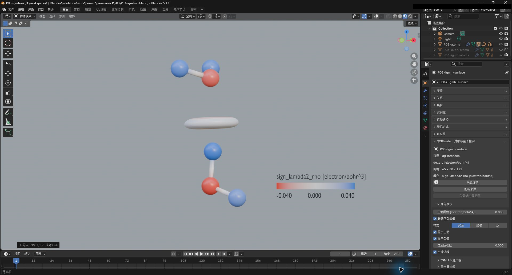
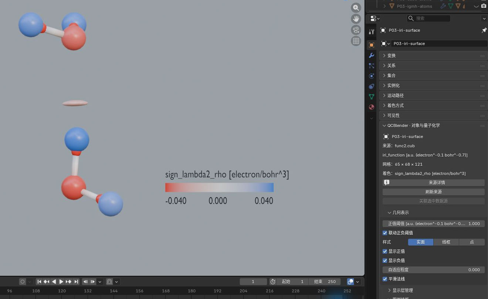

# IGMH 与 IRI

[返回教程目录](../SOP.md#topics)

路径相对材料根目录。本专题从 **File → New → General** 开始，在 Outliner 删除默认 Cube；使用同一个水二聚体参考对象完成两种分析。

本页截图使用案例 `P03-` 前缀。

> IGMH 和 IRI 是根据电子密度构造的空间指标，可用表面观察分子间或分子内的相互作用区域。这里读取已经算好的 Cube。

1. 点击 **N 侧栏 → 工作流 → 导入 Gaussian / Cube / XYZ**，导入 [shared/data/public/P03/water-dimer.fchk](../../shared/data/public/P03/water-dimer.fchk)，将原子对象命名为 **P03-atoms**。应看到两个水分子，共六个原子。

2. 只选 **P03-atoms**，点击 **N 侧栏 → 导入外部结果 → IGMH / IRI 成对场**。按下表输入 IGMH 参数，确认并等待完成；在 **Display Layers** 选新建的 **QC paired field data**，按 `F2` 命名为 **IGMH-data**。

| 控件 | 输入值 |
| --- | --- |
| Analysis | IGMH |
| Geometry Cube | [shared/data/public/P03/igmh/dg_inter.cub](../../shared/data/public/P03/igmh/dg_inter.cub) |
| sign(lambda2)rho Cube | [shared/data/public/P03/igmh/sl2r.cub](../../shared/data/public/P03/igmh/sl2r.cub) |
| Geometry value unit | electron/bohr^4 |
| Color value unit | electron/bohr^3 |
| IGMH component | inter |
| Fragment atoms (JSON) | `[[1,2,3],[4,5,6]]` |
| Declaration source (optional) | P03 Multiwfn fragment setup |
| Color minimum / maximum | −0.04 / 0.04 |

> `inter` 表示片段间分量；两组方括号分别指定两个水分子的源原子编号。

3. 选 **QC delta_g**，在 **对象属性 → 几何表示** 设 **正值阈值=0.005**；在 **颜色映射** 设 **Color Minimum/Center/Maximum=−0.04/0/0.04**，开启 **图例排版 → 显示图例**。切到 **Material Preview**，应在两个水分子之间看到着色表面，图例单位为 **electron/bohr^3**。**IGMH 来源声明** 应显示 **inter** 及两组片段。截图保存为 `human/screenshots/P03-igmh.png`。

4. 重新只选 **P03-atoms**，使用同一成对场入口导入下表 IRI 参数。完成后选新建的 **QC paired field data**，命名为 **IRI-data**；再选 **QC iri_function**，设 **正值阈值=1.0**、**Color Minimum/Center/Maximum=−0.04/0/0.04** 并开启图例。在 **Display Layers** 隐藏 **QC delta_g**，应能单独观察 IRI 表面。截图保存为 `human/screenshots/P03-iri.png`。

| 控件 | 输入值 |
| --- | --- |
| Analysis | IRI |
| Geometry Cube | [shared/data/public/P03/iri/func2.cub](../../shared/data/public/P03/iri/func2.cub) |
| sign(lambda2)rho Cube | [shared/data/public/P03/iri/func1.cub](../../shared/data/public/P03/iri/func1.cub) |
| Geometry value unit | a.u. (electron^-0.1 bohr^-0.7) |
| Color value unit | electron/bohr^3 |
| IRI density exponent a | 1.1 |
| Color minimum / maximum | −0.04 / 0.04 |

> 这份 IRI 使用指数 a=1.1，其单位沿用生成计算的定义。两种分析都用 `sign(lambda2)rho` 场着色，原值直接使用。

5. 选 **IGMH-data**，打开 **对象属性 → External Result Browser**。保持 **Swap value columns** 关闭，打开 X、Y 两行的全部范围开关，填 **X From=−0.04、To=0.04；Y From=0.001、To=0.02**，点击 **Apply Filter**。应提示 **Paired field filter saved for data export**。X 对应 `sign_lambda2_rho [electron/bohr^3]`，Y 对应 `delta_g [electron/bohr^4]`。这里的筛选供 **导出数据与参数摘要 → Data=paired → Rows=Current filter** 使用；输出文件名为 `paired_voxels.csv`，导出方法见[剖面 CSV](04-spatial-tools.md#profile)。

> 成对场在相同网格位置保存两个值。筛选作用于导出的数据行，三维表面继续由等值和颜色参数控制。
