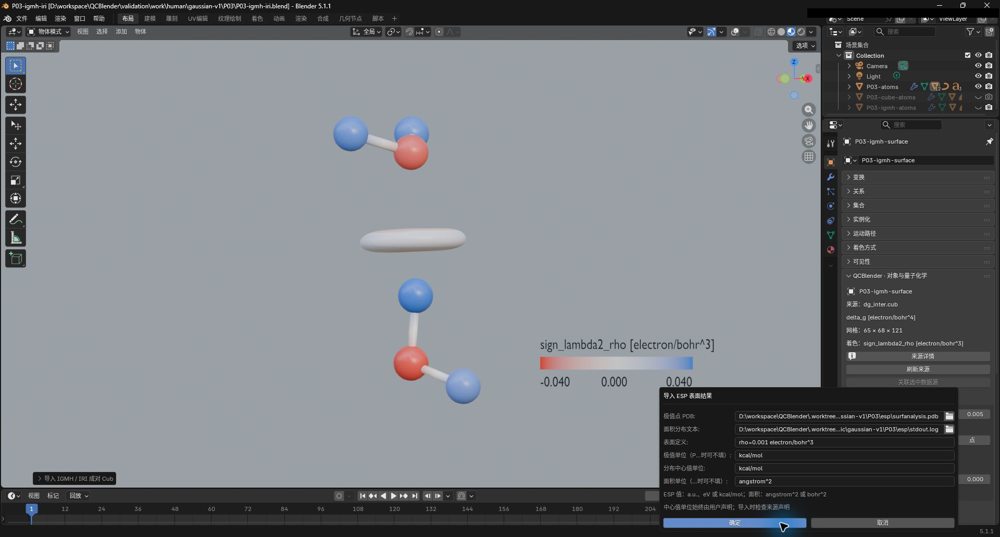
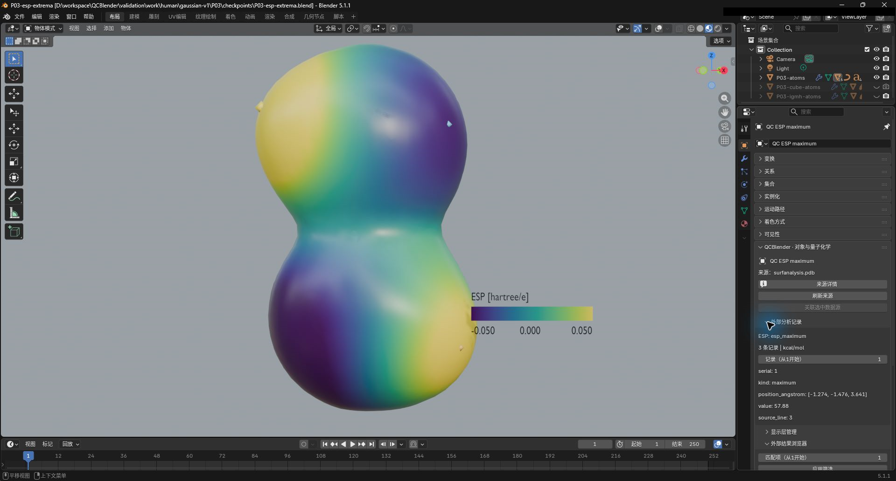
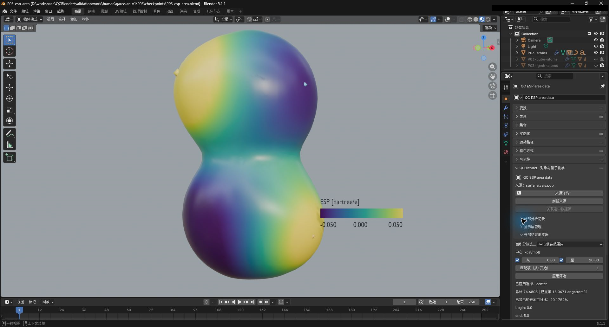
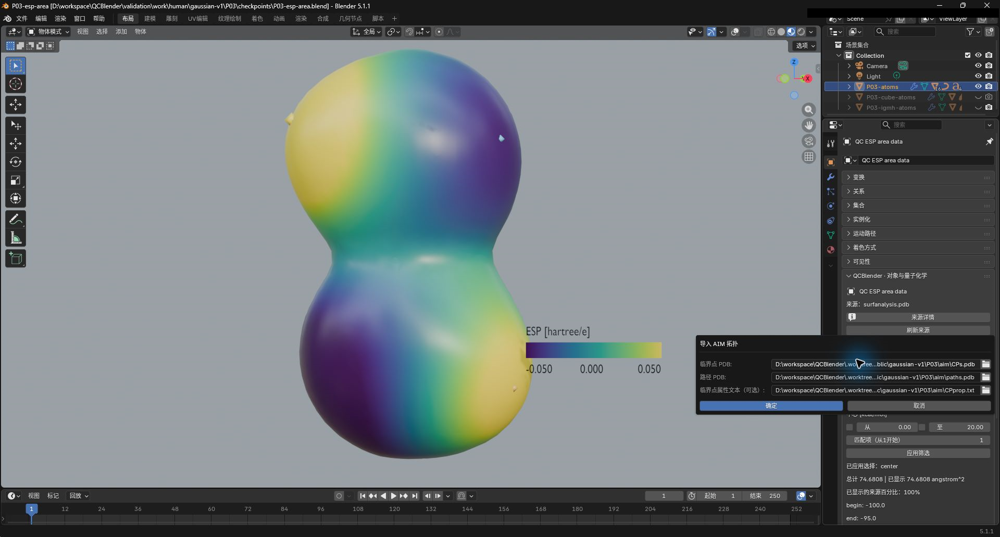
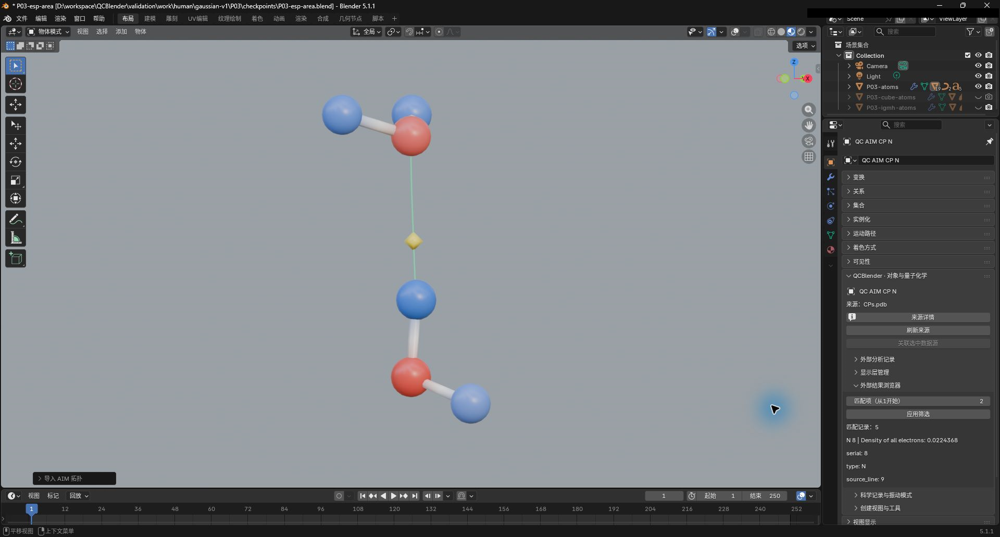
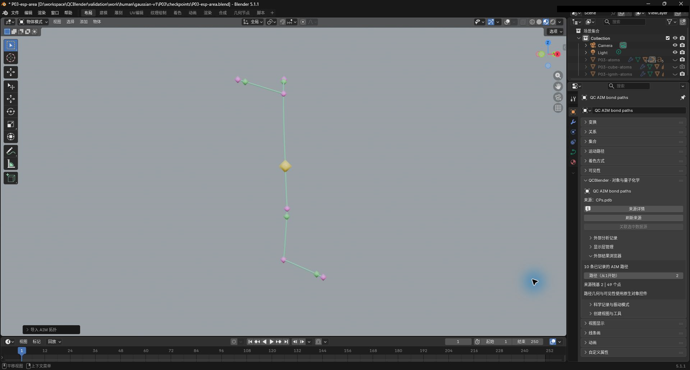

# 外部 ESP 与 AIM 分析

[返回教程目录](../SOP.md#topics)

## 目录

- [ESP 极值与面积](#esp)
  - [1. 匹配密度等值面并导入 ESP 分析](#step-01)
  - [2. 浏览 ESP 极值并高亮指定源点](#step-02)
  - [3. 按 ESP 范围筛选表面积](#step-03)
- [AIM 临界点与路径](#aim)
  - [4. 导入 AIM 临界点和路径](#step-04)
  - [5. 查看并高亮分子间的 AIM 临界点](#step-05)
  - [6. 浏览 AIM 路径记录并观察曲线](#step-06)

路径相对材料根目录。先完成[密度与 ESP](03-density-esp.md#mapping)步骤 1–5，或打开保留了该页步骤 2、3 所用稳定名称的三层工程：**P03-atoms**、**P03-density** 和 **P03-esp**。在 Outliner 显示原子与映射后的密度表面，独立 ESP 表面保持隐藏；若已练习其他专题，隐藏切片、雾、偶极及其他案例对象。切到 **材质预览（Material Preview）**。

本页截图使用案例 `P03-` 前缀。

## ESP 极值与面积

### 1. 匹配密度等值面并导入 ESP 分析

- 在 **N 侧栏 → QC 对象导航（QC Object Navigation）** 点击 **P03-density** 行最左侧的选择图标，点击 **N 侧栏 → 当前 QC 对象（Current QC Object） → 打开对象属性（Open Object Properties）**，将 **几何表示（Geometry Representation） → 正值阈值（Positive Isovalue）** 改为 **0.001**。
- 再用列表的选择图标选 **P03-esp**，点击 **N 侧栏 → 导入与导出（Import and Export） → 导入外部结果（Import External Results） → 空间场分析（Spatial Field Analysis） → ESP 表面分析（ESP Surface Analysis）**，按下表输入并确认。应新增 **QC ESP maximum、QC ESP minimum、QC ESP area data**；导航选中 ESP 表面不会改变其隐藏状态，导入后保持该表面隐藏。

| 控件 | 输入值 |
| --- | --- |
| 极值点 PDB（Extrema PDB） | [shared/data/public/gaussian-v1/P03/esp/surfanalysis.pdb](../../shared/data/public/gaussian-v1/P03/esp/surfanalysis.pdb) |
| 面积分布文本（Area distribution text） | [shared/data/public/gaussian-v1/P03/esp/stdout.log](../../shared/data/public/gaussian-v1/P03/esp/stdout.log) |
| 表面定义（Surface definition） | rho=0.001 electron/bohr^3 |
| 极值单位（Extrema value unit） | kcal/mol |
| 分布中心值单位（Distribution center unit） | kcal/mol |
| 面积单位（Area unit） | angstrom^2 |

- 截图保存为 `human/screenshots/P03-esp-analysis-import.png`。

了解 ESP 表面分析、输入文件与单位

> ESP 是静电势，描述单位正试探电荷在某位置的势能。ESP 极值是在指定表面上找到的最大值和最小值；本例外部分析使用电子密度为 0.001 electron/bohr^3 的等值面。

> 最大值、最小值对象用于定位外部分析给出的 ESP 极值点；**QC ESP area data** 是面积分布的记录对象，用于查看和筛选各势值区间的面积及占比。

> PDB 是保存点坐标等记录的文本格式；rho 表示电子密度。

- **极值点 PDB（Extrema PDB）**：提供极值点的位置与数值，用于在表面附近定位极值。
- **面积分布文本（Area distribution text）**：提供面积表，用于查看各 ESP 区间占据的表面积。
- **表面定义（Surface definition）**：记录外部分析所用表面，需与本例密度表面的阈值一致。
- **极值单位（Extrema value unit） / 分布中心值单位（Distribution center unit）**：分别声明极值与面积区间势值的单位。

> kcal/mol 表示千卡每摩尔，本例按外部分析的约定表达 ESP 数值；angstrom^2 是平方埃，用来表达表面积。导入时声明这些单位，不改变源表中的数值。

### 2. 浏览 ESP 极值并高亮指定源点

- 选 **QC ESP minimum**，点击 **N 侧栏 → 当前 QC 对象（Current QC Object） → 打开对象属性（Open Object Properties）**，展开 **外部分析记录（External Analysis Records）**，应有 **2 条记录**；设 **记录（从1开始）（Record (1-based)）=1**，值应为 **−48.88 kcal/mol**。
- 再选 **QC ESP maximum**，重新点击该对象属性入口，应有 **3 条记录**；将 **记录（从1开始）（Record (1-based)）** 设为 **2**，应显示源编号 **2**、值 **57.88 kcal/mol**。
- 展开 **外部结果浏览器（External Result Browser）**，使用初始默认条件，设 **匹配项（从1开始）（Match (1-based)）=2**，点击 **应用筛选（Apply Filter）**，应突出该点并显示它的标签。
- 截图保存为 `human/screenshots/P03-esp-extrema.png`。

- 若密度表面遮住标签，先关闭 **P03-density** 的眼睛图标，并旋转视图，让标签正面朝向观察方向。
- 白色标签在浅色背景下不易辨认时，打开视口右上角着色选项，关闭 **场景世界（Scene World）**，使用材质预览的默认深色背景。
- 下图采用这组观察设置；截图后恢复密度表面的可见性和原背景设置。

- 可再将 **外部分析记录（External Analysis Records） → 记录（从1开始）（Record (1-based)）** 改为 **1**：面板切到另一条源记录，视口仍保留上次应用的源点 2 高亮。
- 将记录（Record）恢复为 **2**，即可重新查看这个高亮点的源记录。

区分源记录、匹配项与高亮标签

**外部分析记录（External Analysis Records）** 用于回查源数据，**外部结果浏览器（External Result Browser）** 用于筛选并高亮视口中的点。两个面板的编号各有用途：

- **记录（从1开始）（Record (1-based)）**：当前对象源记录表中的第几行，从 1 开始。改变它只浏览记录及属性。
- **匹配项（从1开始）（Match (1-based)）**：当前匹配列表中的第几个结果，从 1 开始；筛选条件改变后，匹配位置可能变化。设置后点击 **应用筛选（Apply Filter）**，更新视口中的高亮。

高亮点默认附带源编号及数值标签（Value Labels），方便将视口位置与源记录对应。

### 3. 按 ESP 范围筛选表面积

- 选 **QC ESP area data**，重新点击 **N 侧栏 → 当前 QC 对象（Current QC Object） → 打开对象属性（Open Object Properties）**，在 **外部分析记录（External Analysis Records）** 应看到 **40 条记录**、总面积 **74.6808 angstrom^2**。
- 在 **外部结果浏览器（External Result Browser）** 选 **面积分箱选择（Area bin selection）=中心值在范围内（Center in range）**，开启 **中心（Center） [kcal/mol]** 两端范围，填 **从（From）=0、至（To）=20**，点击 **应用筛选（Apply Filter）**。应显示面积 **15.0671 angstrom^2**、源百分比约 **20.1752%**。
- 截图保存为 `human/screenshots/P03-esp-area.png`。

- 保持 **从（From）=0、至（To）=20**，改选 **记录区间与范围重叠（Recorded interval overlaps range）** 并应用筛选（Apply Filter）。
- 此时范围行显示为 **记录区间重叠（Recorded interval overlap） [kcal/mol]**；本例还会选入与边界相接的 **−5 到 0**、**20 到 25 kcal/mol** 两个完整区间，面积应为 **22.9027 angstrom^2**、源百分比约 **30.6673%**。

- 若需保留筛选表，按[共同导出方法](../SOP.md#export)选择 **数据（Data）=ESP_AREA、行（Rows）=当前筛选（Current filter）**，可导出选中区间的 `esp_area.csv` 和 `metadata.json`；**行（Rows）=全部来源记录（All source records）** 导出完整面积表。
- 完成比较后，恢复 **面积分箱选择（Area bin selection）=中心值在范围内（Center in range）**，关闭两端范围并重新应用，恢复全表。

了解面积区间、范围重叠与源百分比

> 面积区间（bin）按 ESP 值分组统计表面积。每个区间有中心势值，以及源表中记录的 Begin、End 边界。

**面积分箱选择（Area bin selection）** 决定怎样判断一个区间是否选入：

- **中心值在范围内（Center in range）**：中心势值在范围内就选入完整区间，适合按源表中心值分组比较。
- **记录区间与范围重叠（Recorded interval overlaps range）**：源区间的 Begin–End 与指定范围有重叠或边界接触，就选入完整区间，适合查找与某势值范围相关的源区间。仅在源表记录边界时可用，面积不会按重叠长度拆分。

范围两端的开关分别启用 **从（From）** 下限和 **至（To）** 上限；关闭一端表示该侧不限范围，边界值包含在内。

> 源百分比沿用原分析表；本例以原分析的总表面积为分母。筛选后只加总选中区间的面积和源百分比，便于查看它们占整个表面的比例。

## AIM 临界点与路径

### 4. 导入 AIM 临界点和路径

- 在 Outliner 隐藏 ESP 极值和密度表面，只选 **P03-atoms**。
- 点击 **N 侧栏 → 导入与导出（Import and Export） → 导入外部结果（Import External Results） → 原子与键分析（Atom and Bond Analysis） → AIM 拓扑（AIM Topology）**，按下表选择三份文件并确认。应新增 **QC AIM CP C、QC AIM CP N、QC AIM bond paths**；C/N 两层分别有 **6/5 个点**。

| 控件 | 输入文件 |
| --- | --- |
| 临界点 PDB（CPs PDB） | [shared/data/public/gaussian-v1/P03/aim/CPs.pdb](../../shared/data/public/gaussian-v1/P03/aim/CPs.pdb) |
| 路径 PDB（Paths PDB） | [shared/data/public/gaussian-v1/P03/aim/paths.pdb](../../shared/data/public/gaussian-v1/P03/aim/paths.pdb) |
| 临界点属性文本（可选）（CP properties text (optional)） | [shared/data/public/gaussian-v1/P03/aim/CPprop.txt](../../shared/data/public/gaussian-v1/P03/aim/CPprop.txt) |

- 截图保存为 `human/screenshots/P03-aim-import.png`。

了解 AIM 临界点与路径输入

> AIM（分子中的原子）拓扑分析从电子密度中找出临界点和路径。临界点（CP）处，电子密度向各方向的空间变化率均为零，用于描述密度分布的特征；本例文件中的 C/N 是类别编码，分别表示核临界点和键临界点。

> C/N 点对象用于在构型中定位临界点并查看其源属性；**QC AIM bond paths** 用于观察导入的路径及各路径的采样点记录。

- **临界点 PDB（CPs PDB）**：提供临界点坐标，用于在构型中定位点。
- **路径 PDB（Paths PDB）**：提供路径上的采样点，用于绘制曲线。
- **临界点属性文本（可选）（CP properties text (optional)）**：提供按源编号与点对应的临界点属性；optional 表示可不提供属性表，本例提供它以查看电子密度。

### 5. 查看并高亮分子间的 AIM 临界点

- 选 **QC AIM CP N**，点击 **N 侧栏 → 当前 QC 对象（Current QC Object） → 打开对象属性（Open Object Properties）**，在 **外部分析记录（External Analysis Records）** 将 **记录（从1开始）（Record (1-based)）** 设为 **2**。应显示源编号 **8**，位置约 **(0.037,0,1.670) Å**，`Density of all electrons` 为 **0.02243675042**。
- 在 **外部结果浏览器（External Result Browser）** 使用初始默认条件，设 **匹配项（从1开始）（Match (1-based)）=2**，点击 **应用筛选（Apply Filter）**，应突出两个水分子之间的该点。
- 截图保存为 `human/screenshots/P03-aim-point.png`。

了解临界点密度与记录编号

> Density of all electrons 是该点的总电子密度；属性值来自输入分析表，本例单位为 electron/bohr^3。

这里继续使用步骤 2 的记录（Record）与匹配项（Match）：记录（Record）在 **QC AIM CP N** 的五条源记录中定位一行，匹配项（Match）在当前筛选结果中选取要高亮的点。源编号沿用原分析，不会随筛选重新编号。

### 6. 浏览 AIM 路径记录并观察曲线

- 选 **QC AIM bond paths**，重新点击 **N 侧栏 → 当前 QC 对象（Current QC Object） → 打开对象属性（Open Object Properties）**，在 **外部结果浏览器（External Result Browser）** 应看到 **10 条已记录的 AIM 路径（10 recorded AIM paths）**。
- 将 **路径（从1开始）（Path (1-based)）** 从 **1** 改为 **2**，面板应分别显示 **10 个点（10 points） / 49 个点（49 points）**。
- 在视口旋转观察路径；如果原子球遮挡路径，可临时隐藏 **P03-atoms**。
- 截图保存为 `human/screenshots/P03-aim-paths.png`。

如果为观察路径临时隐藏了 **P03-atoms**，截图后恢复它的视口可见性，再按[共同保存方法](../SOP.md#save)保留本专题工程。

了解路径编号、点数与曲线显示

> 路径（Path）选择源路径中的第几条；points 是该路径包含的采样点数，用于了解导入曲线的离散记录。

**路径（从1开始）（Path (1-based)）** 用于浏览各条路径的来源和点数；视口中的路径显示仍由对象的可见性和几何控件管理。

