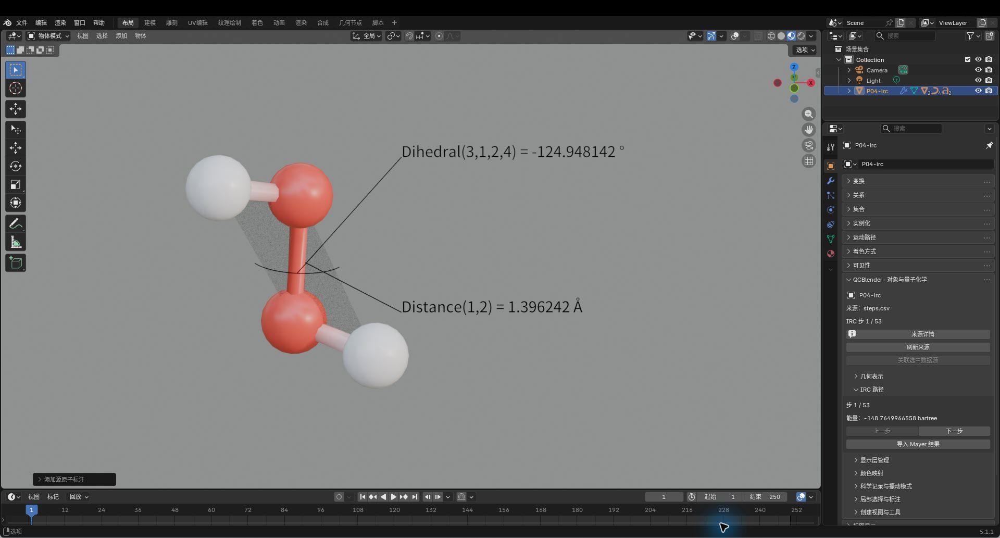
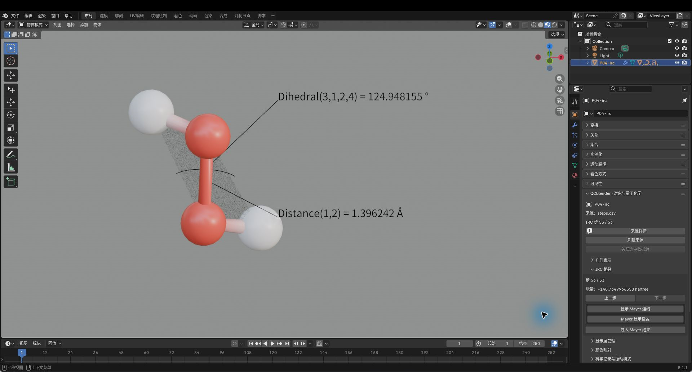
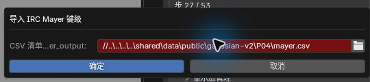

# 07. IRC 路径与 Mayer 键级

[返回教程目录](../SOP.md#topics)

## 目录

- [1. 导入完整 IRC 路径](#step-01)
- [2. 创建随构型更新的测量标注](#step-02)
- [3. 切换构型并比较能量与标注](#step-03)
- [4. 导入各步的 Mayer 键级](#step-04)
- [5. 选择原子对并比较随步键级](#step-05)
- [6. 按 Mayer 键级着色并筛选连线](#step-06)
- [附录：参数、原理与输入规范](#appendix)
  - [A1. 了解 IRC、清单与步号](#appendix-step-01)
  - [A2. 了解随步测量、精度与偏移](#appendix-step-02)
  - [A3. 了解切步按钮与关联状态](#appendix-step-03)
  - [A4. 了解 Mayer 键级与分析来源](#appendix-step-04)
  - [A5. 了解原子对筛选与 IRC/Mayer 导出](#appendix-step-05)
  - [A6. 了解色域、来源与失败处理](#appendix-step-06)

路径均相对教程材料根目录（同时含 `human/` 和 `shared/`）。先完成[安装](../SOP.md#install)，按[准备新工程](../SOP.md#new-scene)开始；每次换对象后重新打开其对象属性。

---

### 1. 导入完整 IRC 路径

本例为 53 帧原生 Gaussian GS2 分段 IRC，TS 在第 27 步，不包含端点松弛帧；不同于旧 69 帧数据。计算条件见[当前样本说明](../../shared/data/public/NOTICE.md)，步号表示清单次序，不是物理时间。

详细说明见[附录 A1：了解 IRC、清单与步号](#appendix-step-01)。

1. 点击 **N 侧栏 → 导入与导出 → 导入 → 导入 IRC 路径（Import IRC Path）**。
2. 在 **CSV 清单：step,fchk** 中选择文件 `shared/data/public/gaussian-v2/P04/steps.csv`（包含全部 53 帧有序 FCHK）。
3. 导入后在 **QC 对象导航** 中选中 **IRC path**，打开对象属性。
4. 在 **IRC 路径（IRC Path）** 面板中核对：
   - 初始显示为 **步 1 / 53（Step 1 / 53）**
   - 能量约为 `-148.7649966558 hartree`

### 2. 创建随构型更新的测量标注

详细说明见[附录 A2：了解随步测量、精度与偏移](#appendix-step-02)。

1. 保持 **IRC path** 活动，进入 **局部选择与标注** 面板。
2. 点击 **距离（Distance）**，配置参数：
   - **原子 1 / 原子 2**：`1 / 2`（O–O 键）
   - **小数位数**：`6`
3. 点击 **二面角（Dihedral）**，配置参数：
   - **原子顺序**：调整为 `3/1/2/4`（H–O–O–H 二面角）
   - **小数位数**：`6`
4. 调整文字偏移避免遮挡分子，确保测量数值与辅助几何图形清晰可见。

### 3. 切换构型并比较能量与标注

详细说明见[附录 A3：了解切步按钮与关联状态](#appendix-step-03)。

1. **Step 1（反应起点）**：
   - 核对参数：O–O 距离 `1.396242 Å`、二面角 `-124.948142°`、能量 `-148.7649966558 Eh`。
   - 截图保存至 `human/screenshots/P04-irc-start.png`。

2. **Step 27（过渡态 TS）**：
   - 点击 **下一步（Next）** 逐步推进至第 27 步。
   - 核对参数：O–O 距离 `1.401928 Å`、二面角 `+180.000000°`、能量 `-148.7648830348 Eh`。
   - 截图保存至 `human/screenshots/P04-irc.png`。

3. **Step 53（反应终态）**：
   - 继续推进至第 53 步（此时“下一步”按钮停用）。
   - 核对参数：O–O 距离 `1.396242 Å`、二面角 `+124.948155°`、能量 `-148.7649966558 Eh`。
   - 截图保存至 `human/screenshots/P04-irc-end.png`。

4. 连续点击 **上一步（Previous）**，核对当前步号回到第 27 步备用。

### 4. 导入各步的 Mayer 键级

详细说明见[附录 A4：了解 Mayer 键级与分析来源](#appendix-step-04)。

1. 保持 **IRC path** 活动，进入 **对象属性 → IRC 路径**。
2. 点击 **导入 Mayer 结果（Import Mayer Results）**。
3. 在弹窗中选择清单文件 `shared/data/public/gaussian-v2/P04/mayer.csv`。截图保存至 `human/screenshots/P04-mayer-import.png`。
4. 导入后大纲视图生成新对象 **QC IRC Mayer orders**。

### 5. 选择原子对并比较随步键级

详细说明见[附录 A5：了解原子对筛选与 IRC/Mayer 导出](#appendix-step-05)。

1. 在 **QC 对象导航** 中选中 **QC IRC Mayer orders** 并打开对象属性。
2. 在 **IRC 路径** 面板设置参数：
   - **原子 A（从1开始）**：`1`
   - **原子 B（从1开始）**：`2`
3. 点击 **读取原子对（Read Pair）**：
   - 第 27 步回显键级约 `0.987349`。
   - 点击下一步至 28 步，键级变为 `0.987345`。
4. 切换回第 27 步，截图保存至 `human/screenshots/P04-mayer.png`。

### 6. 按 Mayer 键级着色并筛选连线

Mayer 连线来自导入的原子对及键级，距离推断的普通连线不是 Mayer 键级。完成后按[共同保存方法](../SOP.md#save)保存到 `work/human/gaussian-v2/P04/`，导出目录也使用该版本路径；保留工程与 `.qcdata/`。

详细说明见[附录 A6：了解色域、来源与失败处理](#appendix-step-06)。

1. 选中 **IRC path**，在对象属性中点击 **显示 Mayer 连线（Show Mayer Bonds）**。
2. 点击 **Mayer 显示设置（Mayer Display Settings）**，配置显示与筛选参数：
   - **按键级下限筛选（Filter by Lower Bond Order）**：开启
   - **Mayer 键级下限（Minimum Mayer Order）**：`0.5`
   - **色带范围**：手动范围（Minimum=0, Maximum=1）
3. 确认视口仅保留成键明显的 3 条主要连线（1–2、1–3、2–4），其余弱相互作用连线被滤除。
4. 保持在第 27 步，截图保存至 `human/screenshots/P04-mayer-colors.png`。

---

## 附录：参数、原理与输入规范

### A1. 了解 IRC、清单与步号

> 过渡态是反应路径上能量势垒处的构型。IRC（内禀反应坐标）用于跟随过渡态两侧的反应路径；这里导入沿路径计算的一组构型。本例贯穿两侧末端与中间过渡态，原子顺序为 O/O/H/H。过渡态只有一个虚频 **−48.1468 cm⁻¹**，对应 O–O 扭转；两侧末端的六个谐振动频率全正，负端最低为 **185.0169 cm⁻¹**、正端最低为 **185.0168 cm⁻¹**。

> CSV manifest 是文件清单；step、fchk 两列把步号与对应的波函数文件配对。IRC path 是管理整条路径的根对象。

**步 1 / 53（Step 1 / 53）** 表示当前显示完整清单中的第一份构型。路径顺序为负二面角端点→过渡态→正二面角端点；这与程序从过渡态分别向两侧积分的计算顺序不同。步号不是物理时间。

52 份构型属于 `native_gs2_accepted` 阶段，TS 单列为 `transition_state`。Gaussian 的 `Forward` 对应本例负二面角端，`Reverse` 对应正二面角端。每段局部第 0 点是前一段已有边界，第 1 点是新接受点，边界只计一次。后续段用 `Downhill` 从前一接受构型继续，坐标保持同一 TS 原始笛卡尔坐标系。

逐段输入、日志和步长/父步映射见 [shared/data/public/gaussian-v2/P04/energies.csv](../../shared/data/public/gaussian-v2/P04/energies.csv) 与[当前清单](../../shared/data/public/gaussian-v2/tutorial-samples.json)。TS 频率见 [shared/data/public/gaussian-v2/P04/ts.log](../../shared/data/public/gaussian-v2/P04/ts.log)；两端直接在最后接受构型计算频率，见[负端频率](../../shared/data/public/gaussian-v2/P04/forward-endpoint-frequency.log)和[正端频率](../../shared/data/public/gaussian-v2/P04/reverse-endpoint-frequency.log)。

常规单作业在平坦峰顶附近的早停限制仍存在，本例使用原生分段续算。旧 Gaussian-v1 的 69 帧路径、v3 包与旧工程保留为独立历史版本，不能与本例步号混用。

### A2. 了解随步测量、精度与偏移

> 测量标注按源原子编号绑定当前构型。距离标注需要两个编号；二面角标注需要按测量顺序填写四个编号，本例用于观察 H–O–O–H 的扭转。

标注设置用来安排文字的精度和位置，便于比较不同步的测量值。

- **小数位数（Decimal places）**：标签保留的小数位数；本例设为 6，便于对照过渡态附近的微小变化。
- **偏移（Offset）**：移动文字相对测量位置的显示位置，用于避开分子或其他标签。
- **显示引线（Show leader）**：显示标签与测量位置之间的引线，便于辨认文字对应的原子位置。
- 测量几何的显隐独立于文字引线：距离用两原子之间的 1:1 虚线，二面角用圆弧及两组三原子三角面。二面角圆弧以输入的第二、第三个原子的中点为圆心，平面垂直于这两原子确定的轴；半透明三角面显示输入的第 1–2–3 和第 2–3–4 个原子所在平面。
- **可见（Visible）**：控制该标注是否显示；关闭后仍保留标注设置。

### A3. 了解切步按钮与关联状态

**IRC 路径（IRC Path）** 的切步按钮控制根对象的当前构型；能量、原子位置和绑定的测量标注随当前步更新。

- **下一步（Next）**：查看清单中的下一步；到最后一步时按钮停用。
- **上一步（Previous）**：查看清单中的前一步；到第一步时按钮停用。

### A4. 了解 Mayer 键级与分析来源

> Mayer 键级是由电子结构计算得到的无量纲数值，用于比较指定原子对沿路径的成键变化；本例从每份原生 Gaussian FCHK 的总 SCF 密度矩阵与 IOData 重叠矩阵计算，采用 `sum((P S)_AB × (P S)_BA)`，并按 Multiwfn 兼容文本格式保存。step、mayer_output 清单把各步与相应的键级分析文件配对。

### A5. 了解原子对筛选与 IRC/Mayer 导出

**QC IRC Mayer orders** 用原子对筛选要读的键级序列，再按路径的当前步显示其中一个值。

- **原子 A（从1开始）（Atom A (1-based)）**、**原子 B（从1开始）（Atom B (1-based)）**：指定两个源原子编号；本例 1、2 对应两个氧原子。
- **读取原子对（Read Pair）**：读取选定原子对的全部随步值。修改编号后需再次点击；该原子对必须出现在导入的分析结果中。
- **下一步（Next） / 上一步（Previous）**：切换整条路径的构型，同时显示已读取原子对在该步的键级。

> `irc_steps.csv` 保存各步的能量与来源文件信息，供整理路径能量变化；`mayer.csv` 保存所有源步、原子对及其键级，供比较成键变化。绘图时可用步号作横轴，能量（hartree）或无量纲键级作纵轴；步号不是时间。两份表可在表格或绘图软件中按步号对应查看。

### A6. 了解色域、来源与失败处理

整条路径色域由全部导入步骤的最小、最大 Mayer 键级确定，便于跨步比较。手动范围用于统一不同工程的显示尺度。两种范围都只改变颜色；键级是无量纲数值。

所有步骤必须包含相同原子对集合；缺失值不会按零补齐。导入文件与 IRC 构型的步号、原子顺序必须对应，来源身份随数据保存。若提示原子对载体、源身份或节点图不一致，先撤销对内部载体或节点的改动，再切步；预检失败时不会推进到新构型。首版应在未映射其他标量颜色场的 IRC 原子视图上开启 Mayer 显示；配置 Mayer 后，如需其他标量场着色，请另建原子视图。
