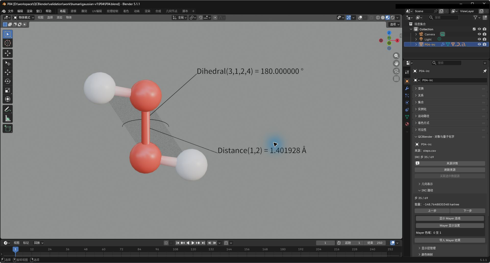
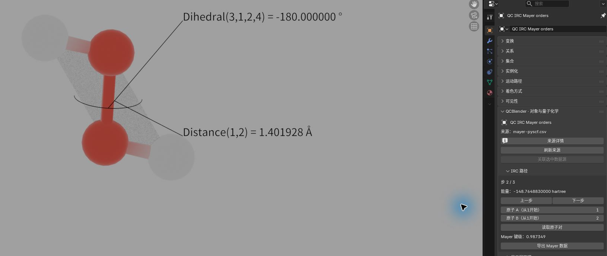
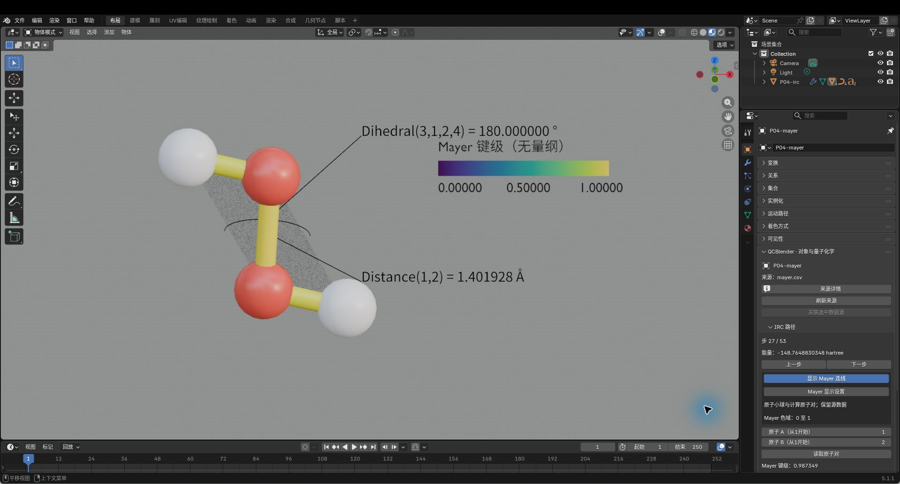

# IRC 路径与 Mayer 键级

[返回教程目录](../SOP.md#topics)

## 目录

- [1. 导入三步 IRC 路径](#step-01)
- [2. 创建随构型更新的测量标注](#step-02)
- [3. 切换构型并比较能量与标注](#step-03)
- [4. 导入各步的 Mayer 键级](#step-04)
- [5. 选择原子对并比较随步键级](#step-05)
- [6. 按 Mayer 键级着色并筛选连线](#step-06)

路径相对材料根目录。先按[准备新工程](../SOP.md#new-scene)准备场景并打开 QCBlender 侧栏。

本页截图使用案例 `P04-` 前缀。

### 1. 导入三步 IRC 路径

- 点击 **N 侧栏 → 导入与导出（Import and Export） → 导入（Import） → 导入 IRC 路径（Import IRC Path）**，在 **CSV 清单：step,fchk（CSV manifest: step,fchk）** 选择 [shared/data/public/P04/steps.csv](../../shared/data/public/P04/steps.csv)。
- 该 CSV 与以下三份文件保持在同一目录。
- 完成后在 **N 侧栏 → QC 对象导航（QC Object Navigation）** 点击 **IRC path** 行最左侧的选择图标，点击 **N 侧栏 → 当前 QC 对象（Current QC Object） → 打开对象属性（Open Object Properties）**，在 **IRC 路径（IRC Path）** 应看到 **步 1 / 3（Step 1 / 3）**、能量约 **−148.764884 hartree**。

| 步号 | 波函数文件 |
| --- | --- |
| 1 | [shared/data/public/P04/step-001.fchk](../../shared/data/public/P04/step-001.fchk) |
| 2 | [shared/data/public/P04/step-002.fchk](../../shared/data/public/P04/step-002.fchk) |
| 3 | [shared/data/public/P04/step-003.fchk](../../shared/data/public/P04/step-003.fchk) |

了解 IRC、清单与步号

> 过渡态是反应路径上能量势垒处的构型。IRC（内禀反应坐标）用于跟随过渡态两侧的反应路径；这里导入沿路径计算的一组构型。本例使用 H₂O₂ 路径上靠近过渡态的三个点；原子顺序为 O/O/H/H。

> CSV manifest 是文件清单；step、fchk 两列把步号与对应的波函数文件配对。IRC path 是管理整条路径的根对象。

**步 1 / 3（Step 1 / 3）** 表示当前显示三份构型中的第一份。切换步号可比较路径上的构型和能量；步号取自清单中的顺序。

### 2. 创建随构型更新的测量标注

- 若原子遮挡测量几何，先在该对象的 **几何表示（Geometry Representation）** 选 **球棍（Ball and Stick）**，将 **原子半径（Atom Radius）=0.35、键半径（Bond Radius）=0.12**。
- 本页截图将两条标注的字号设为 **0.45**，距离文字偏移设为 **(1.1, 0, −0.6)**、二面角文字偏移设为 **(1.1, 0, 1.2)**，并按[标注朝向相机](01-molecule-xyz.md#step-05)调整文字朝向；这些设置只改变显示。

- 保持 **IRC path** 活动，重新打开该对象属性，在 **对象属性（Object Properties） → 局部选择与标注（Local Selection and Annotations）** 点击 **距离（Distance）**，将独立整数控件 **原子 1（Atom 1）=1**、**原子 2（Atom 2）=2**；再点击 **二面角（Dihedral）**，初始为 1/2/3/4 时先点 **2 ↔ 3**、再点 **1 ↔ 2**，核对四项依次为 **3/1/2/4**。
- 编号可直接输入或左右步进，超出来源范围会限制在边界内，撞到同组已有编号则保留原值；交换按钮用于调整顺序。
- 两个标注的 **小数位数（Decimal places）** 均设为 **6**，保持默认前缀与测量几何可见。
- 默认文字分别以 `Distance(1,2) = `、`Dihedral(3,1,2,4) = ` 开头，再接实际数值和单位；这些英文前缀不随界面语言改变。
- 新标注默认为黑色金属材质，创建时可选择颜色。

- 创建后仍选 **IRC path**，转到能看清标签的视角，必要时在 **局部选择与标注（Local Selection and Annotations） → 源原子标注（Source Atom Annotations）** 找到相应标注行，点击设置图标调整 **偏移（Offset）** 并点击 **确定（OK）**。
- 虚线、圆弧的尺寸可独立于引线调整；二面角三角面与测量圆弧分别显隐。
- 自定义前缀、材质节点编辑、整层朝向相机与旧标注材质处理见[分子专题的标注步骤](01-molecule-xyz.md#step-05)。
- 每条标注的文字、引线与测量线共享自己的材质，二面角面另外共享一份材质；手工编辑材质后切换 IRC 步仍保留节点设置。
- 上述显示设置不改变构型或测量值。

了解随步测量、精度与偏移

> 测量标注按源原子编号绑定当前构型。距离标注需要两个编号；二面角标注需要按测量顺序填写四个编号，本例用于观察 H–O–O–H 的扭转。

标注设置用来安排文字的精度和位置，便于比较不同步的测量值。

- **小数位数（Decimal places）**：标签保留的小数位数；本例设为 6，便于对照三步结果。
- **偏移（Offset）**：移动文字相对测量位置的显示位置，用于避开分子或其他标签。
- **显示引线（Show leader）**：显示标签与测量位置之间的引线，便于辨认文字对应的原子位置。
- 测量几何的显隐独立于文字引线：距离用两原子之间的 1:1 虚线，二面角用圆弧及两组三原子三角面。二面角圆弧以输入的第二、第三个原子的中点为圆心，平面垂直于这两原子确定的轴；半透明三角面显示输入的第 1–2–3 和第 2–3–4 个原子所在平面。
- **可见（Visible）**：控制该标注是否显示；关闭后仍保留标注设置。

### 3. 切换构型并比较能量与标注

- 在 **IRC 路径（IRC Path）** 点击 **下一步（Next） → 下一步（Next） → 上一步（Previous）**，按 **1→2→3→2** 切换。
- 距离始终约 **1.401928 Å**，二面角应依次约为 **171.760508°、−180.000000°、−171.760508°**；第 2 步能量约 **−148.764883 hartree**。
- 面板步号、文字读数与测量几何应一起更新；来源构型保留在科学记录中，不额外拼入默认文字。
- 二面角无法定义时会显示 `undefined`（未定义）并隐藏无效几何，不沿用上一构型的圆弧或面。
- 截图保存为 `human/screenshots/P04-irc.png`。

了解切步按钮与关联状态

**IRC 路径（IRC Path）** 的切步按钮控制根对象的当前构型；能量、原子位置和绑定的测量标注随当前步更新。

- **下一步（Next）**：查看清单中的下一步；到最后一步时按钮停用。
- **上一步（Previous）**：查看清单中的前一步；到第一步时按钮停用。

### 4. 导入各步的 Mayer 键级

- 保持 **IRC path** 活动，点击 **对象属性（Object Properties） → IRC 路径（IRC Path） → 导入 Mayer 结果（Import Mayer Results）**，在 **CSV 清单：step,mayer_output（CSV manifest: step,mayer_output）** 选择 [shared/data/public/P04/mayer-pyscf.csv](../../shared/data/public/P04/mayer-pyscf.csv)。
- 保留其同目录的下列文件；完成后应新增 **QC IRC Mayer orders**。

| 步号 | 分析文件 |
| --- | --- |
| 1 | [shared/data/public/P04/step-001-mayer-pyscf.txt](../../shared/data/public/P04/step-001-mayer-pyscf.txt) |
| 2 | [shared/data/public/P04/step-002-mayer-pyscf.txt](../../shared/data/public/P04/step-002-mayer-pyscf.txt) |
| 3 | [shared/data/public/P04/step-003-mayer-pyscf.txt](../../shared/data/public/P04/step-003-mayer-pyscf.txt) |

了解 Mayer 键级与分析来源

> Mayer 键级是由电子结构计算得到的无量纲数值，用于比较指定原子对沿路径的成键变化；本例文本由 PySCF 计算并按 Multiwfn 兼容格式保存。step、mayer_output 清单把各步与相应的键级分析文件配对。

### 5. 选择原子对并比较随步键级

- 在 **N 侧栏 → QC 对象导航（QC Object Navigation）** 选 **QC IRC Mayer orders**，点击 **N 侧栏 → 当前 QC 对象（Current QC Object） → 打开对象属性（Open Object Properties）**，在 **IRC 路径（IRC Path）** 填 **原子 A（从1开始）（Atom A (1-based)）=1、原子 B（从1开始）（Atom B (1-based)）=2**，点击 **读取原子对（Read Pair）**。
- 第 2 步应显示约 **0.987349**。
- 点击 **下一步（Next）** 到第 3 步，值应变为约 **0.987331**，构型和标注同步切换；再点击 **上一步（Previous）** 回第 2 步。
- 截图保存为 `human/screenshots/P04-mayer.png`。

- 需要表格时，在 **N 侧栏 → QC 对象导航（QC Object Navigation）** 选 **IRC path**，按[数据导出](../SOP.md#export)选择 **数据（Data）=IRC** 并设置输出目录，得到 `irc_steps.csv`；再选 **QC IRC Mayer orders**，用同一入口选择 **数据（Data）=Mayer**，得到 `mayer.csv`。
- 两次导出各有一个新子目录，各自的 `metadata.json` 与 CSV 一起保留。

了解原子对筛选与 IRC/Mayer 导出

**QC IRC Mayer orders** 用原子对筛选要读的键级序列，再按路径的当前步显示其中一个值。

- **原子 A（从1开始）（Atom A (1-based)）**、**原子 B（从1开始）（Atom B (1-based)）**：指定两个源原子编号；本例 1、2 对应两个氧原子。
- **读取原子对（Read Pair）**：读取选定原子对的全部随步值。修改编号后需再次点击；该原子对必须出现在导入的分析结果中。
- **下一步（Next） / 上一步（Previous）**：切换整条路径的构型，同时显示已读取原子对在该步的键级。

> `irc_steps.csv` 保存各步的能量与来源文件信息，供整理路径能量变化；`mayer.csv` 保存所有源步、原子对及其键级，供比较成键变化。绘图时可用步号作横轴，能量（hartree）或无量纲键级作纵轴；步号不是时间。两份表可在表格或绘图软件中按步号对应查看。

### 6. 按 Mayer 键级着色并筛选连线

数值查询适合比较一个原子对；逐键着色可以同时观察导入的全部原子对。连线按计算结果中的源原子编号建立，与按距离推断的几何键分开。

> Mayer 连线表示导入的原子对及其键级。显示一条很弱的连线不等于将该原子对判定为化学键；下限筛选也只控制显示。

- 选中 **IRC path** 或 **QC IRC Mayer orders**，在 **对象属性 → IRC 路径（IRC Path）** 点击 **显示 Mayer 连线（Show Mayer Bonds）**。原子改用小球，距离推断连线隐藏，六个导入原子对显示为各自颜色均匀的独立连线。
- 默认使用 Viridis 和 **整条 IRC 路径（Entire IRC Path）** 色域。按 **上一步 / 下一步** 切换构型；连线端点、当前键级和颜色随步变化，图例的范围固定。
- 点击 **Mayer 显示设置（Mayer Display Settings）**，启用 **按键级下限筛选（Filter by Lower Bond Order）**，将 **Mayer 键级下限（Minimum Mayer Order）** 设为 `0.5`。本例保留 1–2、1–3、2–4 三条连线；关闭下限筛选恢复六条。
- 如需与其他工程使用相同范围，选择 **手动范围（Manual Range）**，填写 **Minimum=0、Maximum=1**。最小值必须小于最大值；超出范围的数值使用端点颜色，原值仍保留。
- **图例位置（Legend Position）** 和 **图例旋转（Legend Rotation）** 用于排版；从侧面观察时，旋转图例使文字正对观察方向，再按主流程重新取景出图。
- 选回 **IRC path**，用 **局部选择与标注 → 局部原子选择（Local Atom Selection）** 的 **替换（Replace）** 模式输入 `1,2`，只保留两个氧原子及它们之间的连线；**清除（Clear）** 恢复原子范围。元素筛选同样要求连线两端原子都可见。
- 在 **几何表示（Geometry Representation）** 调整 **原子半径（Atom Radius）** 和 **键半径（Bond Radius）**。再次点击 **显示 Mayer 连线** 可关闭显示并恢复开启前的表示方式；也可按 `Ctrl+Z` 撤销最近一步。
- 返回第 2 步，使用 `0–1` 手动色域和 `0.5` 下限，截图保存为 `human/screenshots/P04-mayer-colors.png`。

- 按[保存并重新打开工程](../SOP.md#save)保存便携工程及配套 `.qcdata`；重开后检查当前步、Mayer 开关、手动范围和下限仍与保存前一致。
- 按上一步导出 **Mayer** 数据。即使画面只显示三条连线，`mayer.csv` 仍保留三步、六原子对的全部 18 个键级。

了解色域、来源与失败处理

整条路径色域由全部导入步骤的最小、最大 Mayer 键级确定，便于跨步比较。手动范围用于统一不同工程的显示尺度。两种范围都只改变颜色；键级是无量纲数值。

所有步骤必须包含相同原子对集合；缺失值不会按零补齐。导入文件与 IRC 构型的步号、原子顺序必须对应，来源身份随数据保存。若提示原子对载体、源身份或节点图不一致，先撤销对内部载体或节点的改动，再切步；预检失败时不会推进到新构型。首版应在未映射其他标量颜色场的 IRC 原子视图上开启 Mayer 显示；配置 Mayer 后，如需其他标量场着色，请另建原子视图。

