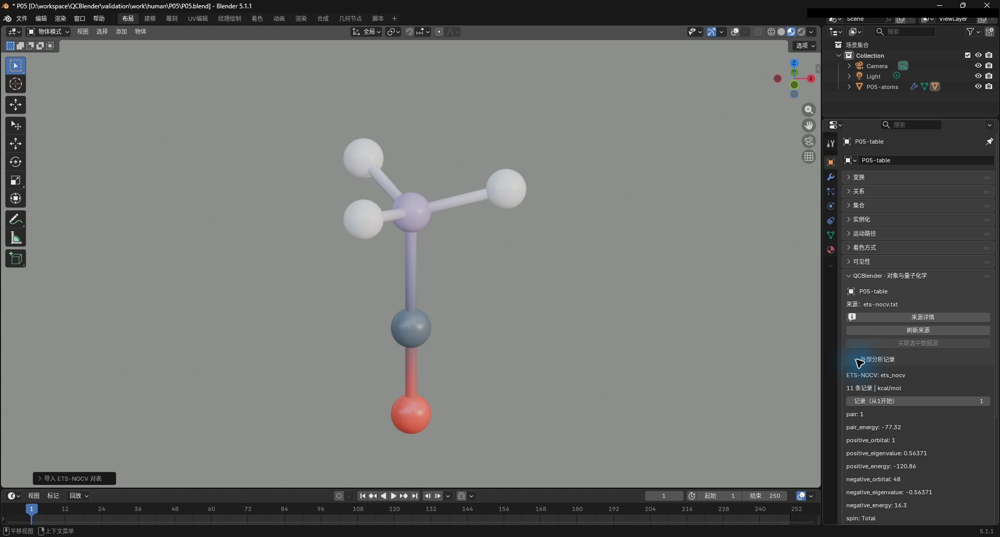
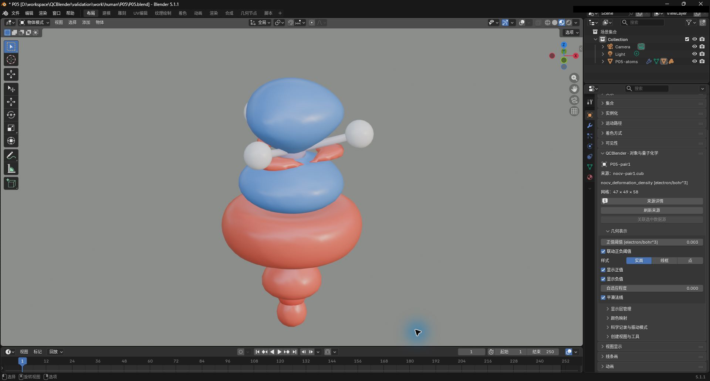

# ETS-NOCV 表与变形密度

[返回教程目录](../SOP.md#topics)

## 目录

- [1. 导入分子和 ETS-NOCV 表](#step-01)
- [2. 读取源表中的 Pair 记录](#step-02)
- [3. 按自旋和能量范围筛选贡献](#step-03)
- [4. 导入 Pair1 的变形密度场](#step-04)
- [5. 从表记录定位场并切换符号显示](#step-05)

路径相对材料根目录。先按[准备新工程](../SOP.md#new-scene)准备场景并打开 QCBlender 侧栏。

本页截图使用案例 `P05-` 前缀。

### 1. 导入分子和 ETS-NOCV 表

> NOCV（自然化学价轨道）将片段组合时的电子密度变化分成配对贡献；ETS-NOCV 将这些贡献与相互作用能量分析结合，表中列出各对的数值与能量。本例能量由 Multiwfn 的近似方法计算，详细条件见[样本说明](../../shared/data/public/NOTICE.md)。

> 轨道对能量单位（Pair energy unit）声明源表中每对贡献的能量单位。这里导入源表数值，单位选项不执行换算。

按原始输出中的单位选择：

- **kcal/mol**：千卡每摩尔；本例源表使用这个单位。
- **hartree**：原子单位能量；用于源表按 hartree 输出的结果。

点击 **N 侧栏 → 工作流（Workflow） → 导入（Import） → 导入 Gaussian / Cube / XYZ（Import Gaussian / Cube / XYZ）**，导入 [shared/data/public/P05/complex.fchk](../../shared/data/public/P05/complex.fchk)。只选新原子对象，点击 **导入外部结果（Import External Results） → 能量分解（Energy Decomposition） → ETS-NOCV 表（ETS-NOCV Table）**，选 **ETS-NOCV 输出文本（ETS-NOCV output text）=[shared/data/public/P05/nocv/ets-nocv.txt](../../shared/data/public/P05/nocv/ets-nocv.txt)**、**轨道对能量单位（Pair energy unit）=kcal/mol** 并确认。应保留 **C/O/B/H/H/H** 六原子分子，并新增 **QC ETS-NOCV pairs**。

### 2. 读取源表中的 Pair 记录

> **QC ETS-NOCV pairs** 是分析表的记录对象，用于查看各轨道对（Pair）的能量和本征值，并筛选对应的成对贡献。

> 轨道对（Pair）是源分析中一对贡献的编号。轨道对能量（Pair energy）是该对贡献的能量，正负本征值描述该对电子密度重排的大小；它们用于比较各对贡献。

查看时先区分记录的位置与贡献的身份：

- **外部分析记录（External Analysis Records） → 记录（从1开始）（Record (1-based)）**：按源表中的行位置查看完整记录，从 1 开始。
- **轨道对（Pair）**：源分析给贡献对分配的编号；源表可能省略部分贡献或分别打印不同自旋，因此应读取行内的轨道对（Pair）字段。
- **外部结果浏览器（External Result Browser） → 匹配项（从1开始）（Match (1-based)）**：从当前筛选并排序后的结果中选择第几条，从 1 开始。

> 自旋（Spin）区分自旋记录。总计（Total）表示总通道，Alpha、Beta 表示分别列出的两种自旋通道；同一轨道对（Pair）的记录需连同自旋（Spin）一起辨认。

在 **显示层（Display Layers）** 点击 **QC ETS-NOCV pairs** 行最左侧的选择图标，点击 **工作流（Workflow） → 对象属性与显示参数（Object Properties and Display Parameters）**，展开 **外部分析记录（External Analysis Records）**。应有 **11 条实际打印的记录**；**记录（从1开始）（Record (1-based)）=1** 应为 **Pair1 / 总计（Total）**、**pair_energy=−57.02 kcal/mol**，正负本征值为 **+0.54550/−0.54550**。截图保存为 `human/screenshots/P05-nocv-table.png`。

把 **记录（Record）=2**，应读到 **Pair2 / 总计（Total）**、**pair_energy=−11.91 kcal/mol**；再恢复 **记录（Record）=1**。这一步便于熟悉逐行读取，筛选较多记录时则使用下面的浏览器。

### 3. 按自旋和能量范围筛选贡献

**外部结果浏览器（External Result Browser）** 用多个条件共同筛选记录，再按 **排序（Sort）** 排序。能量范围使用源表声明的单位，负值按通常数值大小比较，例如 −60 小于 −50。

- **自旋（Spin）**：**全部（All）** 包含表内所有通道；**总计（Total）**、**Alpha**、**Beta** 分别限定一个通道。本例打印的是总计（Total）记录。
- **轨道对能量（Pair energy） → 从（From） / 至（To）**：启用左侧勾选框后，对应端点才参与筛选；可只设下限、只设上限或同时设置两端。范围包含端点，从（From）应小于或等于至（To）。
- **本征值（Eigenvalue）**：需要按本征值筛选时，**任意（Either）** 允许一对中的任一符号满足范围；**正本征值轨道（Positive orbital）**、**负本征值轨道（Negative orbital）** 分别只比较正值或负值。未启用本征值范围时，保留默认设置即可。
- **排序（Sort）**：**轨道对（Pair）** 按源轨道对（Pair）编号排序；**轨道对能量（Pair energy）** 按能量从小到大排序；**正本征值（Positive eigenvalue）**、**负本征值（Negative eigenvalue）** 分别按对应本征值从小到大排序。排序后用 **匹配项（Match）** 选择要查看的匹配记录。

在表对象的 **外部结果浏览器（External Result Browser）** 中选 **自旋（Spin）=总计（Total）**，在 **轨道对能量（Pair energy） [kcal/mol]** 一行开启两端范围，填 **从（From）=−60、至（To）=−50**，设 **匹配项（从1开始）（Match (1-based)）=1**，点击 **应用筛选（Apply Filter）**。应显示 **匹配记录：（Matching records:） 1**，匹配 **Pair1**。此时尚未导入该轨道对（Pair）的场，视口中还没有对应变形密度表面。

可将范围临时改为 **从（From）=−12、至（To）=−11** 并点击 **应用筛选（Apply Filter）**：应有 **匹配记录：（Matching records:） 2**，在默认 **排序（Sort）=轨道对（Pair）** 下，**匹配项（Match）=1** 对应 Pair2，**匹配项（Match）=2** 对应 Pair3；改变匹配项（Match）后再次点击 **应用筛选（Apply Filter）** 查看记录。完成后恢复 **从（From）=−60、至（To）=−50、匹配项（Match）=1** 并应用，供后续定位 Pair1 使用。

### 4. 导入 Pair1 的变形密度场

> 带符号的轨道对 Cube（Signed pair Cube）保存一对贡献的带正负号变形密度场；形变密度单位（Deformation density unit）声明该场的密度单位，供图例与导出使用。

导入时，用以下字段将 Cube 与已导入的表记录对应：

- **自旋（Spin）**：选择该 Cube 所属的自旋通道；列表来自当前表中实际存在的通道。
- **轨道对编号（Pair number）**：选择该通道下的源轨道对（Pair）编号；列表来自表中的实际记录。
- **形变密度单位（Deformation density unit）**：填写 Cube 数值使用的密度单位，本例为 **electron/bohr^3**。

保持表对象活动，点击 **N 侧栏 → 导入外部结果（Import External Results） → 能量分解（Energy Decomposition） → NOCV 贡献对 Cube（NOCV pair Cube）**，选择 **带符号的轨道对 Cube（Signed pair Cube）=[shared/data/public/P05/nocv/nocv-pair1.cub](../../shared/data/public/P05/nocv/nocv-pair1.cub)**，设 **自旋（Spin）=总计（Total）**，从 **轨道对编号（Pair number）** 的实际源编号列表选择 **1**，并设 **形变密度单位（Deformation density unit）=electron/bohr^3**。完成后在 **显示层（Display Layers）** 选 **QC nocv_deformation_density**，重新点击 **工作流（Workflow） → 对象属性与显示参数（Object Properties and Display Parameters）**，其网格应为 **47×50×57**。

> 变形密度的正值表示电子密度增加，负值表示电子密度减少；本例表面的单位是 electron/bohr^3，用于观察对应轨道对（Pair）的电子密度重排发生在哪些区域。

在 **几何表示（Geometry Representation）** 中，阈值决定绘制哪一层等值面，显示开关决定查看哪个符号：

- **正值阈值（Positive Isovalue）**：指定正值等值面的数值。
- **联动正负阈值（Link Thresholds）**：让负值阈值（Negative Isovalue）与正值阈值（Positive Isovalue）等绝对值、符号相反，便于在同一尺度下比较密度增加和减少区域。
- **显示正值（Show Positive Values） / 显示负值（Show Negative Values）**：分别显示或隐藏两种符号的表面。

在 **几何表示（Geometry Representation）** 设 **正值阈值（Positive Isovalue）=0.003**，保持 **联动正负阈值（Link Thresholds）、显示正值（Show Positive Values）、显示负值（Show Negative Values）** 开启。应看到两种颜色的变形密度。截图保存为 `human/screenshots/P05-nocv-density.png`。

### 5. 从表记录定位场并切换符号显示

**应用筛选（Apply Filter）** 会尝试选中与当前匹配记录对应的已导入场。表记录与场通过来源、轨道对（Pair）和自旋（Spin）关联；找到唯一场后活动对象会切换到它，再打开对象属性即可调整该场的显示。

在 **显示层（Display Layers）** 选回 **QC ETS-NOCV pairs**，重新点击 **工作流（Workflow） → 对象属性与显示参数（Object Properties and Display Parameters）**，保留步骤 3 的筛选条件与 **匹配项（Match）=1**，再点击 **应用筛选（Apply Filter）**。活动对象应切换到刚才导入的唯一 **Pair1 / 总计（Total）** 场 **QC nocv_deformation_density**。再次点击 **工作流（Workflow） → 对象属性与显示参数（Object Properties and Display Parameters）**，将原先固定在表对象上的属性区切到场对象；然后在 **几何表示（Geometry Representation）** 关闭再开启 **显示负值（Show Negative Values）**，对应部分应消失后恢复，另一符号仍可见。
