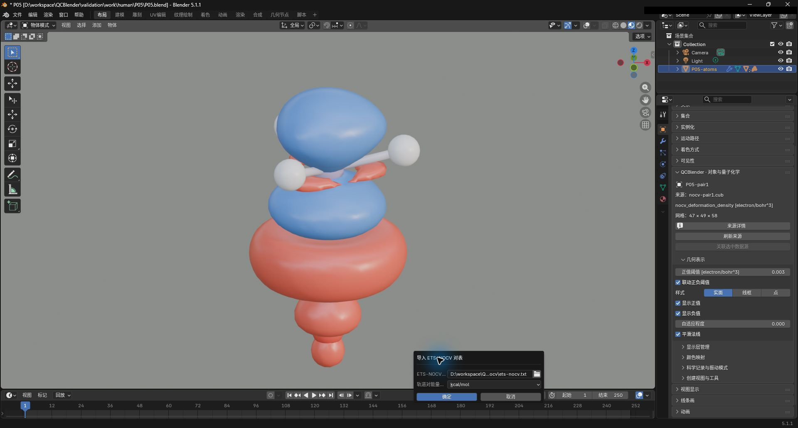
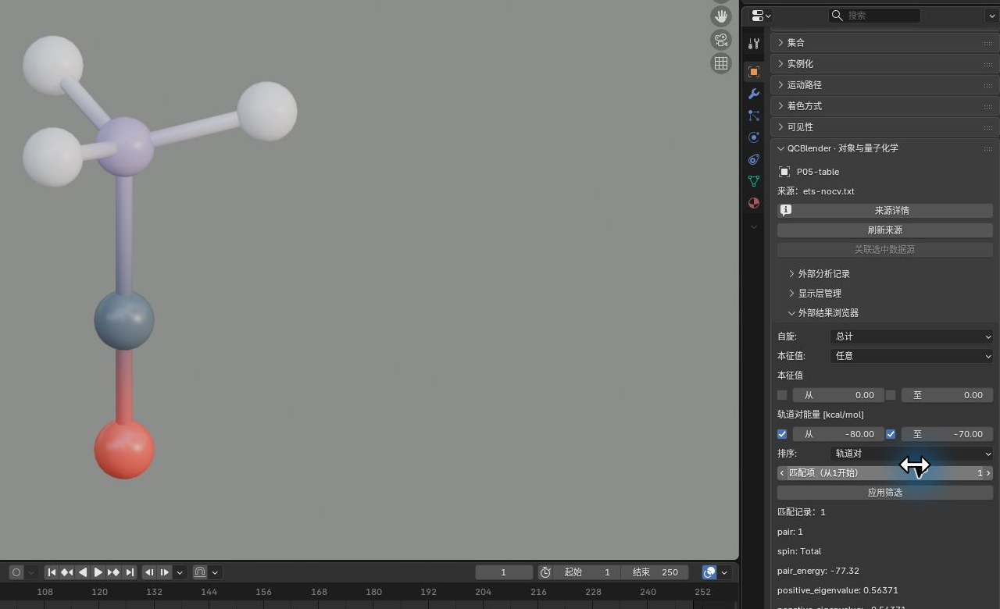
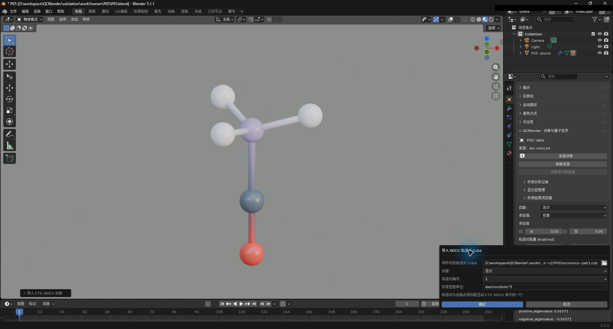

# 08. ETS-NOCV 表与变形密度

[返回教程目录](../SOP.md#topics)

## 目录

- [1. 导入分子和 ETS-NOCV 表](#step-01)
- [2. 读取源表中的 Pair 记录](#step-02)
- [3. 按自旋和能量范围筛选贡献](#step-03)
- [4. 导入 Pair1 的变形密度场](#step-04)
- [5. 从表记录定位场并切换符号显示](#step-05)
- [附录：参数、原理与输入规范](#appendix)
  - [A1. 了解 ETS-NOCV、轨道对与能量单位](#appendix-step-01)
  - [A2. 区分记录位置、Pair 身份与自旋](#appendix-step-02)
  - [A3. 了解自旋、能量范围与排序条件](#appendix-step-03)
  - [A4. 了解 Pair Cube、变形密度与双符号显示](#appendix-step-04)
  - [A5. 了解筛选记录如何定位已导入场](#appendix-step-05)

路径均相对教程材料根目录（同时含 `human/` 和 `shared/`）。先完成[安装](../SOP.md#install)，按[准备新工程](../SOP.md#new-scene)开始；每次换对象后重新打开其对象属性。

---

### 1. 导入分子和 ETS-NOCV 表

本例能量由 Multiwfn 使用实际复合物 KS 矩阵重建的近似方法得到，不等同于 F_TS 过渡态算符法。单位只声明源表含义，不做数值换算；条件与适用范围见[样本说明](../../shared/data/public/NOTICE.md)及本节附录。

详细说明见[附录 A1：了解 ETS-NOCV、轨道对与能量单位](#appendix-step-01)。

1. 点击 **N 侧栏 → 导入与导出 → 导入 → 导入 Gaussian / Cube / XYZ**。
2. 选择文件 `shared/data/public/gaussian-v2/P05/complex.fchk`。
3. 保持选中新生成的六原子（C/O/B/H/H/H）分子对象。
4. 点击 **导入外部结果 → 能量分解 → ETS-NOCV 表（ETS-NOCV Table）**。
5. 配置导入参数：
   - **ETS-NOCV 输出文本**：`shared/data/public/gaussian-v2/P05/nocv/ets-nocv.txt`
   - **轨道对能量单位**：`kcal/mol`
6. 确认导入，生成对象 **QC ETS-NOCV pairs**。截图保存至 `human/screenshots/P05-nocv-table-import.png`。

### 2. 读取源表中的 Pair 记录

详细说明见[附录 A2：区分记录位置、Pair 身份与自旋](#appendix-step-02)。

1. 在 **QC 对象导航** 中选中 **QC ETS-NOCV pairs** 并打开对象属性。
2. 展开 **外部分析记录**，确认包含 11 条记录。
3. 设置 `记录（从1开始） = 1`：
   - 通道：`Pair1 / 总计（Total）`
   - 轨道对能量：`pair_energy = -77.32 kcal/mol`
   - 本征值：`+0.56371 / -0.56371`
4. 截图保存至 `human/screenshots/P05-nocv-table.png`。

### 3. 按自旋和能量范围筛选贡献

详细说明见[附录 A3：了解自旋、能量范围与排序条件](#appendix-step-03)。

1. 保持在表对象的属性面板中，展开 **外部结果浏览器**。
2. 开启 **轨道对能量** 一行的上下限开关，再配置筛选条件：
   - **自旋（Spin）**：总计（Total）
   - **轨道对能量 [kcal/mol] 从 / 至**：`-80 / -70`
   - **匹配项（从1开始）**：`1`
3. 点击 **应用筛选（Apply Filter）**，显示唯一匹配记录 `Pair1`。截图保存至 `human/screenshots/P05-nocv-filter.png`。

### 4. 导入 Pair1 的变形密度场

详细说明见[附录 A4：了解 Pair Cube、变形密度与双符号显示](#appendix-step-04)。

1. 保持表对象活动，点击 **导入外部结果 → 能量分解 → NOCV 贡献对 Cube（NOCV pair Cube）**。
2. 配置导入参数：
   - **带符号的轨道对 Cube**：`shared/data/public/gaussian-v2/P05/nocv/nocv-pair1.cub`
   - **自旋（Spin）**：总计（Total）
   - **轨道对编号（Pair number）**：`1`
   - **形变密度单位**：`electron/bohr^3`
3. 截图保存至 `human/screenshots/P05-nocv-pair-import.png`。

4. 导入后在导航中选中新生成的场对象 **QC nocv_deformation_density**，打开对象属性。
5. 在 **几何表示** 中配置参数：
   - **正值阈值（Positive Isovalue）**：`0.003`
   - **联动正负阈值**：开启
   - **显示正值 / 显示负值**：开启
6. 视口中呈现正负双色电荷形变密度曲面。截图保存至 `human/screenshots/P05-nocv-density.png`。

### 5. 从表记录定位场并切换符号显示

详细说明见[附录 A5：了解筛选记录如何定位已导入场](#appendix-step-05)。

1. 切回 **QC ETS-NOCV pairs** 并打开对象属性。
2. 点击 **应用筛选**，焦点自动跳转并选中关联的 **QC nocv_deformation_density** 场对象。
3. 打开该场对象属性，测试关闭并重新开启 **显示负值（Show Negative Values）**，验证负相曲面可独立显隐。

---

## 附录：参数、原理与输入规范

### A1. 了解 ETS-NOCV、轨道对与能量单位

> NOCV（自然化学价轨道）将片段组合时的电子密度变化分成配对贡献；ETS-NOCV 将这些贡献与相互作用能量分析结合，表中列出各对的数值与能量。本例使用 CO→BH₃ 的同源计算；CO 片段为14电子，BH₃片段为8电子，两片段保持复合物中的构型。能量由 Multiwfn 基于实际复合物 KS 矩阵重建的近似方法计算，不等同于 F_TS 过渡态算符法，详细条件见[样本说明](../../shared/data/public/NOTICE.md)。

> 轨道对能量单位（Pair energy unit）声明源表中每对贡献的能量单位。这里导入源表数值，单位选项不执行换算。

按原始输出中的单位选择：

- **kcal/mol**：千卡每摩尔；本例源表使用这个单位。
- **hartree**：原子单位能量；用于源表按 hartree 输出的结果。

### A2. 区分记录位置、Pair 身份与自旋

> **QC ETS-NOCV pairs** 是分析表的记录对象，用于查看各轨道对（Pair）的能量和本征值，并筛选对应的成对贡献。

> 轨道对（Pair）是源分析中一对贡献的编号。轨道对能量（Pair energy）是该对贡献的能量，正负本征值描述该对电子密度重排的大小；它们用于比较各对贡献。

查看时先区分记录的位置与贡献的身份：

- **外部分析记录（External Analysis Records） → 记录（从1开始）（Record (1-based)）**：按源表中的行位置查看完整记录，从 1 开始。
- **轨道对（Pair）**：源分析给贡献对分配的编号；源表可能省略部分贡献或分别打印不同自旋，因此应读取行内的轨道对（Pair）字段。
- **外部结果浏览器（External Result Browser） → 匹配项（从1开始）（Match (1-based)）**：从当前筛选并排序后的结果中选择第几条，从 1 开始。

> 自旋（Spin）区分自旋记录。总计（Total）表示总通道，Alpha、Beta 表示分别列出的两种自旋通道；同一轨道对（Pair）的记录需连同自旋（Spin）一起辨认。

### A3. 了解自旋、能量范围与排序条件

**外部结果浏览器（External Result Browser）** 用多个条件共同筛选记录，再按 **排序（Sort）** 排序。能量范围使用源表声明的单位，负值按通常数值大小比较，例如 −80 小于 −70。

- **自旋（Spin）**：**全部（All）** 包含表内所有通道；**总计（Total）**、**Alpha**、**Beta** 分别限定一个通道。本例打印的是总计（Total）记录。
- **轨道对能量（Pair energy） → 从（From） / 至（To）**：启用左侧勾选框后，对应端点才参与筛选；可只设下限、只设上限或同时设置两端。范围包含端点，从（From）应小于或等于至（To）。
- **本征值（Eigenvalue）**：需要按本征值筛选时，**任意（Either）** 允许一对中的任一符号满足范围；**正本征值轨道（Positive orbital）**、**负本征值轨道（Negative orbital）** 分别只比较正值或负值。未启用本征值范围时，保留默认设置即可。
- **排序（Sort）**：**轨道对（Pair）** 按源轨道对（Pair）编号排序；**轨道对能量（Pair energy）** 按能量从小到大排序；**正本征值（Positive eigenvalue）**、**负本征值（Negative eigenvalue）** 分别按对应本征值从小到大排序。排序后用 **匹配项（Match）** 选择要查看的匹配记录。

#### 比较多个匹配项并恢复 Pair1

将启用的能量范围临时改为 **−16 至 −15 kcal/mol** 并应用，应匹配 2 条。在默认 **排序=轨道对** 下，匹配项 1、2 分别对应 Pair2、Pair3；改变匹配项后再次应用。完成后恢复 **−80 至 −70、匹配项=1** 并应用，再继续正文 Pair1 场导入与定位。

### A4. 了解 Pair Cube、变形密度与双符号显示

> 带符号的轨道对 Cube（Signed pair Cube）保存一对贡献的带正负号变形密度场；形变密度单位（Deformation density unit）声明该场的密度单位，供图例与导出使用。

导入时，用以下字段将 Cube 与已导入的表记录对应：

- **自旋（Spin）**：选择该 Cube 所属的自旋通道；列表来自当前表中实际存在的通道。
- **轨道对编号（Pair number）**：选择该通道下的源轨道对（Pair）编号；列表来自表中的实际记录。
- **形变密度单位（Deformation density unit）**：填写 Cube 数值使用的密度单位，本例为 **electron/bohr^3**。

> 变形密度的正值表示电子密度增加，负值表示电子密度减少；本例表面的单位是 electron/bohr^3，用于观察对应轨道对（Pair）的电子密度重排发生在哪些区域。

在 **几何表示（Geometry Representation）** 中，阈值决定绘制哪一层等值面，显示开关决定查看哪个符号：

- **正值阈值（Positive Isovalue）**：指定正值等值面的数值。
- **联动正负阈值（Link Thresholds）**：让负值阈值（Negative Isovalue）与正值阈值（Positive Isovalue）等绝对值、符号相反，便于在同一尺度下比较密度增加和减少区域。
- **显示正值（Show Positive Values） / 显示负值（Show Negative Values）**：分别显示或隐藏两种符号的表面。

### A5. 了解筛选记录如何定位已导入场

**应用筛选（Apply Filter）** 会尝试选中与当前匹配记录对应的已导入场。表记录与场通过来源、轨道对（Pair）和自旋（Spin）关联；找到唯一场后活动对象会切换到它，再打开对象属性即可调整该场的显示。
