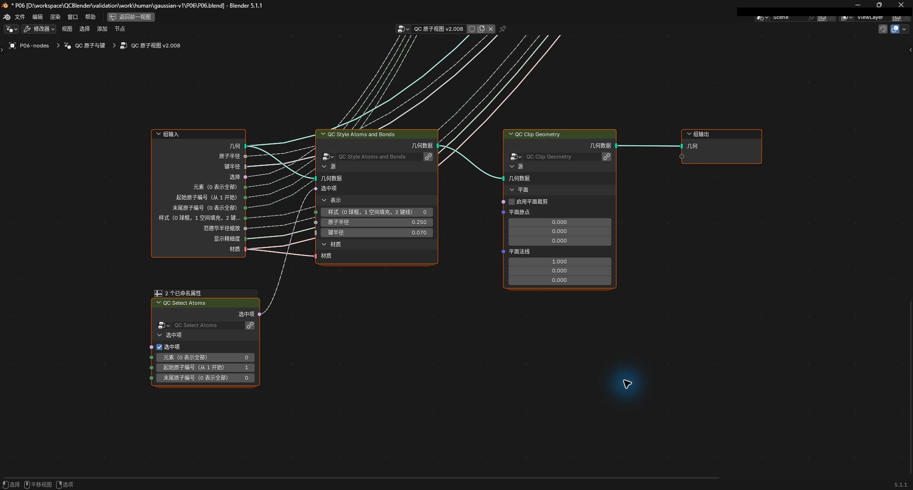
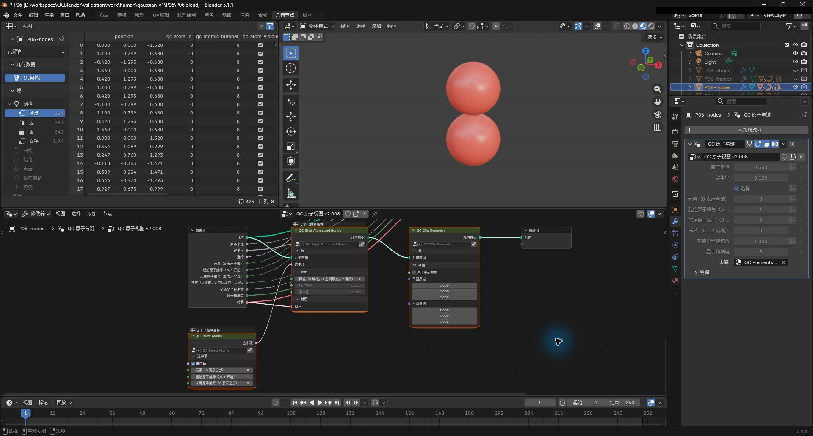
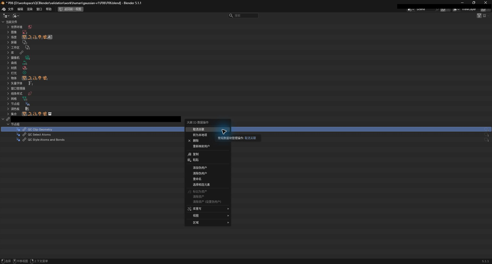
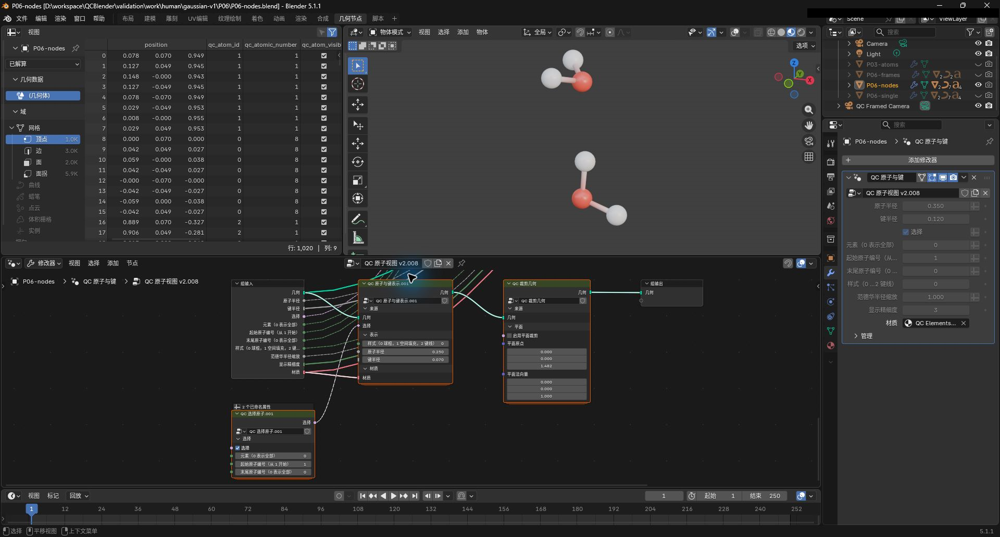

# 用公共几何节点组合显示

[返回教程目录](../SOP.md#topics)

## 目录

- [1. 导入分子并创建显示副本](#step-01)
- [2. 添加选择、表示和裁剪节点](#step-02)
- [3. 连接新分支并接入组输出](#step-03)
- [4. 筛选氧原子并切换表示方式](#step-04)
- [5. 裁剪上方水分子并恢复完整显示](#step-05)
- [源属性与求值几何](#attributes)
  - [读取与几何对应的属性](#section-01)

路径相对材料根目录。先按[准备新工程](../SOP.md#new-scene)准备场景并打开 QCBlender 侧栏。

本页截图使用案例 `P06-` 前缀。

### 1. 导入分子并创建显示副本

- 点击 **N 侧栏 → 导入与导出（Import and Export） → 导入（Import） → 导入 Gaussian / Cube / XYZ（Import Gaussian / Cube / XYZ）**，导入 [shared/data/public/gaussian-v2/P06/water-dimer.xyz](../../shared/data/public/gaussian-v2/P06/water-dimer.xyz)。
- 选中新原子对象，在三维视口按 `F2` 命名为 **P06-original**。
- 点击 **打开对象属性（Open Object Properties）**，在 **对象属性（Object Properties） → 显示层管理（Display Layer Management） → 复制（Duplicate）** 创建副本，将副本命名为 **P06-nodes**，重新打开副本的对象属性；在 Outliner 关闭原层的眼睛和相机图标，保持副本活动。
- 复制（Duplicate）会为副本复制可编辑的外层节点树。

了解节点树、修改器与显示副本

> 几何节点（Geometry Nodes）用连线把选择、表示和裁剪组合起来。节点树是这组计算连接；修改器把节点树应用到对象，生成视口中看到的几何。这里在显示副本上建立一个简单分支。

### 2. 添加选择、表示和裁剪节点

- 切换顶部 **几何节点（Geometry Nodes）** 工作区，在大纲视图（Outliner）选 **P06-nodes**。
- 在 **属性（Properties） → 修改器（Modifiers）** 找到已有的 **QC 原子与键（QC Atoms and Bonds）** 几何节点修改器；让下方几何节点编辑器显示这个修改器使用的 **QC 原子视图 v2（QC Atoms View v2）** 节点树副本，名称可能带 `.001` 等后缀。
- 若编辑器固定在其他树，先取消其图钉固定；将鼠标移入节点编辑器，按 `Home` 查看全部节点，应能看到组输入、原有表示节点和组输出。
- 通过节点编辑器的 **添加（Add）** 菜单，放入下列三个公共节点，并将它们摆在原节点下方的空白区域。

| 菜单 | 节点 |
| --- | --- |
| 原子选择（Atom Selection） | QC 选择原子（QC Select Atoms） |
| 表示 → 原子与键（Representation → Atoms and Bonds） | QC 原子与键表示（QC Style Atoms and Bonds） |
| 空间 → 裁剪（Spatial → Clipping） | QC 裁剪几何（QC Clip Geometry） |

了解选择、表示、裁剪节点与界面语言

本例把显示过程分成三个环节，分别决定选择哪些原子、如何画出原子与键，以及保留哪个空间区域。

节点、插口、资产和目录的显示名称随 Blender 界面语言切换；下文仍用“中文名称（English name）”对照。显示名变化不改变节点连接、原子编号或场值，手动改过的名称会保留。工程中已有的对象名可能保留创建时的名称；本教程中的 **P06-original**、**P06-nodes** 是手动命名，用它们定位案例对象。

- **QC 选择原子（QC Select Atoms）**：输出原子选择（Atom Selection）条件，交给表示节点使用。
- **QC 原子与键表示（QC Style Atoms and Bonds）**：接收原子载体与选择条件，生成球、键或二者组合。
- **QC 裁剪几何（QC Clip Geometry）**：裁剪已经生成的显示几何，便于查看局部空间。

### 3. 连接新分支并接入组输出

- 留在外层节点树，按下表从输出插口拖线到输入插口，连接新分支；接入 **组输出（Group Output）几何（Geometry）** 时替换原来接到该插口的连线。
- 组输入的 **材质（Material）** 沿用副本的元素材质。
- 保留原节点，便于对照；本步完成后由新分支提供显示几何。

| 起点 | 终点 |
| --- | --- |
| 组输入（Group Input）几何（Geometry） | 新 QC 原子与键表示（QC Style Atoms and Bonds）的几何（Geometry） |
| 组输入（Group Input）材质（Material） | 新 QC 原子与键表示（QC Style Atoms and Bonds）的材质（Material） |
| 新 QC 选择原子（QC Select Atoms）的选择（Selection） | 新 QC 原子与键表示（QC Style Atoms and Bonds）的选择（Selection） |
| 新 QC 原子与键表示（QC Style Atoms and Bonds）的几何（Geometry） | 新 QC 裁剪几何（QC Clip Geometry）的几何（Geometry） |
| 新 QC 裁剪几何（QC Clip Geometry）的几何（Geometry） | 组输出（Group Output）几何（Geometry） |

- 截图保存为 `human/screenshots/P06-nodes-wiring.png`。

了解几何、选择与材质插口

> 插口是节点边缘用于输入或输出数据的连接点；连线把上游输出交给下游输入。组输入接收对象的原子载体，组输出交付最终显示几何。

本分支使用三类接口：

- **几何（Geometry）**：传递几何和附在几何上的属性；表示节点接收源原子载体，裁剪节点接收表示节点生成的球棍网格。
- **选择（Selection）**：传递逐原子的真假条件；选择节点的输出连接到表示节点，由后者在收到的原子载体上判断哪些原子参与显示。
- **材质（Material）**：指定外观材质；本例沿用组输入传入的元素材质。

### 4. 筛选氧原子并切换表示方式

- 直接在新选择节点上开启 **选择（Selection）**，设 **元素（0 表示全部）（Element (0 = all)）=8、起始原子编号（从 1 开始）（First Atom (1-based)）=1、末尾原子编号（0 表示全部）（Last Atom (0 = all)）=0**；在新表示节点上设 **样式（0 球棍，1 空间填充，2 键线）（Style (0 ball-stick, 1 space-fill, 2 bonds)）=1**。应只看到两个氧球。
- 可暂时关闭再开启选择节点的 **选择（Selection）**，观察两个氧球一起消失后恢复。

- 截图保存为 `human/screenshots/P06-nodes-oxygen.png`。

- 再将新选择节点的 **元素（Element）=0**，新表示节点的 **样式（Style）=0、原子半径（Atom Radius）=0.25、键半径（Bond Radius）=0.07**，应恢复两个水分子的球棍。
- 试将 **起始原子（First Atom）=4、末尾原子（Last Atom）=6**，应只显示源编号 4–6 的上方水分子；随后恢复 **起始原子（First Atom）=1、末尾原子（Last Atom）=0**，回到六原子显示。

这里修改新节点的输入值；修改器上的旧样式参数仍连接原分支。

了解元素筛选、编号范围与三种样式

**QC 选择原子（QC Select Atoms）** 将输入的选择（Selection）、元素条件和源编号范围共同使用；一个原子满足全部条件时才输出 true。

- **选择（Selection）**：未连接时，勾选表示允许所有原子继续接受元素和编号筛选，取消勾选则全部不选。连接上游选择条件后，以连线传来的条件为起点继续筛选。
- **元素（0 表示全部）（Element (0 = all)）**：填元素原子序数，例如氧为 8；0 表示所有元素。
- **起始原子编号（从 1 开始）（First Atom (1-based)）**、**末尾原子编号（0 表示全部）（Last Atom (0 = all)）**：按源原子编号限定闭区间；起始原子（First Atom）=1 从第一个原子开始，末尾原子（Last Atom）=0 不限制末尾。

**QC 原子与键表示（QC Style Atoms and Bonds） → 样式（Style）** 决定选中原子的表示方式：

- **0 球棍（ball-stick）**：球棍；**原子半径（Atom Radius）** 调整原子球半径，**键半径（Bond Radius）** 调整键半径。
- **1 空间填充（space-fill）**：空间填充球；用元素的范德华半径乘以 **范德华半径缩放（VDW Scale）**，适合观察原子占据的空间。
- **2 键线（bonds）**：只显示键；**键半径（Bond Radius）** 调整键半径。

### 5. 裁剪上方水分子并恢复完整显示

- 在新裁剪节点开启 **启用平面裁剪（Plane Enabled）**，设 **平面原点（Plane Origin）=(0,0,1.4822285)、平面法向量（Plane Normal）=(0,0,1)**。应只剩上方水分子。
- 关闭 **启用平面裁剪（Plane Enabled）**，恢复六原子显示。

- 如果要保存这个自定义工程，先把本页新添加的三个节点组转为本地项。
- 在大纲视图（Outliner）左上方的 **显示模式（Display Mode）** 选择 **Blender 文件（Blender File）**，展开底部指向外部 `nodes.blend` 的库条目；若下面仍有同路径的库条目，继续展开，再展开 **节点组（Node Groups）**。
- 逐个右键点击 **QC 选择原子**、**QC 原子与键表示**、**QC 裁剪几何**，在弹出的 **大纲 ID 数据操作** 菜单直接选择 **转为本地项（Make Local）**。

- 截图保存为 `human/screenshots/P06-nodes-make-local.png`。

- 完成后，这三个节点组移入 **当前文件（Current File） → 节点组（Node Groups）**，不再带外部库图标；名称可能增加 `.001` 等后缀。
- 检查节点连接和六原子显示保持不变。

截图保存为 `human/screenshots/P06-nodes.png`。

- 在材料根目录创建 `work/human/gaussian-v1/P06/`，按[保存自包含工程](../SOP.md#save)保存为 `work/human/gaussian-v1/P06/P06-nodes.blend`；保留同目录的 `P06-nodes.qcdata/`。
- 重新打开后，选 **P06-nodes** 检查新分支和六原子显示仍在。

了解裁剪坐标与转为本地项

**QC 裁剪几何（QC Clip Geometry）** 按位置保留显示几何，源构型仍保留。节点提供两种可共同使用的裁剪条件：

- **启用平面裁剪（Plane Enabled）**：启用平面裁剪；**平面原点（Plane Origin）** 给出以视图对象原点和坐标轴为参考的平面位置，**平面法向量（Plane Normal）** 用三个无量纲分量指定朝向，保留法向所指一侧。
- **启用包围盒裁剪（Box Enabled）**：启用方盒裁剪；**包围盒最小值（Box Minimum） / 包围盒最大值（Box Maximum）** 给出各轴边界，保留盒内几何。与平面同时启用时，仅保留两种条件都允许的区域。

> 转为本地项（Make Local）将链接节点组保存在当前工程中，解除对插件安装目录中节点库的依赖。

查阅其他公共节点与工程保存内容

> 保存得到的 `.blend` 保留本页的节点组合与显示设置，配套 `.qcdata/` 保存该工程引用的科学数据。两者一起保留，供重新打开、继续编辑或移动工程。

> 资产浏览器（Asset Browser）是可复用资产的浏览器；QCBlender 节点（QCBlender Nodes）中的节点资产可以加入当前节点树，按需要组合显示。

在 **资产浏览器（Asset Browser） → QCBlender 节点（QCBlender Nodes）** 可找到全部公共节点；其他节点的用途如下。

| 节点 | 用途 |
| --- | --- |
| QC 采样标量场（QC Sample Scalar Field） | 从体场读取指定位置的值和有效状态 |
| QC 等值面表示 v3（QC Style Isosurface v3） | 生成带正负符号的等值面 |
| QC 表面表示（QC Surface Representation） | 把表面改为实体、线框或点 |
| QC 体积雾表示 v1（QC Style Volume Fog v1） | 给体积显示应用雾材质 |
| QC 标量颜色映射 v2（QC Map Scalar Colors v2） | 按数值和色域给几何着色 |
| QC 平面切片（QC Planar Slice） | 生成平面采样几何 |

## 源属性与求值几何

区分源原子属性与求值网格

> 属性是附在几何元素上的数据；POINT 表示属性按网格点保存。原子载体的每个点对应一个源原子；`qc_atom_id` 从 0 开始，界面使用的源编号等于它加 1。

步骤 4 中筛选氧后，仍使用原文件的氧 1、4。筛选输出的第几行不能代替源编号。制作自定义分支时，保留 `qc_atom_id`，将坐标、元素和可用电荷作为同一个原子的属性一起传递。

> 求值几何是节点运行后的显示结果。原子样式把一个点变成球面，键样式生成管面，因此一个原子可以产生很多顶点。

球棍的求值网格顶点数不等于原子数，球面或键面顶点的位置也不等于核位置。选择原子、创建距离标注或核对构型时，使用源编号与源构型；查看节点结果时，区分样式生成前的原子载体和样式生成后的球棍网格。

下表说明常见属性应如何读取；只有对应来源可用时才提供科学属性。

| 属性 | 读法 |
| --- | --- |
| `qc_atom_id`、`qc_atomic_number` | 源原子零起始编号与元素原子序数 |
| `qc_charge`、`qc_charge_valid` | 电荷值及其有效标志；未提供电荷数据时这两个属性可能都不存在 |
| `qc_mode_displacement` | 已选择振动模式的位移；没有模式数据时不要假定它存在 |
| `qc_scalar_value`、`qc_sample_valid` | 表面或切片上的场采样值及有效标志，应配对使用 |

> 有效标志说明当前位置或记录是否有可用数据。属性不存在、标志为 false、有效数值恰好为零，含义各不相同。

### 读取与几何对应的属性

了解 Named Attribute 与标量场采样接口

> 已命名属性（Named Attribute）按名称读取当前求值几何上的属性。节点输出要连接到使用该几何的下游节点，才能在相应几何上求值。

例如本页的 **QC 选择原子（QC Select Atoms）** 按 `qc_atomic_number` 和 `qc_atom_id` 生成选择条件，条件在 **QC 原子与键表示（QC Style Atoms and Bonds）** 收到的源原子载体上求值。保持组输入的原子载体连接到表示节点的 **几何（Geometry）**，就能按源元素和编号选择；若改接其他几何，需先确认其中保留了这些属性。

自定义节点用 **已命名属性（Named Attribute）** 读取属性时，按属性类型选择数据类型，并将名称完整填入 **名称（Name）**。常用输出各有用途：

- **属性（Attribute）**：读取的属性值，例如 `qc_atomic_number` 的整数元素编号。
- **存在（Exists）**：当前几何上是否存在该属性；先检查它，再检查对应的有效标志。

> QC 采样标量场（QC Sample Scalar Field）在指定位置探测体场；数值（Value）是采样值，有效（Valid）表示这个值是否有效，二者一起传递才能区分缺失数据和零值。

将采样用于着色时，接口按以下方式对应：

- **体积（Volume）**：接入要采样的体场。
- **位置（Position）**：接入需要采样的位置，须与体场采用同一坐标系。
- **数值（Value） / 有效（Valid）**：分别连接到 **QC 标量颜色映射 v2（QC Map Scalar Colors v2）** 的同名输入，同时将要着色的几何接入该节点的 **几何（Geometry）**。

本页 XYZ 样本提供原子坐标和元素。练习电荷或体场着色时，应先导入具有对应数据的来源；可按[电子密度、自旋密度与 ESP](03-density-esp.md)使用带场的案例。

标准着色中，无效区域显示为洋红色。网格外位置和内部缺失区域都不能按“真实零值”解读；更换预设或反转颜色不会使这些位置变成有效数据。导出剖面时，无效点在 CSV 中显示 **valid=0、value 留空**，有效零值则保留为数值零。剖面操作见[空间观察与数据导出](04-spatial-tools.md#profile)。

