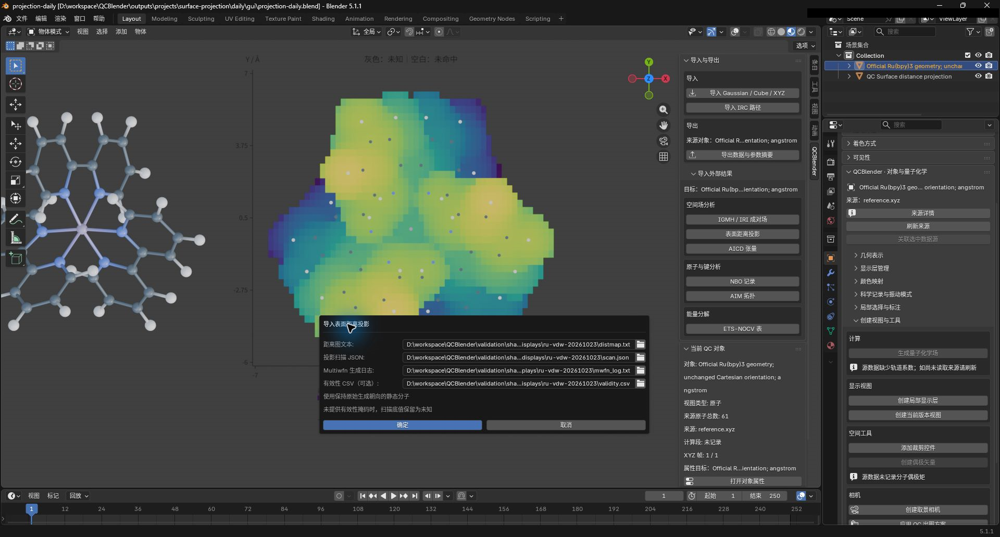
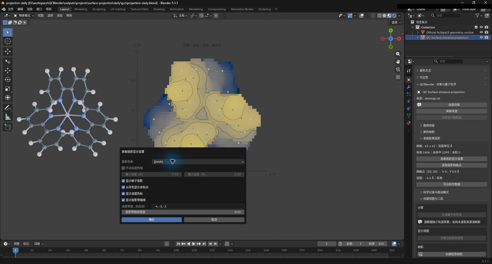
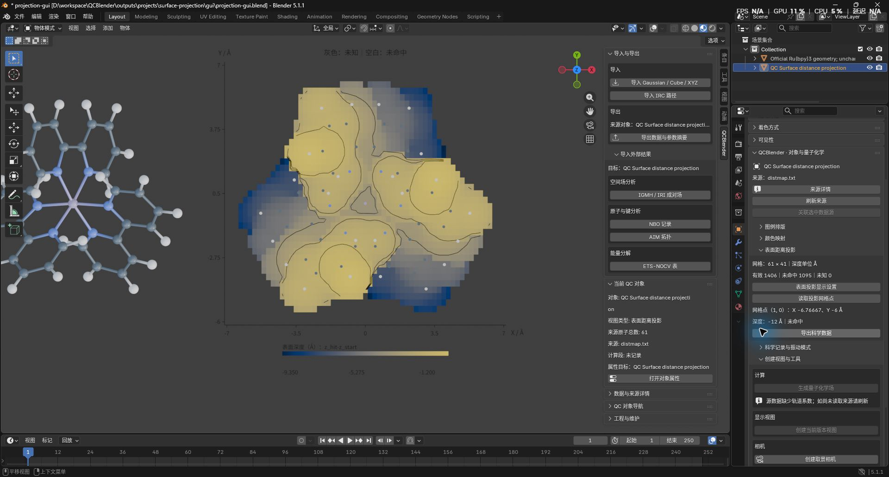
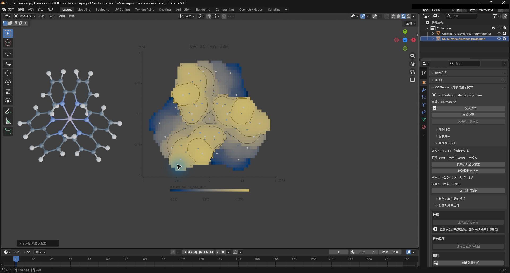

# 表面距离投影

[返回教程目录](../SOP.md#topics)

## 目录

- [导入并观察真实案例](#example)
  - [1. 准备同朝向的静态分子](#step-01)
  - [2. 导入距离图、扫描声明与日志](#step-02)
  - [3. 调整色表、原子投影和等值线](#step-03)
  - [4. 读取网格点并导出数据](#step-04)
  - [5. 保存并重新打开工程](#step-05)
- [准备自己的输入](#inputs)

路径相对材料根目录，即同时包含 `human/` 和 `shared/` 的目录。先按[入门教程](../SOP.md#install)安装插件。本页用 Multiwfn 官方 Ru 构型及实际计算结果练习二维深度图的配色、等值线和点值读取。

本例输入仅保存在本机，不包含在公开样本 ZIP 中。缺少材料时，先按[准备自己的输入](#inputs)取得同源完整材料；分子必须保持距离图生成时的朝向，不能与其他分子的结果配对。

本页截图使用案例 `SD01-` 前缀。

<a id="example"></a>
## 导入并观察真实案例

<a id="step-01"></a>
### 1. 准备同朝向的静态分子

- 按[准备新工程](../SOP.md#new-scene)进入物体模式，点击 **N 侧栏 → QCBlender → 导入与导出（Import and Export） → 导入 Gaussian / Cube / XYZ（Import Gaussian / Cube / XYZ）**，选择 `shared/data/local/scientific-displays/ru-vdw-20261023/reference.xyz`。
- 在 Outliner 选中导入的 **61 原子静态分子**，保留其原始朝向。若场景中还有其他案例对象，先隐藏它们。

此处必须使用生成距离图的静态构型；不要换成自动对齐后的另一份坐标。轨迹、优化或 IRC 动态对象不能作为参考。

<a id="step-02"></a>
### 2. 导入距离图、扫描声明与日志

- 保持选中第 1 步的分子，点击 **N 侧栏 → 导入与导出（Import and Export） → 导入外部结果（Import External Results） → 空间场分析（Spatial Field Analysis） → 表面距离投影（Surface Distance Projection）**，按下表选择四份文件并确认。

| 控件 | 输入文件 |
| --- | --- |
| 距离图文本（Distance map text） | `shared/data/local/scientific-displays/ru-vdw-20261023/distmap.txt` |
| 投影扫描 JSON（Projection scan JSON） | `shared/data/local/scientific-displays/ru-vdw-20261023/scan.json` |
| Multiwfn 生成日志（Multiwfn generation log） | `shared/data/local/scientific-displays/ru-vdw-20261023/mwfn_log.txt` |
| 有效性 CSV（可选）（Validity CSV (optional)） | `shared/data/local/scientific-displays/ru-vdw-20261023/validity.csv` |

- 截图保存为 `human/screenshots/SD01-import-dialog.png`。



- 分子旁应出现独立二维投影图。选中图，点击 **N 侧栏 → 当前 QC 对象（Current QC Object） → 打开对象属性（Open Object Properties）**，展开 **表面距离投影（Surface Distance Projection）**，应显示网格 **61 × 41**、有效 **1406**、未命中 **1095**、未知 **0**。
- 保持选中图，按小键盘 `.` 居中观察。需要清楚查看图表时，关闭视口的 **显示叠加层（Show Overlays）**，隐藏网格和父子关系辅助线。

<a id="meaning"></a>
<details>
<summary>理解投影深度、有效性与四份输入</summary>

> 表面距离投影是在每个 XY 网格位置沿负 Z 扫描，记录首次命中表面的深度 `z_hit-z_start`，单位为 Å。深度通常为负值；它不是三维电子密度场，也不是到原子核的距离。

> 有效性掩码是逐点说明“未命中、有效、未知”的 CSV。只凭原始三列距离图，等于扫描底值的点无法区分“未命中”和“恰在终点命中”。

- **距离图文本（Distance map text）**：提供每个点的 XY 坐标和原始深度。
- **投影扫描 JSON（Projection scan JSON）**：声明单位、坐标范围、扫描方向和表面条件。
- **Multiwfn 生成日志（Multiwfn generation log）**：用于核对生成参数与扫描声明。
- **有效性 CSV（可选）（Validity CSV (optional)）**：补充各点是否命中的依据。

有效点按深度着色，未命中点留空，未知点默认显示灰色。未知点不参与自动色域或等值线；关闭灰色显示只是隐藏这些点，不会把它们改为有效。原子小圆点使用生成时构型的 XY 坐标，图的 XY 轴保持等比例。

若保持前三项不变、留空有效性 CSV，本例将显示有效 `1406`、未知 `1095`；这些底值应为灰色。这两种结果对应不同的已知信息，不能把灰色点当作命中表面。

</details>

<a id="step-03"></a>
### 3. 调整色表、原子投影和等值线

- 保持选中投影图，在 **对象属性 → 表面距离投影（Surface Distance Projection）** 点击 **表面投影显示设置（Surface Projection Display）**，按下表设置并确认。

| 控件 | 输入值 |
| --- | --- |
| 投影色表（Projection palette） | Cividis |
| 显示原子投影（Show projected atoms） | 开启 |
| 显示深度色标（Show depth legend） | 开启 |
| 显示投影等值线（Show projection contours） | 开启 |
| 深度等值值（Å；留空则自动）（Depth levels (Å; blank = automatic)） | `-4,-3,-2` |

- 截图保存为 `human/screenshots/SD01-display-dialog.png`。



- 图中应出现对应的三组等值线，并保留原子投影和色标；未命中和未知区域保持空缺，不跨接或填洞。
- 截图保存为 `human/screenshots/SD01-surface-projection.png`。



- 可重新打开显示设置，试选 Viridis 后取消，图中应保留 Cividis；确认修改后可用 **编辑 → 撤销 / 重做**恢复前后设置。

<details>
<summary>了解色表、深度色域与自动等值线</summary>

Viridis 和 Cividis 只改变配色。自动色域取有效点的深度范围；比较多张图时，开启 **手动深度色域（Manual depth range）**，为它们输入相同的最小值和最大值，且最小值必须小于最大值。

**深度等值值（Å；留空则自动）（Depth levels (Å; blank = automatic)）** 留空时，程序按当前色域自动选取内部等值值。**以灰色显示未知点（Show unknown points in gray）** 只控制未知点是否可见，不改变其有效性。

</details>

<a id="step-04"></a>
### 4. 读取网格点并导出数据

- 在 **表面距离投影（Surface Distance Projection）** 面板点击 **读取投影网格点（Inspect Projection Point）**，设 **X 索引（从 0 开始）（X index (0-based)）=30**、**Y 索引（从 0 开始）（Y index (0-based)）=20** 并确认。面板应显示 **X 0、Y 0.5 Å、深度 −4.1 Å、有效**。
- 再次读取，将 X、Y 索引都设为 **0**，应显示 **X −7、Y −6 Å、深度 −12 Å、未命中**。这里的 `-12` 是保留的扫描底值，不是已测得的表面深度。

- 截图保存为 `human/screenshots/SD01-point-miss.png`。



- 点击面板中的 **导出科学数据（Export Scientific Data）**，按[公共导出步骤](../SOP.md#export)选择 **数据（Data）=PROJECTION**，保存到 `work/human/gaussian-v1/SD01-export/`，应得到 `surface_projection.csv` 和随附元数据。

<details>
<summary>了解网格索引和导出范围</summary>

索引从 `0` 开始，本例 X 为 `0–60`，Y 为 `0–40`。索引用于定位排序后的网格点，点的坐标和深度仍读取原始数据。

`surface_projection.csv` 保留全部 2,501 个点的索引、源 XY、绝对 XY、原始深度与状态；随附元数据保留扫描声明和来源。显示隐藏或色域裁剪不会删除导出点。

</details>

<a id="step-05"></a>
### 5. 保存并重新打开工程

- 若第 2 步为观察图表关闭了视口叠加层，先恢复原设置，再按[保存与重开](../SOP.md#save)保存为 `work/human/gaussian-v1/SD01-projection.blend`，保留同名 `.qcdata/`。
- 重开后选中投影图，查看点数、Cividis 色表、等值线、原子投影与最后读取的网格点；再次读取 **(30,20)**，应仍显示 **深度 −4.1 Å、有效**。
- 移动工程时，同时移动 `.blend` 和 `.qcdata/`。

<a id="inputs"></a>
## 准备自己的输入

使用自己的案例时，先保留生成距离图的静态分子、原始三列距离图、扫描 JSON 和完整 Multiwfn 日志，再从第 1 步开始。只有能确定逐点命中状态时才补充有效性 CSV；各文件要求见下方说明。

<details>
<summary>检查距离图格式、网格与大小限制</summary>

距离图必须是未缩放的 Å 单位三列 `X Y depth`，每行一个点；支持乱序行和非方形规则网格。重复点、缺点、非有限值、非规则网格或与声明冲突的坐标会被拒绝。每轴至少两个点，总数不超过 250,000；每份文本输入不超过 64 MiB。

</details>

<details>
<summary>填写扫描 JSON 并核对生成日志</summary>

扫描 JSON 必须明确来源版本、物理量、坐标模式和范围。下面是本例的声明；自己的数据须按实际生成设置填写，不能直接套用其中数值：

```json
{
  "format": "qcblender.surface_projection.scan.v1",
  "producer": "Multiwfn",
  "producer_version": "2026.9.20",
  "coordinate_unit": "angstrom",
  "depth_unit": "angstrom",
  "coordinate_frame": "reference_cartesian",
  "depth_definition": "z_hit-z_start",
  "data_scale_factor": 1.0,
  "nx": 61,
  "ny": 41,
  "x_range_angstrom": [-7.0, 7.0],
  "y_range_angstrom": [-6.0, 7.0],
  "z_start_angstrom": 6.0,
  "z_end_angstrom": -6.0,
  "z_step_angstrom": 0.05,
  "surface": "union_of_open_vdw_spheres",
  "radius_scale": 1.0,
  "xy_mode": "relative_to_scan_min",
  "xy_offset_angstrom": [-7.0, -6.0]
}
```

`absolute` 表示源 XY 已是绝对坐标，偏移必须为 `[0,0]`；`relative_to_scan_min` 表示源 XY 从扫描起点计量，偏移必须等于 X、Y 下界，导入时只加一次。本例源 XY 为 `[0,14] × [0,13]`，应用偏移后为 `[-7,7] × [-6,7]`。

vdW 表面使用 `union_of_open_vdw_spheres` 和 `radius_scale`；若实际生成使用自由原子叠加密度或电子密度，分别声明 `promolecular_density` 或 `electron_density`，并提供 `density_isovalue_au`。这些类型的声明受支持；本教程的真实数值参照仅覆盖上述 vdW 案例。

日志必须保留 Multiwfn 版本、最后一组扫描参数、表面条件及 `distmap.txt` 导出信息；声明和日志不符时应核查生成记录，不要修改日志来绕过检查。选择的静态分子与结果同源、同朝向仍由操作者确认，程序不能从三列数值证明任意分子的对应关系。

</details>

<details>
<summary>准备可选的有效性 CSV</summary>

可选掩码的表头必须为 `ix,iy,state`，完整覆盖排序后的全部网格点。状态 `0` 为未命中、`1` 为有效、`2` 为未知；未命中只能用于扫描底值。只有生成过程或独立参照足以判断时才填写明确状态，否则省略掩码并保留未知。

</details>
