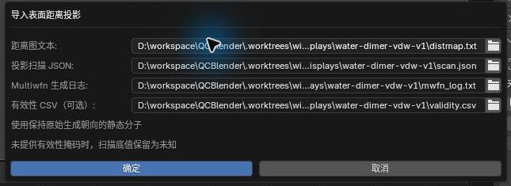
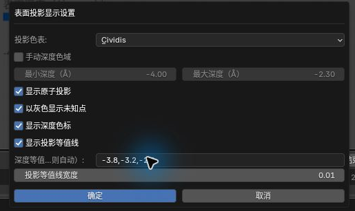
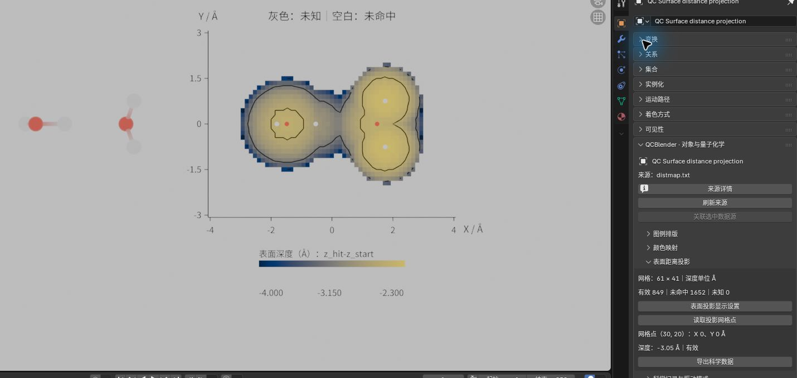

# 10. 表面距离投影

[返回教程目录](../SOP.md#topics)

## 目录

- [导入并观察真实案例](#example)
  - [1. 准备同朝向的静态分子](#step-01)
  - [2. 导入距离图、扫描声明与日志](#step-02)
  - [3. 调整色表、原子投影和等值线](#step-03)
  - [4. 读取网格点并导出数据](#step-04)
  - [5. 保存并重新打开工程](#step-05)
- [准备自己的输入](#inputs)
- [附录：参数、原理与输入规范](#appendix)
  - [A1. 理解投影深度、有效性与四份输入](#appendix-meaning)
  - [A2. 了解色表、深度色域与自动等值线](#appendix-step-03)
  - [A3. 了解网格索引和导出范围](#appendix-step-04)
  - [A4. 准备自定义输入](#appendix-inputs)

路径均相对教程材料根目录（同时含 `human/` 和 `shared/`）。先完成[安装](../SOP.md#install)，按[准备新工程](../SOP.md#new-scene)开始；每次换对象后重新打开其对象属性。

---

<a id="example"></a>
## 导入并观察真实案例

<a id="step-01"></a>
### 1. 准备同朝向的静态分子

使用生成距离图的同源静态构型和朝向，不使用另行对齐后的坐标或动态轨迹。构型与旋转条件见[本例 NOTICE](../../shared/data/public/scientific-displays/water-dimer-vdw-v1/NOTICE.md)。

1. 点击 **N 侧栏 → 导入与导出 → 导入 → 导入 Gaussian / Cube / XYZ**。
2. 选择文件 `shared/data/public/scientific-displays/water-dimer-vdw-v1/reference.xyz`。
3. 导入 6 原子静态分子，保持其原始坐标与朝向。

<a id="step-02"></a>
### 2. 导入距离图、扫描声明与日志

深度为沿负 Z 扫描首次命中的 `z_hit-z_start`；有效、未命中和未知是三种不同状态，不能把扫描底值当作已测表面深度。

详细说明见[附录 A1：理解投影深度、有效性与四份输入](#appendix-meaning)。

1. 保持选中静态分子。
2. 点击 **N 侧栏 → 导入与导出 → 导入外部结果 → 空间场分析 → 表面距离投影（Surface Distance Projection）**。
3. 配置导入文件清单：
   - **距离图文本（Distance map text）**：`shared/data/public/scientific-displays/water-dimer-vdw-v1/distmap.txt`
   - **投影扫描 JSON（Projection scan JSON）**：`shared/data/public/scientific-displays/water-dimer-vdw-v1/scan.json`
   - **Multiwfn 生成日志**：`shared/data/public/scientific-displays/water-dimer-vdw-v1/mwfn_log.txt`
   - **有效性 CSV（可选）**：`shared/data/public/scientific-displays/water-dimer-vdw-v1/validity.csv`
4. 确认导入，截图保存至 `human/screenshots/SD02-import-dialog.png`。



5. 分子旁生成独立二维投影图。选中图并打开对象属性，确认网格规模为 `61 × 41`，有效点 849，未命中 1652，未知 0。若不提供有效性 CSV，底值点应保留为未知，不能自动判为未命中。

<a id="step-03"></a>
### 3. 调整色表、原子投影和等值线

详细说明见[附录 A2：了解色表、深度色域与自动等值线](#appendix-step-03)。

1. 选中投影图，在对象属性中点击 **表面投影显示设置（Surface Projection Display）**。
2. 配置参数：
   - **投影色表（Projection palette）**：`Cividis`
   - **显示原子投影（Show projected atoms）**：开启
   - **显示深度色标（Show depth legend）**：开启
   - **显示投影等值线（Show projection contours）**：开启
   - **深度等值值（Å；留空则自动）**：`-3.8, -3.2, -2.6`
3. 确认设置，截图保存至 `human/screenshots/SD02-display-dialog.png`。



4. 视口中呈现带有三组等值线轮廓与深度标尺的投影平面。截图保存至 `human/screenshots/SD02-surface-projection.png`。



<a id="step-04"></a>
### 4. 读取网格点并导出数据

详细说明见[附录 A3：了解网格索引和导出范围](#appendix-step-04)。

1. 在对象属性中点击 **读取投影网格点（Inspect Projection Point）**，设置坐标参数：
   - **X 索引（从 0 开始）**：`30`
   - **Y 索引（从 0 开始）**：`20`
   - 确认回显：X 0, Y 0 Å, 深度 `-3.05 Å` (有效点)。
2. 再次读取网格点：
   - **X 索引 / Y 索引**：`0 / 0`
   - 确认回显：X -4, Y -3 Å, 深度 `-8 Å` (未命中状态)。截图保存至 `human/screenshots/SD02-point-miss.png`。


3. 按[共同导出步骤](../SOP.md#export)点击 **导出科学数据**，选择数据类型 `PROJECTION`，保存到 `work/human/gaussian-v1/SD02-export/`；保留 `surface_projection.csv` 与 `metadata.json`。

<a id="step-05"></a>
### 5. 保存并重新打开工程

1. 将工程保存为 `work/human/gaussian-v1/SD02-projection.blend`（配套 `.qcdata/` 目录同步生成）。
2. 退出并重开工程，再次读取点 `(30, 20)`，确认深度仍稳定显示为 `-3.05 Å`。

---

<a id="inputs"></a>
## 准备自己的输入

详细说明见[附录 A4：准备自定义输入](#appendix-inputs)。

使用自定义体系时，保留同源、同朝向的静态分子、原始三列距离文本、扫描 JSON 与完整生成日志，按本节附录的格式填写。只有生成过程或独立参照能确定逐点命中状态时，才提供有效性 CSV；否则保留未知。

---

<a id="appendix"></a>
## 附录：参数、原理与输入规范

<a id="appendix-meaning"></a>
### A1. 理解投影深度、有效性与四份输入

<a id="meaning"></a>

> 表面距离投影是在每个 XY 网格位置沿负 Z 扫描，记录首次命中表面的深度 `z_hit-z_start`，单位为 Å。深度通常为负值；它不是三维电子密度场，也不是到原子核的距离。

> 有效性掩码是逐点说明“未命中、有效、未知”的 CSV。只凭原始三列距离图，等于扫描底值的点无法区分“未命中”和“恰在终点命中”。

- **距离图文本（Distance map text）**：提供每个点的 XY 坐标和原始深度。
- **投影扫描 JSON（Projection scan JSON）**：声明单位、坐标范围、扫描方向和表面条件。
- **Multiwfn 生成日志（Multiwfn generation log）**：用于核对生成参数与扫描声明。
- **有效性 CSV（可选）（Validity CSV (optional)）**：补充各点是否命中的依据。

有效点按深度着色，未命中点留空，未知点默认显示灰色。未知点不参与自动色域或等值线；关闭灰色显示只是隐藏这些点，不会把它们改为有效。原子小圆点使用生成时构型的 XY 坐标，图的 XY 轴保持等比例。

若保持前三项不变、留空有效性 CSV，本例将显示有效 `849`、未知 `1652`；这些底值应为灰色。这两种结果对应不同的已知信息，不能把灰色点当作命中表面。

<a id="appendix-step-03"></a>
### A2. 了解色表、深度色域与自动等值线

Viridis 和 Cividis 只改变配色。自动色域取有效点的深度范围；比较多张图时，开启 **手动深度色域（Manual depth range）**，为它们输入相同的最小值和最大值，且最小值必须小于最大值。

**深度等值值（Å；留空则自动）（Depth levels (Å; blank = automatic)）** 留空时，程序按当前色域自动选取内部等值值。**以灰色显示未知点（Show unknown points in gray）** 只控制未知点是否可见，不改变其有效性。

<a id="appendix-step-04"></a>
### A3. 了解网格索引和导出范围

索引从 `0` 开始，本例 X 为 `0–60`，Y 为 `0–40`。索引用于定位排序后的网格点，点的坐标和深度仍读取原始数据。

`surface_projection.csv` 保留全部 2,501 个点的索引、源 XY、绝对 XY、原始深度与状态；随附元数据保留扫描声明和来源。显示隐藏或色域裁剪不会删除导出点。

<a id="appendix-inputs"></a>
### A4. 准备自定义输入

#### 检查距离图格式、网格与大小限制

距离图必须是未缩放的 Å 单位三列 `X Y depth`，每行一个点；支持乱序行和非方形规则网格。重复点、缺点、非有限值、非规则网格或与声明冲突的坐标会被拒绝。每轴至少两个点，总数不超过 250,000；每份文本输入不超过 64 MiB。

#### 填写扫描 JSON 并核对生成日志

扫描 JSON 必须明确来源版本、物理量、坐标模式和范围。下面是本例的声明；自己的数据须按实际生成设置填写，不能直接套用其中数值：

```json
{
  "format": "qcblender.surface_projection.scan.v1",
  "producer": "Multiwfn",
  "producer_version": "2026.9.20",
  "coordinate_unit": "angstrom",
  "depth_unit": "angstrom",
  "coordinate_frame": "reference_cartesian",
  "depth_definition": "z_hit-z_start",
  "data_scale_factor": 1.0,
  "nx": 61,
  "ny": 41,
  "x_range_angstrom": [-4.0, 4.0],
  "y_range_angstrom": [-3.0, 3.0],
  "z_start_angstrom": 4.0,
  "z_end_angstrom": -4.0,
  "z_step_angstrom": 0.05,
  "surface": "union_of_open_vdw_spheres",
  "radius_scale": 1.0,
  "radii_angstrom": {"H": 1.2, "O": 1.52},
  "xy_mode": "relative_to_scan_min",
  "xy_offset_angstrom": [-4.0, -3.0]
}
```

`absolute` 表示源 XY 已是绝对坐标，偏移必须为 `[0,0]`；`relative_to_scan_min` 表示源 XY 从扫描起点计量，偏移必须等于 X、Y 下界，导入时只加一次。本例源 XY 为 `[0,8] × [0,6]`，应用偏移后为 `[-4,4] × [-3,3]`。

vdW 表面使用 `union_of_open_vdw_spheres` 和 `radius_scale`；若实际生成使用自由原子叠加密度或电子密度，分别声明 `promolecular_density` 或 `electron_density`，并提供 `density_isovalue_au`。这些类型的声明受支持；本教程的真实数值参照仅覆盖上述 vdW 案例。Z 步长为 0.05 Å；本例有一条很薄的连续球面交段落在两个采样点之间，因此未命中。这里展示的是离散扫描结果，不能将它解释为连续表面的精确求交。

日志必须保留 Multiwfn 版本、最后一组扫描参数、表面条件及 `distmap.txt` 导出信息；声明和日志不符时应核查生成记录，不要修改日志来绕过检查。选择的静态分子与结果同源、同朝向仍由操作者确认，程序不能从三列数值证明任意分子的对应关系。

#### 准备可选的有效性 CSV

可选掩码的表头必须为 `ix,iy,state`，完整覆盖排序后的全部网格点。状态 `0` 为未命中、`1` 为有效、`2` 为未知；未命中只能用于扫描底值。只有生成过程或独立参照足以判断时才填写明确状态，否则省略掩码并保留未知。
