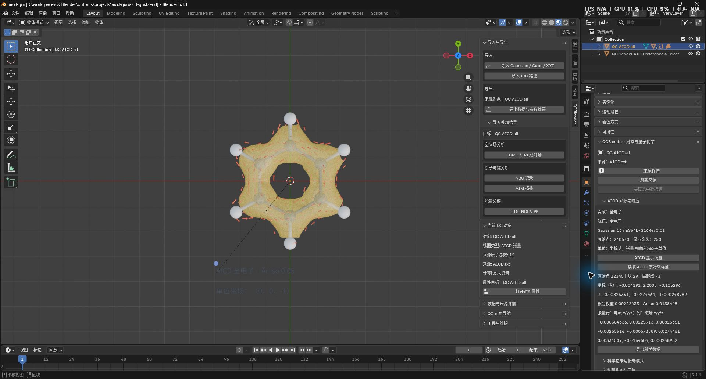

# AICD 张量、等值面与电流响应

[返回教程目录](../SOP.md#topics)

## 目录

- [比较同源苯的全电子与 π 结果](#example)
  - [1. 导入生成朝向的静态分子](#step-01)
  - [2. 导入全电子张量并指定等值值](#step-02)
  - [3. 改变磁场方向和箭头数量](#step-03)
  - [4. 读取原始点并导出全部数值](#step-04)
  - [5. 导入 π 贡献并保存工程](#step-05)
- [准备自己的来源声明](#inputs)
- [理解网格与内存限制](#grid)

路径相对材料根目录，即包含 `human/` 和 `shared/` 的目录。先按[入门教程](../SOP.md#install)安装插件。本页用同一苯构型的全电子与 π 结果，练习等值面显示、磁场方向调整和原始点读取。

本例原始计算材料仅保存在本机，不包含在公开样本 ZIP 中。缺少输入时，先按[准备自己的来源声明](#inputs)取得同源完整材料；不能把其他分子的坐标与本例张量配对。

本页截图使用案例 `AICD01-` 前缀。

<a id="example"></a>
## 比较同源苯的全电子与 π 结果

<a id="step-01"></a>
### 1. 导入生成朝向的静态分子

- 按[准备新工程](../SOP.md#new-scene)进入物体模式，点击 **N 侧栏 → QCBlender → 导入与导出（Import and Export） → 导入 Gaussian / Cube / XYZ（Import Gaussian / Cube / XYZ）**，选择 `shared/data/local/scientific-displays/aicd-benzene/all/all.fchk`。
- 在 Outliner 选中导入的 **12 原子静态分子**，保留其原始朝向。若场景中还有其他案例对象，先隐藏它们。

所选分子的原子顺序与坐标须符合日志中的 Standard orientation；不要使用另行对齐或优化后的坐标。轨迹、优化及 IRC 动态对象不能作为参考。

<details>
<summary>了解本例计算条件与 π 轨道来源</summary>

本例为 Gaussian 16 C.01、RB3LYP/6-31G(d)、6D/7F、CSGT、SCF=Tight、UltraFine，固定 XY 平面的苯构型。全电子与 π 是两次独立生成的张量转储；π 选取同一波函数的占据轨道 `17,20,21`，共 6 个电子。π 归属已有本例的波函数分析依据，不能将这些轨道号套用到别的计算。

</details>

<a id="step-02"></a>
### 2. 导入全电子张量并指定等值值

- 保持选中第 1 步的分子，点击 **N 侧栏 → 导入与导出（Import and Export） → 导入外部结果（Import External Results） → 空间场分析（Spatial Field Analysis） → AICD 张量（AICD Tensors）**，按下表输入并确认。

| 控件 | 输入值 |
| --- | --- |
| AICD 来源 JSON（AICD source JSON） | `shared/data/local/scientific-displays/aicd-benzene/all/source.json` |
| Aniso 等值值（响应原子单位）（Aniso isovalue (response a.u.)） | `0.05` |
| AICD 网格间距（Å）（AICD grid spacing (Å)） | `0.25` |
| AICD 边界外扩（Å）（AICD grid padding (Å)） | `2.5` |
| 内存预算（MiB）（Memory budget (MiB)） | `512` |

- 等待后台导入完成，应生成独立的 **QC AICD all** 对象，原分子仍保留。黄色等值面和电流响应箭头应围绕同一个苯环，蓝色箭头及文字标明单位磁场。
- 选中 **QC AICD all**，点击 **N 侧栏 → 当前 QC 对象（Current QC Object） → 打开对象属性（Open Object Properties）**，展开 **AICD 来源与响应（AICD Source and Response）**，应看到全电子贡献、程序版本、**240570 个原始点**和最多 **1000 个显示箭头**。
- 为清楚观察，可隐藏第 1 步的原分子副本，并关闭视口的 **显示叠加层（Show Overlays）**。保留原分子对象，第 5 步还需选中它。

等值值必须明确填写，初始 `0` 不会自动套用其他程序的值；`0.05` 是本例的显示选择，不是适用于所有分子的芳香性阈值。输入哈希、计算段、轨道号或静态构型不匹配时，先核对原始材料，不要编辑日志来绕过检查。

<a id="meaning"></a>
<details>
<summary>理解 AICD 张量、Aniso 等值面与响应单位</summary>

> AICD 原始张量 `T` 描述给定位置的电流密度对外磁场的线性响应。这里九分量按“行＝电流 x/y/z，列＝磁场 x/y/z”保存。

> Aniso 是张量对称无迹部分的各向异性标量：`sqrt(3/2) × ||(T+Tᵀ)/2 − tr(T)I/3||F`。它不是 NICS，也不是电流向量的模长。

黄色等值面显示 Aniso，箭头显示 `J = T B̂`，其中 `B̂` 是归一化后的磁场方向。张量与单位场响应均保留响应原子单位，即电流密度原子单位／磁场原子单位。

</details>

<a id="step-03"></a>
### 3. 改变磁场方向和箭头数量

- 保持选中 **QC AICD all**，在 **AICD 来源与响应（AICD Source and Response）** 面板点击 **AICD 显示设置（AICD Display）**，按下表设置，其他参数保留，然后确认。

| 控件 | 输入值 |
| --- | --- |
| 磁场方向（生成坐标系）（Field direction in generating coordinates） | `(0,0,-3)` |
| AICD 箭头数上限（Maximum AICD arrows） | `250` |

- 面板中的单位磁场应变为 **(0,0,-1)**，视口中的响应箭头反向并减少，等值面保持不变。磁场不能设为零向量。
- 可重新打开显示设置，关闭 **显示电流响应箭头（Show current response arrows）** 后取消，箭头应保持可见；确认后的修改可用 **编辑 → 撤销 / 重做**恢复。继续下一步前，保持负 Z 单位场和 **250** 个箭头上限。

<details>
<summary>了解磁场归一化、显示开关与箭头缩放</summary>

磁场分量使用**原始生成坐标系**。输入 `(0,0,3)` 和 `(0,0,1)` 得到相同响应；改为 `(0,0,-1)` 会反转箭头，Aniso 不变。整体移动或旋转 AICD 对象会带着分子、等值面和磁场标记一起移动，不会重新计算源张量。

- **显示 Aniso 等值面（Show Aniso surface）**、**显示电流响应箭头（Show current response arrows）**及**显示参考原子（Show reference atoms）**：分别控制三个部分的可见性。
- **Aniso 表面颜色（Aniso surface color）**、**电流箭头颜色（Current arrow color）**及**Aniso 表面不透明度（Aniso surface opacity）**：只改变外观。
- **箭头缩放（Å/响应原子单位）（Arrow scale (Å per response a.u.)）**：只改变显示长度，数值读值及导出不乘该缩放。

比较不同贡献时，应使用相同的等值值、网格、磁场及箭头缩放，并保留这些参数。

</details>

<a id="step-04"></a>
### 4. 读取原始点并导出全部数值

- 在 **AICD 来源与响应（AICD Source and Response）** 面板点击 **读取 AICD 原始采样点（Inspect AICD Sample）**，设 **原始点索引（从 0 开始）（Original sample index (0-based)）=12345** 并确认。
- 面板应显示块 **29**、局部点 **73**，坐标约为 **(-0.804191, 2.2008, -0.105296) Å**，积分权重 **0.00222433**，Aniso **0.0138448**。在上一步的负 Z 单位场下，`J = (-0.00825361, -0.0274461, -0.000248982)`；下面三行保留完整九分量张量。
- 截图保存为 `human/screenshots/AICD01-source-response.jpg`。



- 点击 **导出科学数据（Export Scientific Data）**，按[公共导出步骤](../SOP.md#export)选择 **数据（Data）=AICD**，保存到 `work/human/AICD01-export/`，应得到 `aicd_samples.csv` 和随附元数据。

<details>
<summary>区分原始采样点、显示箭头与导出数值</summary>

原始点索引从 `0` 开始，用于回查输入张量中的一条记录。减少显示箭头只改变视口中的抽样数量，不删除原始点。

`aicd_samples.csv` 包含全部 `240570` 个原始点，而不是显示的 250 个箭头：原始块及点号、bohr/Å 坐标、积分权重、九分量、Aniso 和当前单位场下的 J。随附元数据保留输入身份、轨道声明、生成坐标系及重映射参数。

</details>

<a id="step-05"></a>
### 5. 导入 π 贡献并保存工程

- 在 Outliner 恢复第 1 步原分子的可见性并选中它，重复第 2 步导入，将 **AICD 来源 JSON（AICD source JSON）** 改为 `shared/data/local/scientific-displays/aicd-benzene/pi/source.json`。保留相同的 **0.05、0.25 Å、2.5 Å、512 MiB**。
- 生成 **QC AICD pi** 后，选中它并打开对象属性，在 **AICD 来源与响应（AICD Source and Response）** 中应看到 **π**、轨道 **17,20,21**、**240570 个原始点**，以及“轨道号已核对；π/σ 归属由使用者声明”。
- 点击 **AICD 显示设置（AICD Display）**，将 π 对象的磁场方向也设为 **(0,0,-3)**、箭头数上限设为 **250**，并与全电子对象使用相同的箭头缩放后确认。此时两个对象的单位磁场都应为 **(0,0,-1)**。
- 隐藏原分子副本，将两个 **AICD 根对象**移到左右并列位置，不单独移动其子对象。本例相同等值值下，全电子表面更接近六边形环，π 表面更接近连续圆环。
- 若前面关闭了视口叠加层，恢复原设置，再按[保存与重开](../SOP.md#save)保存为 `work/human/AICD01-benzene.blend`，保留同名 `.qcdata/`。
- 重开后分别选中两个对象，查看贡献身份、等值值、磁场、箭头数及最后读取的点；选中 **QC AICD all** 再读取 **12345**，应与第 4 步一致。移动工程时将 `.blend` 与 `.qcdata/` 成套移动。

<details>
<summary>理解全电子与 π 结果的比较条件</summary>

本例 π 归属依据存于来源声明；程序不会仅凭“pi”文件名判断轨道性质。两种结果来自不同的张量数据，不通过开关从全电子数据中伪造 π 分解。环流的科学解读仍需结合计算条件及独立分析。

</details>

<a id="inputs"></a>
## 准备自己的来源声明

使用自己的案例时，保留同次计算的输入、完整日志及张量转储，将它们放在同一个来源声明目录内，再填写 `source.json`。导入前按下方说明核对文件、计算段和轨道身份。

<details>
<summary>检查张量格式、计算条件与参考构型</summary>

首版接受 Gaussian CSGT 的 `Gitterpunkte:`、`Gewichtungsfaktoren:`、`Stromdichtetensor, II=1/2/3` 原始文本，每块保留相同的点数和从 1 开始的局部编号。原始坐标为 bohr，II 按列组成张量。缺块、重复段、非有限值及负积分权重会被拒绝。

输入须为默认 Å 单位的显式笛卡尔坐标；程序核对日志的 Input orientation、输入电荷/多重度及 route，再用生成时 Standard orientation 匹配所选静态分子。当前限定固定构型的闭壳层单重态，不支持从 checkpoint 隐式读取构型、Z-matrix 或非平面 π/σ 归属。日志必须正常结束并明确写出该转储文件，所选计算段不得包含变化构型。

</details>

<details>
<summary>填写来源 JSON、文件哈希与计算段</summary>

下面是**结构示例**；尖括号内容必须替换为自己的真实文件哈希，不能直接作为输入：

```json
{
  "format": "qcblender.aicd.source.v1",
  "coordinate_unit": "bohr",
  "response_unit": "au_current_density_per_au_field",
  "job_index": 0,
  "component": "all",
  "orbitals": [],
  "orbital_assignment_evidence": "",
  "files": {
    "tensor": {"path": "AICD.txt", "sha256": "<张量文件 SHA-256>"},
    "log": {"path": "all.log", "sha256": "<日志 SHA-256>"},
    "input": {"path": "all.gjf", "sha256": "<输入 SHA-256>"}
  }
}
```

在文件目录用 PowerShell 的 `Get-FileHash -Algorithm SHA256 -LiteralPath .\AICD.txt` 等命令取得哈希，填写小写十六进制值。三个 `path` 必须相对于声明目录，不能跳出该目录。`job_index` 从 0 开始，选择日志中实际生成转储的计算段。

</details>

<details>
<summary>声明全电子、指定轨道及 π/σ 贡献</summary>

`component` 可为 `all`、`pi`、`sigma`、`selected` 或 `unknown`。全电子要求 `IOp(10/93=1)` 且无选择轨道；已选择贡献要求 `IOp(10/93=2)`，`orbitals` 与日志 `CSGT: Occupy MOs` 完全一致。π/σ 还需填写同源波函数、轨道分析方法和证据定位；没有归属依据时保留 `selected` 或 `unknown`。程序能核对轨道号与日志，不能代替轨道性质的科学判定。

</details>

<a id="grid"></a>
## 理解网格与内存限制

使用本例参数可从第 2 步开始。若自己的输入超出内存预算，可增大网格间距、减小边界外扩，或在确认本机资源后提高预算。没有等值面时，先检查输入身份，以及等值值是否大于零且小于有效网格最大值。

<details>
<summary>了解显示网格、重映射与间距的影响</summary>

规则网格只用于显示。程序先在原始点计算 Aniso，再将该标量和九分量张量分别映射到最近四个有限网格节点，用 `1/max(d, 10⁻⁸ Å)` 归一化；并列距离按网格编号确定次序。原始 Gaussian 积分权重被保存，但不参与显示插值。网格外原始点仍向有限网格的最近节点贡献，不将坐标截到边界；无贡献节点保留无效掩码，等值面不填洞或外推。

网格从原子包围盒向各侧扩展指定距离。较小间距增加内存与计算量，也会改变有效域和局部数值。本例 `0.25 Å` 与 `0.125 Å` 的独立算法对照均通过，但两种间距之间并未收敛到相同数值；不能把网格显示当作积分守恒的计算结果。原始点读值和 CSV 不受网格间距或箭头抽样影响。

</details>

<details>
<summary>了解内存预算包含的内容</summary>

默认 `512 MiB` 预算包含原始数组、网格九分量缓存及分块工作空间。超限时导入会明确失败，不会自动放粗网格。

</details>
