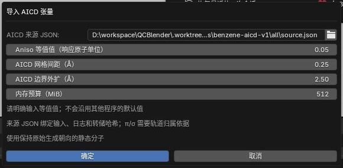
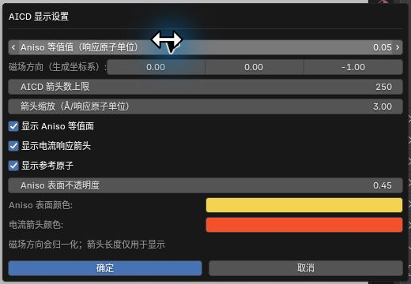
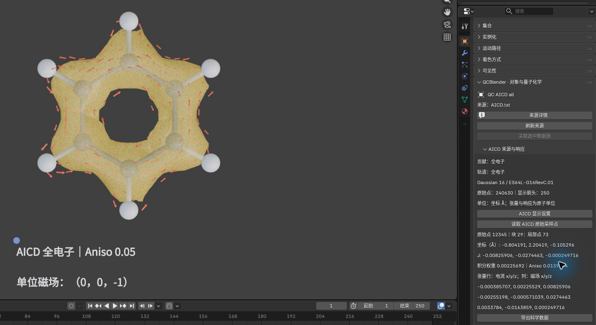
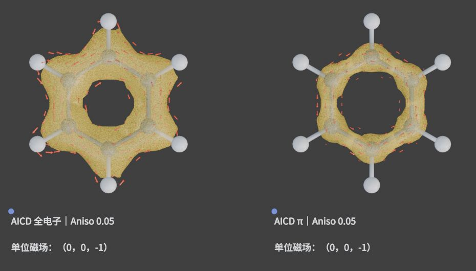

# 11. AICD 张量、等值面与电流响应

[返回教程目录](../SOP.md#topics)

## 目录

- [比较同源苯的全电子与 π 结果](#example)
  - [1. 导入生成朝向的静态分子](#step-01)
  - [2. 导入全电子张量并指定等值值](#step-02)
  - [3. 改变磁场方向和箭头数量](#step-03)
  - [4. 读取原始点并导出全部数值](#step-04)
  - [5. 导入 π 贡献并保存工程](#step-05)
- [准备自己的来源声明](#inputs)
- [理解网格与内存限制](#grid)
- [附录：参数、原理与输入规范](#appendix)
  - [A1. 了解本例计算条件与 π 轨道来源](#appendix-step-01)
  - [A2. 理解 AICD 张量、Aniso 等值面与响应单位](#appendix-meaning)
  - [A3. 了解磁场归一化、显示开关与箭头缩放](#appendix-step-03)
  - [A4. 区分原始采样点、显示箭头与导出数值](#appendix-step-04)
  - [A5. 理解全电子与 π 结果的比较条件](#appendix-step-05)
  - [A6. 准备自定义输入](#appendix-inputs)
  - [A7. 显示网格与内存预算](#appendix-grid)

路径均相对教程材料根目录（同时含 `human/` 和 `shared/`）。先完成[安装](../SOP.md#install)，按[准备新工程](../SOP.md#new-scene)开始；每次换对象后重新打开其对象属性。

---

<a id="example"></a>
## 比较同源苯的全电子与 π 结果

<a id="step-01"></a>
### 1. 导入生成朝向的静态分子

本例固定苯构型未经几何优化；当前导入限定固定构型的闭壳层单重态。原子顺序与坐标须符合日志的 Standard orientation，不使用另行对齐或优化后的坐标。材料与许可见[NOTICE](../../shared/data/public/scientific-displays/benzene-aicd-v1/NOTICE.md)。

详细说明见[附录 A1：了解本例计算条件与 π 轨道来源](#appendix-step-01)。

1. 点击 **N 侧栏 → 导入与导出 → 导入 → 导入 Gaussian / Cube / XYZ**。
2. 选择文件 `shared/data/public/scientific-displays/benzene-aicd-v1/all/all.fchk`。
3. 导入 12 原子静态苯分子，保持其原始朝向（Standard orientation）。

<a id="step-02"></a>
### 2. 导入全电子张量并指定等值值

Aniso 是电流响应张量对称无迹部分的各向异性标量，不是磁屏蔽张量或 NICS；箭头为单位磁场方向下的 `J = T B̂`。等值值 0.05 仅为本例显示参数，不是通用芳香性阈值。

详细说明见[附录 A2：理解 AICD 张量、Aniso 等值面与响应单位](#appendix-meaning)。

1. 保持选中静态苯分子。
2. 点击 **N 侧栏 → 导入与导出 → 导入外部结果 → 空间场分析 → AICD 张量（AICD Tensors）**。
3. 配置导入参数：
   - **AICD 来源 JSON**：`shared/data/public/scientific-displays/benzene-aicd-v1/all/source.json`
   - **Aniso 等值值**：`0.05` (response a.u.)
   - **AICD 网格间距**：`0.25 Å`
   - **AICD 边界外扩**：`2.5 Å`
   - **内存预算**：`512 MiB`
4. 确认导入，截图保存至 `human/screenshots/AICD02-import-dialog.png`。



5. 生成对象 **QC AICD all**。打开其对象属性，确认包含 240630 个原始采样点及至多 1000 个响应箭头。

<a id="step-03"></a>
### 3. 改变磁场方向和箭头数量

详细说明见[附录 A3：了解磁场归一化、显示开关与箭头缩放](#appendix-step-03)。

1. 选中 **QC AICD all**，在对象属性中点击 **AICD 显示设置（AICD Display）**。
2. 配置参数：
   - **磁场方向（生成坐标系）**：`(0, 0, -3)`（系统自动归一化为负 Z 单位矢量）
   - **AICD 箭头数上限**：`250`
3. 确认后视口中响应箭头反向且稀疏化，等值面维持不变。截图保存至 `human/screenshots/AICD02-display-dialog.png`。



<a id="step-04"></a>
### 4. 读取原始点并导出全部数值

详细说明见[附录 A4：区分原始采样点、显示箭头与导出数值](#appendix-step-04)。

1. 在属性面板点击 **读取 AICD 原始采样点（Inspect AICD Sample）**。
2. 设置 `原始点索引（0-based） = 12345` 并确认。
3. 面板回显块 29、局部点 73，坐标约 `(-0.804, 2.204, -0.105) Å`，积分权重为 `0.00225692`，Aniso 为 `0.0139264`；在负 Z 单位场下，`J = (-0.00825906, -0.0274463, -0.000249716)`。面板保留完整九分量张量，J 是单位场响应，不是任意 Tesla 场下的实际电流。截图保存至 `human/screenshots/AICD02-source-response.png`。



4. 按[共同导出步骤](../SOP.md#export)点击 **导出科学数据**，选择 `AICD`，保存到 `work/human/gaussian-v1/AICD02-export/`，保留 `aicd_samples.csv` 与 `metadata.json`。

<a id="step-05"></a>
### 5. 导入 π 贡献并保存工程

详细说明见[附录 A5：理解全电子与 π 结果的比较条件](#appendix-step-05)。

1. 重新选中苯分子，再次进入 **AICD 张量** 导入界面。
2. 将 **来源 JSON** 改为 `shared/data/public/scientific-displays/benzene-aicd-v1/pi/source.json`（包含 17, 20, 21 号 $\pi$ 轨道贡献），其余网格参数保持一致。
3. 生成对象 **QC AICD pi**。
4. 将两者的显示参数均统一为：
   - **磁场方向**：`(0, 0, -1)`
   - **箭头数上限**：`250`
   - **箭头缩放**：`3.0 Å/response a.u.`
   - **Aniso 表面不透明度**：`0.45`
5. 分别平移两个根对象（全电子放左侧 X=-4 Å，$\pi$ 放右侧 X=+4 Å），同框比较电流响应；π 归属依赖本例同源波函数证据，不能把轨道号直接套用到其他计算。截图保存至 `human/screenshots/AICD02-all-pi.png`。



6. 按[共同保存与重开方法](../SOP.md#save)保存为 `work/human/gaussian-v1/AICD02.blend`。重开后核对两对象的贡献身份、等值值、磁场与箭头数，重新读取全电子对象的点 12345，应与步骤 4 一致；移动时保留配套 `.qcdata/`。

---

<a id="inputs"></a>
## 准备自己的来源声明

详细说明见[附录 A6：准备自定义输入](#appendix-inputs)。

保留同次计算的输入、完整日志与原始张量转储，按本节附录填写 `source.json` 的文件相对路径、SHA-256、零起始计算段及贡献身份。当前只支持闭壳层单重态；轨道声明须与原始日志一致，不能用自旋通道声明扩展支持范围。

<a id="grid"></a>
## 理解网格与内存限制

详细说明见[附录 A7：显示网格与内存预算](#appendix-grid)。

超出内存预算时会明确失败，不会自动放粗网格。可增大间距、减小外扩，或确认机器资源后提高预算；修改显示网格后须重新检查有效域和表面形状，不能保证科学收敛。没有等值面时，先核对输入身份及等值值是否在有效网格范围内。

---

<a id="appendix"></a>
## 附录：参数、原理与输入规范

<a id="appendix-step-01"></a>
### A1. 了解本例计算条件与 π 轨道来源

本例为 Gaussian 16 C.01、RB3LYP/6-31G(d)、6D/7F、CSGT、SCF=Tight、UltraFine，固定 XY 平面的苯构型。全电子与 π 是两次独立生成的张量转储；π 选取同一波函数的占据轨道 `17,20,21`，共 6 个电子。π 归属已有本例的波函数分析依据，不能将这些轨道号套用到别的计算。

<a id="appendix-meaning"></a>
### A2. 理解 AICD 张量、Aniso 等值面与响应单位

<a id="meaning"></a>

> AICD 原始张量 `T` 描述给定位置的电流密度对外磁场的线性响应。这里九分量按“行＝电流 x/y/z，列＝磁场 x/y/z”保存。

> Aniso 是张量对称无迹部分的各向异性标量：`sqrt(3/2) × ||(T+Tᵀ)/2 − tr(T)I/3||F`。它不是 NICS，也不是电流向量的模长。

黄色等值面显示 Aniso，箭头显示 `J = T B̂`，其中 `B̂` 是归一化后的磁场方向。张量与单位场响应均保留响应原子单位，即电流密度原子单位／磁场原子单位。

<a id="appendix-step-03"></a>
### A3. 了解磁场归一化、显示开关与箭头缩放

磁场分量使用**原始生成坐标系**。输入 `(0,0,3)` 和 `(0,0,1)` 得到相同响应；改为 `(0,0,-1)` 会反转箭头，Aniso 不变。整体移动或旋转 AICD 对象会带着分子、等值面和磁场标记一起移动，不会重新计算源张量。

- **显示 Aniso 等值面（Show Aniso surface）**、**显示电流响应箭头（Show current response arrows）**及**显示参考原子（Show reference atoms）**：分别控制三个部分的可见性。
- **Aniso 表面颜色（Aniso surface color）**、**电流箭头颜色（Current arrow color）**及**Aniso 表面不透明度（Aniso surface opacity）**：只改变外观。
- **箭头缩放（Å/响应原子单位）（Arrow scale (Å per response a.u.)）**：只改变显示长度，数值读值及导出不乘该缩放。

比较不同贡献时，应使用相同的等值值、网格、磁场及箭头缩放，并保留这些参数。

<a id="appendix-step-04"></a>
### A4. 区分原始采样点、显示箭头与导出数值

原始点索引从 `0` 开始，用于回查输入张量中的一条记录。减少显示箭头只改变视口中的抽样数量，不删除原始点。

`aicd_samples.csv` 包含全部 `240630` 个原始点，而不是显示的 250 个箭头：原始块及点号、bohr/Å 坐标、积分权重、九分量、Aniso 和当前单位场下的 J。随附元数据保留输入身份、轨道声明、生成坐标系及重映射参数。

<a id="appendix-step-05"></a>
### A5. 理解全电子与 π 结果的比较条件

本例 π 归属依据存于来源声明；程序不会仅凭“pi”文件名判断轨道性质。两种结果来自不同的张量数据，不通过开关从全电子数据中伪造 π 分解。环流的科学解读仍需结合计算条件及独立分析。

<a id="appendix-inputs"></a>
### A6. 准备自定义输入

#### 检查张量格式、计算条件与参考构型

首版接受 Gaussian CSGT 的 `Gitterpunkte:`、`Gewichtungsfaktoren:`、`Stromdichtetensor, II=1/2/3` 原始文本，每块保留相同的点数和从 1 开始的局部编号。原始坐标为 bohr，II 按列组成张量。缺块、重复段、非有限值及负积分权重会被拒绝。

输入须为默认 Å 单位的显式笛卡尔坐标；程序核对日志的 Input orientation、输入电荷/多重度及 route，再用生成时 Standard orientation 匹配所选静态分子。当前限定固定构型的闭壳层单重态，不支持从 checkpoint 隐式读取构型、Z-matrix 或非平面 π/σ 归属。日志必须正常结束并明确写出该转储文件，所选计算段不得包含变化构型。

#### 填写来源 JSON、文件哈希与计算段

下面是**结构示例**；尖括号内容必须替换为自己的真实文件哈希，不能直接作为输入：

```json
{
  "format": "qcblender.aicd.source.v1",
  "coordinate_unit": "bohr",
  "response_unit": "au_current_density_per_au_field",
  "job_index": 0,
  "component": "all",
  "orbitals": [],
  "orbital_assignment_evidence": "",
  "files": {
    "tensor": {"path": "AICD.txt", "sha256": "<张量文件 SHA-256>"},
    "log": {"path": "all.log", "sha256": "<日志 SHA-256>"},
    "input": {"path": "all.gjf", "sha256": "<输入 SHA-256>"}
  }
}
```

在文件目录用 PowerShell 的 `Get-FileHash -Algorithm SHA256 -LiteralPath .\AICD.txt` 等命令取得哈希，填写小写十六进制值。三个 `path` 必须相对于声明目录，不能跳出该目录。`job_index` 从 0 开始，选择日志中实际生成转储的计算段。

#### 声明全电子、指定轨道及 π/σ 贡献

`component` 可为 `all`、`pi`、`sigma`、`selected` 或 `unknown`。全电子要求 `IOp(10/93=1)` 且无选择轨道；已选择贡献要求 `IOp(10/93=2)`，`orbitals` 与日志 `CSGT: Occupy MOs` 完全一致。π/σ 还需填写同源波函数、轨道分析方法和证据定位；没有归属依据时保留 `selected` 或 `unknown`。程序能核对轨道号与日志，不能代替轨道性质的科学判定。

<a id="appendix-grid"></a>
### A7. 显示网格与内存预算

#### 了解显示网格、重映射与间距的影响

规则网格只用于显示。程序先在原始点计算 Aniso，再将该标量和九分量张量分别映射到最近四个有限网格节点，用 `1/max(d, 10⁻⁸ Å)` 归一化；并列距离按网格编号确定次序。原始 Gaussian 积分权重被保存，但不参与显示插值。网格外原始点仍向有限网格的最近节点贡献，不将坐标截到边界；无贡献节点保留无效掩码，等值面不填洞或外推。

网格从原子包围盒向各侧扩展指定距离。较小间距增加内存与计算量，也会改变有效域和局部数值。网格间距改变时需要重新检查有效域与显示形状；本例未以网格收敛作为验收条件，不能把网格显示当作积分守恒的计算结果。原始点读值和 CSV 不受网格间距或箭头抽样影响。

#### 了解内存预算包含的内容

默认 `512 MiB` 预算包含原始数组、网格九分量缓存及分块工作空间。超限时导入会明确失败，不会自动放粗网格。
