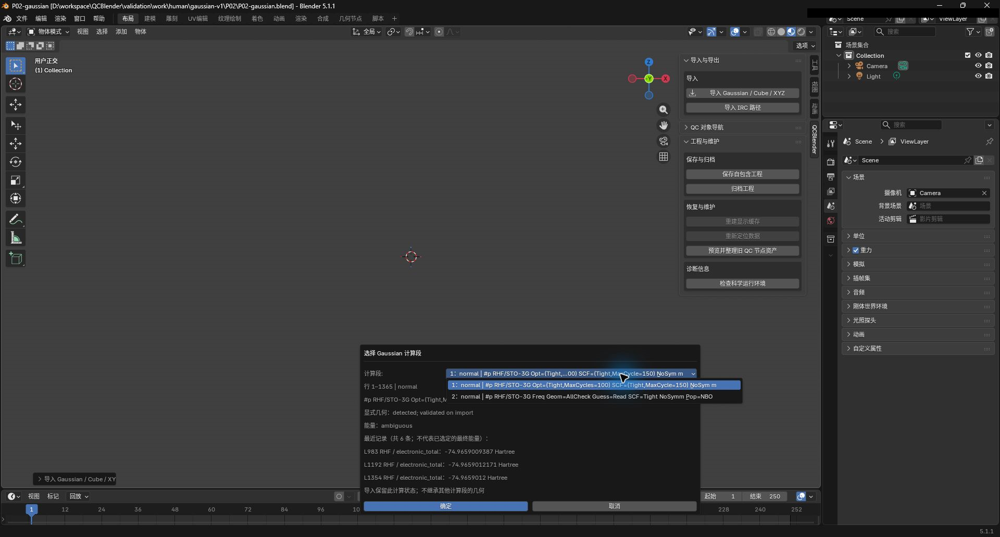
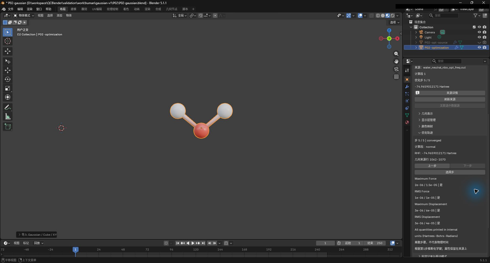
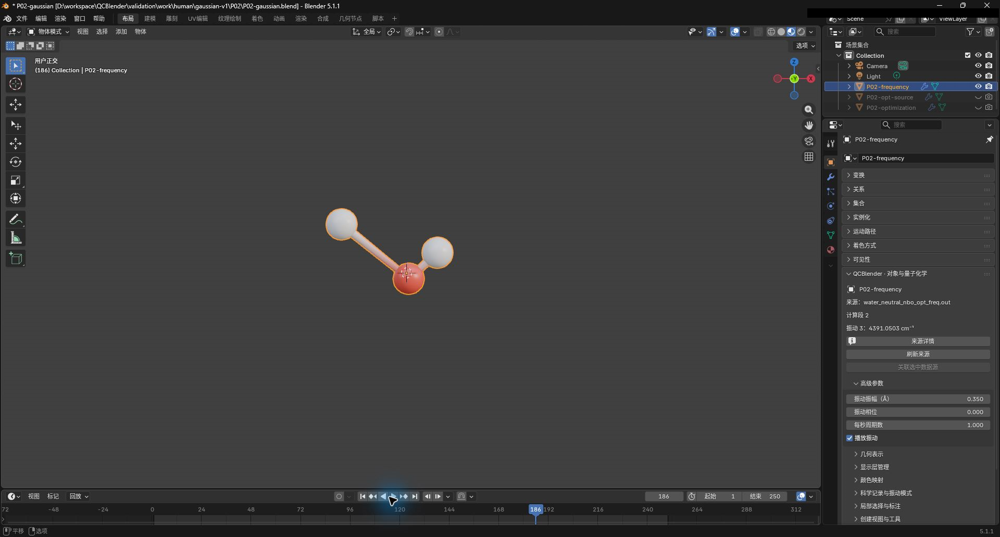
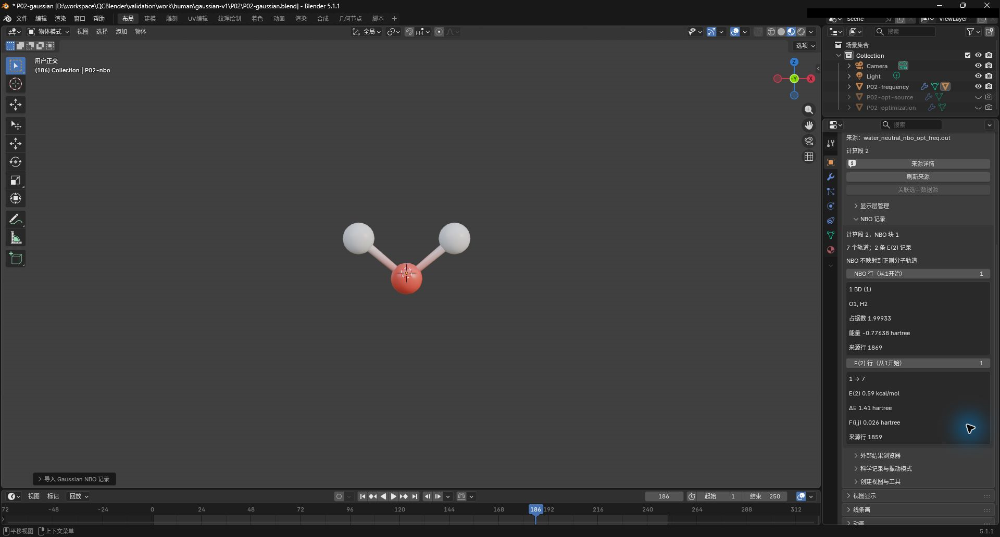

# Gaussian 日志：优化、振动与 NBO

[返回教程目录](../SOP.md#topics)

## 目录

- [选择计算段并浏览优化](#optimization)
  - [1. 导入优化计算段](#step-01)
  - [2. 创建优化轨迹视图](#step-02)
  - [3. 切换优化步并比较收敛记录](#step-03)
- [选择振动并导出 IR 数据](#vibration)
  - [4. 导入频率计算段](#step-04)
  - [5. 选择振动模式并播放](#step-05)
  - [6. 查看位移矢量并导出 IR](#step-06)
- [查看 NBO 与 E(2)](#nbo)
  - [7. 导入指定计算段的 NBO 块](#step-07)
  - [8. 浏览和筛选 NBO 记录](#step-08)

路径相对材料根目录，即同时包含 `human/` 和 `shared/` 的目录。先按[安装与新工程准备](../SOP.md#install)启用插件。本页使用自有 Gaussian 16 C.01 水分子日志，输入已包含在公开材料中，无需本机安装 Gaussian。

输入为 [shared/data/public/gaussian-v1/P02/water_neutral_nbo_opt_freq.out](../../shared/data/public/gaussian-v1/P02/water_neutral_nbo_opt_freq.out)。本例采用 **RHF/STO-3G、0 电荷、单重态**；第 1 段执行 **Opt**，第 2 段执行 **Freq Pop=NBO**。两段各有自己的构型、能量和来源记录。不要换用旧的本机限定 P02 日志来对照下文数值。

本页截图使用案例 `P02-` 前缀。

## 选择计算段并浏览优化

### 1. 导入优化计算段

- 按[准备新工程](../SOP.md#new-scene)进入物体模式，点击 **N 侧栏 → QCBlender → 导入与导出（Import and Export） → 导入（Import） → 导入 Gaussian / Cube / XYZ（Import Gaussian / Cube / XYZ）**，选择 `shared/data/public/gaussian-v1/P02/water_neutral_nbo_opt_freq.out`。
- 等待日志检查，出现 **选择 Gaussian 计算段（Choose Gaussian Calculation）** 后，将 **计算段（Calculation）** 设为第 **1** 段。核对 route 含 **Opt**、状态为正常结束。本段有5次 SCF 求值，选段窗口中的静态能量显示 **ambiguous**（未能自动唯一选择）；先查看最近的能量记录，再确认导入，随后按优化轨迹逐步核对。
- 将新原子对象命名为 **P02-opt-source**。在 **N 侧栏 → 当前 QC 对象（Current QC Object）** 核对 **3** 个源原子和计算段 **1**，应看到 **O/H/H** 水分子。
- 截图保存为 `human/screenshots/P02-gaussian-job-selection.png`。

理解计算段、静态构型与优化轨迹

> 计算段是日志中具有明确方法、基组、任务和状态的一次计算上下文。这里第 1 段优化构型，第 2 段在优化后的构型上计算频率和 NBO。

导入第 1 段先得到它的静态原子视图。优化的逐步数据仍保留在该数据集中，下一步另建轨迹视图浏览；选择计算段时不会从另一段继承缺失构型。

### 2. 创建优化轨迹视图

- 选中 **P02-opt-source**，点击 **N 侧栏 → 当前 QC 对象（Current QC Object） → 打开对象属性（Open Object Properties）**，展开 **优化轨迹（Optimization Trajectory）**。
- 点击 **创建优化轨迹视图（Create Optimization View）**。新视图成为活动对象，将它命名为 **P02-optimization**，重新打开它的对象属性。
- 在 Outliner 隐藏静态 **P02-opt-source** 的眼睛和相机图标，只观察轨迹。**优化轨迹（Optimization Trajectory）** 应显示共 **5 步**，第 1 步能量约 **−74.9458851237 hartree**。

区分优化步与动画帧

> 优化步记录程序寻找较低能量构型的过程，步号不是物理时间，也不是 Blender 时间轴帧号。

轨迹视图按当前优化步读取源构型。创建它不会删除静态来源对象；再次选静态对象时，重新打开对象属性，避免误把固定的属性面板当成当前对象。

### 3. 切换优化步并比较收敛记录

- 保持 **P02-optimization** 活动，在 **优化轨迹（Optimization Trajectory）** 使用 **下一步（Next）** 依次查看第 2–5 步，核对步号、分子构型和电子能量一起更新。
- 本例五步能量依次约为 **−74.9458851237、−74.9658644891、−74.9658975104、−74.9659009387、−74.9659012171 hartree**。面板同时列出该步的力、位移收敛项及对应阈值。
- 在第 5 步观察收敛记录；用 **上一步（Previous）** 回第 4 步，再用 **选择步（Choose Step）** 回第 5 步，确认读取的是同一条源记录。
- 截图保存为 `human/screenshots/P02-optimization-step.png`。

- 需要表格时，保持轨迹对象活动，按[公共导出步骤](../SOP.md#export)选择 **数据（Data）=optimization**，输出目录选 `work/human/gaussian-v1/P02/exports/` 的实际位置。保留 `optimization_steps.csv`、`optimization_convergence.csv` 和随附 `metadata.json`。

理解优化能量与收敛条件

> 电子总能量对应当前方法和构型；零点能与热校正是其他记录，不能作为本表电子能量的替代值。

每项收敛记录给出实际值、阈值和是否达到标准，按源日志解释。只看到能量降低不能代替完整的优化收敛判断。导出保留全部源步；在界面中切到第 5 步不会把导出范围缩成一行。

## 选择振动并导出 IR 数据

### 4. 导入频率计算段

- 再次使用 **导入 Gaussian / Cube / XYZ（Import Gaussian / Cube / XYZ）**，选择同一输入 `shared/data/public/gaussian-v1/P02/water_neutral_nbo_opt_freq.out`，这次在 **选择 Gaussian 计算段（Choose Gaussian Calculation）** 选择第 **2** 段。
- 核对 route 含 **Freq** 和 **Pop=NBO** 后确认，将新原子对象命名为 **P02-frequency**。在 Outliner 隐藏优化轨迹，保留本频率对象可见。
- 选 **P02-frequency** 并重新打开对象属性，展开 **科学记录与振动模式（Scientific Records and Vibration Modes）**。本段只有一次 SCF 求值，电子能量可用（available）；应有三个源振动模式，电子能量约为 **−74.9659012171 hartree**。

| 源模式 | 频率（cm⁻¹） | IR 强度（km/mol） |
| --- | --- | --- |
| 1 | 2170.0464 | 7.2376 |
| 2 | 4139.9847 | 44.2869 |
| 3 | 4391.0503 | 29.9720 |

理解谐振动频率与 IR 强度

> 振动模式是在对应构型附近的一组原子位移方向及频率。IR 强度描述该模式的红外吸收强度，频率和强度均来自源计算。

本页使用原始谐振动频率，不套用经验缩放因子。RHF/STO-3G 的结果用于学习记录浏览和模式显示，不把它当作实验峰位预测。

### 5. 选择振动模式并播放

- 在 **科学记录与振动模式（Scientific Records and Vibration Modes）** 点击源模式 **3**，应显示 **4391.0503 cm⁻¹** 和 **29.9720 km/mol**。
- 展开 **高级参数（Advanced Parameters）**，开启 **播放振动（Animate）**，设 **振动振幅（Å）（Amplitude (angstrom)）=0.35**、**每秒周期数（Cycles per second）=1**。
- 鼠标移入底部 **时间轴（Timeline）**，开始播放；帧号推进时原子应按所选模式振动。观察后暂停时间轴。
- 截图保存为 `human/screenshots/P02-vibration-mode.png`。

区分源模式与显示振幅

振动振幅、相位和每秒周期数只控制可视化位移与播放速度，不改变源频率、IR 强度或平衡构型。时间轴暂停后保留当前帧，继续播放可观察完整周期。

### 6. 查看位移矢量并导出 IR

- 关闭 **播放振动（Animate）**，在 **几何表示（Geometry Representation）** 开启 **显示位移矢量（Show Displacement Vectors）**，在 **高级参数（Advanced Parameters）** 调整 **振动相位（Phase）**，观察相同模式的位移方向。
- 返回模式列表选择源模式 **1**，频率应变为 **2170.0464 cm⁻¹**、IR 强度为 **7.2376 km/mol**，原子位移和矢量随模式更新。练习后关闭位移矢量，振动相位恢复 **0**。
- 保持 **P02-frequency** 活动，按[公共导出步骤](../SOP.md#export)选择 **数据（Data）=IR**，保存到 `work/human/gaussian-v1/P02/exports/`；得到 `ir.csv` 和配套 `metadata.json`。
- 打开 CSV，核对三个源模式的编号、频率、强度与上表一致。需要绘制 IR 谱时，用这些数值在表格或绘图软件中处理，并另行记录采用的峰展宽和缩放条件。

## 查看 NBO 与 E(2)

### 7. 导入指定计算段的 NBO 块

- 保持静态 **P02-frequency** 活动，点击 **N 侧栏 → 导入与导出（Import and Export） → 导入外部结果（Import External Results） → 原子与键分析（Atom and Bond Analysis） → NBO 记录（NBO Records）**。
- 将 **Gaussian Log / Out** 指向 `shared/data/public/gaussian-v1/P02/water_neutral_nbo_opt_freq.out`，先确认以检查日志。
- 检查完成后的编号对话框中，设 **Gaussian 计算段（从1开始）（Gaussian job (1-based)）=2**、**计算段内 NBO 块（从1开始）（NBO block within job (1-based)）=1**，再确认。
- 应新增并选中 **QC NBO: water_neutral_nbo_opt_freq.out**。重新打开它的对象属性，核对记录的计算段与 NBO 块。

理解 NBO、块编号与参考构型

> NBO（自然键轨道）按成键、孤对等方式分析电子分布。E(2) 是供体与受体 NBO 间的二阶微扰相互作用能。

同一日志可有多个计算段，一个计算段也可有多个 NBO 摘要块。这里使用第 2 段第 1 块，并与该段静态分子匹配；不要选择可切换的优化轨迹作为静态参考。NBO 轨道没有在此映射到规范分子轨道，NBO 行号不能直接填入 MO 生成器。

### 8. 浏览和筛选 NBO 记录

- 在 **对象属性 → NBO 记录（NBO Records）** 应看到 **7 条轨道、2 条 E(2) 记录**。
- 设 **NBO 行（从1开始）（NBO row (1-based)）=1**，应读到 **O1–H2、BD、占据数 1.99933、能量 −0.77638 hartree**；设 **E(2) 行（从1开始）（E(2) row (1-based)）=1**，应读到 **1→7、0.59 kcal/mol**。
- 截图保存为 `human/screenshots/P02-nbo-browser.png`。

- 展开 **外部结果浏览器（External Result Browser）**，设 **轨道类型（Orbital type）=BD**、**轨道排序（Orbital order）=占据数从高到低（Occupancy, high to low）**、**E(2) 排序（E(2) order）=E(2) 从高到低（E(2), high to low）**，点击 **应用筛选（Apply Filter）**。应匹配 **2 条轨道、2 条 E(2)**。
- 将 **轨道类型（Orbital type）** 恢复 **全部（All）** 并再次应用，恢复全表。分别选回频率对象和优化轨迹时，重新打开各自对象属性，确认科学数据仍保留。
- 按[共同保存方法](../SOP.md#save)保存为 `work/human/gaussian-v1/P02/P02-gaussian.blend`，连同同名 `.qcdata/` 保留；重开后核对两个计算段来源、当前优化步、振动模式和 NBO 记录。

区分行位置、源轨道号与 E(2) 单位

NBO 行控件按摘要中的记录位置浏览，轨道自身的源编号仍保留在行内；筛选或排序后不要把匹配位置当成新的源轨道号。BD 表示成键轨道，BD* 表示反键轨道，LP 表示孤对轨道。轨道能量单位为 hartree，E(2) 的相互作用能单位为 kcal/mol，不能混用。

