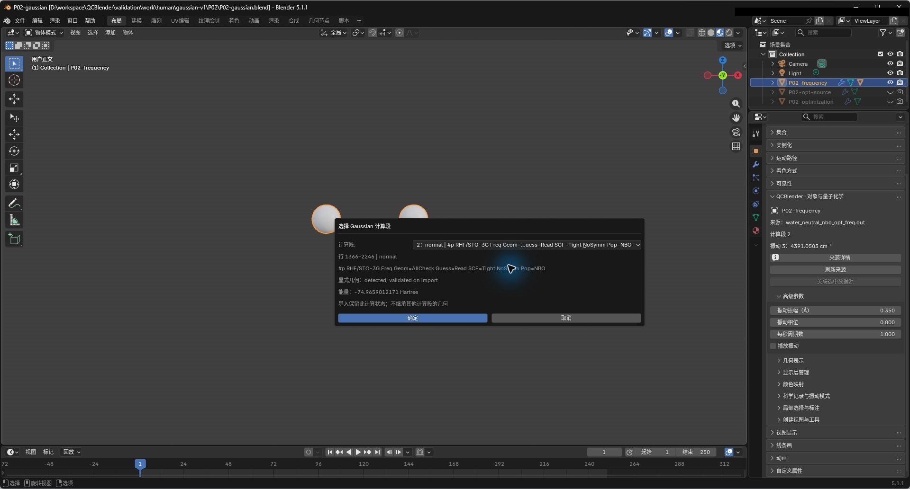
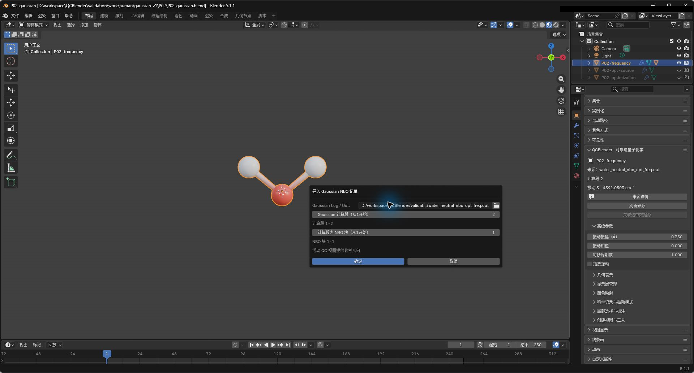

# 12. Gaussian 日志：优化、振动与 NBO

[返回教程目录](../SOP.md#topics)

## 目录

- [选择计算段并浏览优化](#optimization)
  - [1. 导入优化计算段](#step-01)
  - [2. 创建优化轨迹视图](#step-02)
  - [3. 切换优化步并比较收敛记录](#step-03)
- [选择振动并导出 IR 数据](#vibration)
  - [4. 导入频率计算段](#step-04)
  - [5. 选择振动模式并播放](#step-05)
  - [6. 查看位移矢量并导出 IR](#step-06)
- [查看 NBO 与 E(2)](#nbo)
  - [7. 导入指定计算段的 NBO 块](#step-07)
  - [8. 浏览和筛选 NBO 记录](#step-08)
- [附录：参数、原理与输入规范](#appendix)
  - [A1. 理解计算段、静态构型与优化轨迹](#appendix-step-01)
  - [A2. 区分优化步与动画帧](#appendix-step-02)
  - [A3. 理解优化能量与收敛条件](#appendix-step-03)
  - [A4. 理解谐振动频率与 IR 强度](#appendix-step-04)
  - [A5. 区分源模式与显示振幅](#appendix-step-05)
  - [A6. 理解 NBO、块编号与参考构型](#appendix-step-07)
  - [A7. 区分行位置、源轨道号与 E(2) 单位](#appendix-step-08)

路径均相对教程材料根目录（同时含 `human/` 和 `shared/`）。先完成[安装](../SOP.md#install)，按[准备新工程](../SOP.md#new-scene)开始；每次换对象后重新打开其对象属性。

---

## 选择计算段并浏览优化

### 1. 导入优化计算段

详细说明见[附录 A1：理解计算段、静态构型与优化轨迹](#appendix-step-01)。

1. 点击 **N 侧栏 → 导入与导出 → 导入 → 导入 Gaussian / Cube / XYZ**。
2. 选择文件 `shared/data/public/gaussian-v2/P02/water_neutral_nbo_opt_freq.out`。
3. 在 **选择 Gaussian 计算段（Choose Gaussian Calculation）** 弹窗中：
   - **计算段（Calculation）**：设为第 `1` 段（包含 Opt 任务）
4. 确认后生成原子对象并命名为 **P02-opt-source**。截图保存至 `human/screenshots/P02-gaussian-job-selection.png`。

### 2. 创建优化轨迹视图

详细说明见[附录 A2：区分优化步与动画帧](#appendix-step-02)。

1. 选中 **P02-opt-source** 并打开对象属性。
2. 展开 **优化轨迹（Optimization Trajectory）**，点击 **创建优化轨迹视图（Create Optimization View）**。
3. 将生成的轨迹对象命名为 **P02-optimization**。隐藏原静态分子，确认轨迹共包含 5 步弛豫。

### 3. 切换优化步并比较收敛记录

详细说明见[附录 A3：理解优化能量与收敛条件](#appendix-step-03)。

1. 保持 **P02-optimization** 活动，在 **优化轨迹** 面板中点击 **下一步（Next）** 依次浏览各步。
2. 切换至第 5 步（最终收敛构型）：
   - 能量回显：`-74.9659012171 hartree`
   - 力与位移收敛项全部显示收敛达标。
3. 截图保存至 `human/screenshots/P02-optimization-step.png`。

4. 点击 **导出数据与参数摘要**，选择 `optimization`，导出 `optimization_steps.csv`、`optimization_convergence.csv` 与 `metadata.json`。两份 CSV 包含能量、状态和收敛记录，不含完整原子坐标。

---

## 选择振动并导出 IR 数据

### 4. 导入频率计算段

详细说明见[附录 A4：理解谐振动频率与 IR 强度](#appendix-step-04)。

1. 再次导入同一文件 `water_neutral_nbo_opt_freq.out`。
2. 在计算段弹窗中选择：
   - **计算段（Calculation）**：设为第 `2` 段（包含 Freq 和 Pop=NBO）
3. 截图保存至 `human/screenshots/P02-frequency-job-selection.png`。

4. 确认导入，生成原子对象并命名为 **P02-frequency**。

### 5. 选择振动模式并播放

播放振幅和速度是展示参数，不是实际振动幅度或物理频率；静态轨道与密度不会因此成为时变波函数。

详细说明见[附录 A5：区分源模式与显示振幅](#appendix-step-05)。

1. 选中 **P02-frequency**，打开对象属性。
2. 展开 **科学记录与振动模式**，在模式列表中选择源模式 `3`（反对称伸缩振动）：
   - **频率**：`4391.0503 cm⁻¹`
   - **IR 强度**：`29.9720 km/mol`
3. 展开 **高级参数**，配置动画参数：
   - **播放振动（Animate）**：开启
   - **振动振幅（Å）**：`0.35`
   - **每秒周期数**：`1.0`
4. 播放底部时间轴观察分子往复振动，截图保存至 `human/screenshots/P02-vibration-mode.png`。

### 6. 查看位移矢量并导出 IR

1. 停止播放，在 **几何表示** 中开启 **显示位移矢量（Show Displacement Vectors）**，直观观察各原子的振动矢量方向。
2. 进入数据导出面板，选择类型 `IR`，将原始频率与强度导出为 `ir.csv` 表格。

---

## 查看 NBO 与 E(2)

### 7. 导入指定计算段的 NBO 块

必须选择对应计算段的静态分子，不能将优化轨迹当前帧当作 NBO 静态参考；多构型计算段不会自动归到最终几何。NBO 编号与 canonical MO 编号不同。

详细说明见[附录 A6：理解 NBO、块编号与参考构型](#appendix-step-07)。

1. 保持选中 **P02-frequency**。
2. 点击 **N 侧栏 → 导入与导出 → 导入外部结果 → 原子与键分析 → NBO 记录（NBO Records）**。
3. 选择日志文件后，配置参数：
   - **Gaussian 计算段（从1开始）**：`2`
   - **计算段内 NBO 块（从1开始）**：`1`
4. 截图保存至 `human/screenshots/P02-nbo-block-selection.png`。

5. 确定后生成对象 **QC NBO: water_neutral_nbo_opt_freq.out**。

### 8. 浏览和筛选 NBO 记录

详细说明见[附录 A7：区分行位置、源轨道号与 E(2) 单位](#appendix-step-08)。

1. 选中 NBO 对象并打开属性面板，展开 **NBO 记录**（包含 7 条轨道、2 条 E(2) 相互作用）：
   - `NBO 行 = 1`：O1–H2 $\sigma$ 键（BD），占据数 `1.99933`，轨道能 `-0.77638 Eh`。
   - `E(2) 行 = 1`：供体 1 至受体 7，稳定化能 `0.59 kcal/mol`。
2. 截图保存至 `human/screenshots/P02-nbo-browser.png`。

3. 展开 **外部结果浏览器**，可按轨道类型（如 `BD` 键轨道）及 E(2) 相互作用能进行高低排序与筛选浏览。

---

## 附录：参数、原理与输入规范

### A1. 理解计算段、静态构型与优化轨迹

> 计算段是日志中具有明确方法、基组、任务和状态的一次计算上下文。这里第 1 段优化构型，第 2 段在优化后的构型上计算频率和 NBO。

导入第 1 段先得到它的静态原子视图。优化的逐步数据仍保留在该数据集中，下一步另建轨迹视图浏览；选择计算段时不会从另一段继承缺失构型。

### A2. 区分优化步与动画帧

> 优化步记录程序寻找较低能量构型的过程，步号不是物理时间，也不是 Blender 时间轴帧号。

轨迹视图按当前优化步读取源构型。创建它不会删除静态来源对象；再次选静态对象时，重新打开对象属性，避免误把固定的属性面板当成当前对象。

### A3. 理解优化能量与收敛条件

> 电子总能量对应当前方法和构型；零点能与热校正是其他记录，不能作为本表电子能量的替代值。

每项收敛记录给出实际值、阈值和是否达到标准，按源日志解释。只看到能量降低不能代替完整的优化收敛判断。导出保留全部源步；在界面中切到第 5 步不会把导出范围缩成一行。

### A4. 理解谐振动频率与 IR 强度

> 振动模式是在对应构型附近的一组原子位移方向及频率。IR 强度描述该模式的红外吸收强度，频率和强度均来自源计算。

本页使用原始谐振动频率，不套用经验缩放因子。RHF/STO-3G 的结果用于学习记录浏览和模式显示，不把它当作实验峰位预测。

### A5. 区分源模式与显示振幅

振动振幅、相位和每秒周期数只控制可视化位移与播放速度，不改变源频率、IR 强度或平衡构型。时间轴暂停后保留当前帧，继续播放可观察完整周期。

### A6. 理解 NBO、块编号与参考构型

> NBO（自然键轨道）按成键、孤对等方式分析电子分布。E(2) 是供体与受体 NBO 间的二阶微扰相互作用能。

同一日志可有多个计算段，一个计算段也可有多个 NBO 摘要块。这里使用第 2 段第 1 块，并与该段静态分子匹配；不要选择可切换的优化轨迹作为静态参考。NBO 轨道没有在此映射到规范分子轨道，NBO 行号不能直接填入 MO 生成器。

### A7. 区分行位置、源轨道号与 E(2) 单位

NBO 行控件按摘要中的记录位置浏览，轨道自身的源编号仍保留在行内；筛选或排序后不要把匹配位置当成新的源轨道号。BD 表示成键轨道，BD* 表示反键轨道，LP 表示孤对轨道。轨道能量单位为 hartree，E(2) 的相互作用能单位为 kcal/mol，不能混用。
